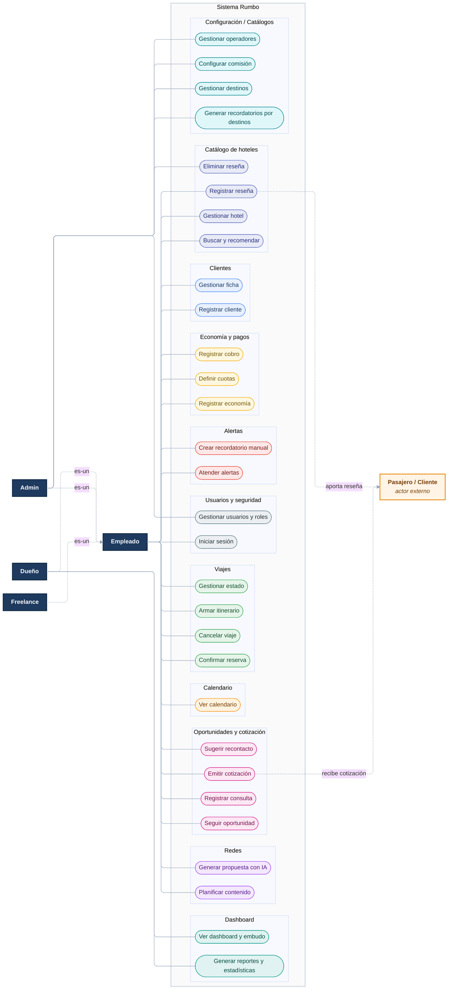

# DGM — Casos de uso

tags:: #tipo/diagrama #estado/formalizado #pc/pc1

> Diagrama de casos de uso de Rumbo (salida del [[MOC — Casos de uso]]). Actores según [[Actores]] y [[DEC-0005 Autenticación y modelo de roles]]. Un editor por vez.
>
> **Render del entregable:** la imagen del DOCX se genera con `mermaid-cli` usando el motor **ELK** (routing ortogonal, líneas ordenadas). Comando en [[CONTINUAR — entregable Casos de uso]]. ⚠️ Si Obsidian no soporta `layout: elk`, la vista previa del vault puede fallar; la fuente de verdad del render es el PNG en `07-Entregables/Casos de uso/img/`.

> **Notas de lectura:**
> - **Generalización de roles:** `Admin`, `Dueño` y `Freelance` son *especializaciones* del `Empleado` (flechas `es-un`): heredan sus casos operativos y solo se dibujan aparte los casos exclusivos (`Admin`: el módulo **Configuración/Catálogos** —configurar comisión, recordatorios por destino, destinos y operadores— más gestionar usuarios y moderar reseñas; `Dueño`: dashboard y reportes). Esto refleja el modelo de visibilidad de [[DEC-0005 Autenticación y modelo de roles]].
> - **`Freelance` (vendedor externo):** hace los **mismos casos operativos** que el `Empleado`, **salvo gestionar hoteles (CU-16) y registrar reseñas (CU-17)** (decidido en la sync del 30/09/26), y con **visibilidad restringida a lo suyo** (excepción al *lectura global*, [[DEC-0008 Autenticación propia y rol de vendedor freelance]]). Esa restricción es de **alcance de datos**, no de casos de uso, por eso el diagrama lo modela como especialización del `Empleado`; el detalle de visibilidad va en las DEC.
> - **Actor externo `Pasajero / Cliente`:** no opera el sistema; solo interactúa con dos casos: **recibe** la cotización (CU-06) y **aporta** la reseña que el empleado registra (CU-17). Por eso va a la derecha, con asociaciones etiquetadas.

## Pendiente
- Refinar relaciones `<<include>>` / `<<extend>>` (p. ej. CU-10 economía incluida al confirmar reserva CU-07).
- ⚠️ **Regenerar el entregable:** se sumó el actor **`Freelance`** (18/09, Q5) a la fuente Mermaid; falta **regenerar el PNG (mermaid-cli, ELK) y el DOCX** de `07-Entregables/Casos de uso/` para que reflejen el nuevo actor. Comando en [[CONTINUAR — entregable Casos de uso]].
