# DGM — Casos de uso

tags:: #tipo/diagrama #estado/borrador #pc/pc1

> Diagrama de casos de uso de Rumbo (salida del [[MOC — Casos de uso]]). Actores según [[Actores]] y [[DEC-0005 Autenticación y modelo de roles]]. Un editor por vez.

```mermaid
flowchart LR
  EMP([Empleado]):::actor
  ADM([Admin]):::actor
  DUE([Dueño]):::actor
  CLI([Pasajero / Cliente<br/>externo]):::actor

  subgraph SYS[Sistema Rumbo]
    direction TB
    subgraph M1[Clientes]
      CU02((Registrar cliente))
      CU03((Gestionar ficha))
    end
    subgraph M2[Oportunidades y cotización]
      CU04((Registrar consulta))
      CU05((Seguir oportunidad))
      CU06((Emitir cotización))
      CU30((Sugerir recontacto))
    end
    subgraph M3[Viajes]
      CU07((Confirmar reserva))
      CU08((Gestionar estado))
      CU09((Armar itinerario))
      CU27((Cancelar viaje))
    end
    subgraph M4[Economía y pagos]
      CU10((Registrar economía))
      CU11((Definir cuotas))
      CU12((Registrar cobro))
      CU13((Configurar %comisión))
    end
    subgraph M5[Alertas]
      CU14((Atender alertas))
      CU15((Recordatorios por destino))
      CU26((Gestionar destinos))
      CU28((Crear recordatorio manual))
    end
    subgraph M6[Catálogo hoteles]
      CU16((Gestionar hotel))
      CU17((Registrar reseña))
      CU18((Buscar y recomendar))
      CU29((Eliminar reseña))
    end
    subgraph M7[Redes]
      CU19((Planificar contenido))
      CU20((Propuesta con IA))
    end
    subgraph M8[Dashboard]
      CU21((Ver dashboard y embudo))
      CU22((Reportes y estadísticas))
    end
    subgraph M9[Calendario]
      CU23((Ver calendario))
    end
    subgraph M10[Usuarios y seguridad]
      CU24((Iniciar sesión))
      CU25((Gestionar usuarios y roles))
    end
  end

  EMP --- CU02 & CU03 & CU04 & CU05 & CU06 & CU07 & CU08 & CU09 & CU30
  EMP --- CU10 & CU11 & CU12 & CU14 & CU15 & CU16 & CU17 & CU18 & CU19 & CU20 & CU23 & CU27 & CU28
  ADM --- CU13 & CU25 & CU26 & CU29
  DUE --- CU26
  DUE --- CU21 & CU22
  EMP --- CU24
  ADM --- CU24
  DUE --- CU24
  CLI -.-> CU06
  CLI -.-> CU17

  classDef actor fill:#eef,stroke:#557,stroke-width:1px;
```

> **Notas:** `Admin` y `Dueño` también pueden ejecutar los casos operativos del `Empleado` (ven toda la empresa, [[DEC-0005 Autenticación y modelo de roles]]); las asociaciones muestran el actor principal de cada CU. El `Pasajero / Cliente` es externo: recibe la cotización (CU-06) y es el origen de la reseña (CU-17), pero **no opera** el sistema.

## Pendiente
- Refinar relaciones `<<include>>` / `<<extend>>` (p. ej. CU-10 economía incluida al confirmar reserva CU-07).
