# DGM-ACT — Cancelar viaje

tags:: #tipo/diagrama #estado/borrador #pc/pc1 #accion/revisar

## Qué representa
El **diagrama de actividad** de [[CU-27 Cancelar viaje]]: el flujo que más ramifica según el estado del [[Viaje]]. Un viaje `finalizado` no se cancela; los [[Pago|Pagos]] no cobrados se anulan, los cobrados solo se informan, y la comisión del vendedor se pierde o se mantiene según el viaje hubiera empezado o no (regla del 21/09). Incluye como **flujo aparte** la reversión de una cancelación hecha por error (A3).

Notas de origen: [[CU-27 Cancelar viaje]] · [[CU-08 Gestionar estado del viaje]] · [[RN-01 Comisión automática]] · [[EST-Viaje]] · [[EST-Pago]] · [[EST-Alerta]] · [[Alcance y fuera de alcance]]

## Diagrama

```mermaid
%%{init: {'theme':'base','flowchart':{'defaultRenderer':'elk','wrappingWidth':260},'themeVariables':{'fontFamily':'Segoe UI, Arial, sans-serif','fontSize':'14px','lineColor':'#334155','clusterBkg':'#f8fafc','clusterBorder':'#94a3b8','edgeLabelBackground':'#ffffff'},'themeCSS':'.state-start{fill:#0f172a !important;stroke:#0f172a !important} [id*=flowchart-fin] g path{fill:#ffffff !important;stroke:#0f172a !important} [id*=flowchart-fin] g g path{fill:#0f172a !important}'}}%%
flowchart TB
    ini@{ shape: sm-circ }
    ini --> e1

    subgraph P1["Paso 1 · Elegir cancelar"]
        e1("(Empleado)<br/>Abre el Viaje y elige cancelar")
        d1{ }
        s1("(Sistema)<br/>Impide la cancelación")
        fin1@{ shape: fr-circ }
        e1 --> d1
        d1 -- "[finalizado] · A1" --> s1 --> fin1
    end

    subgraph P2["Paso 2 · Motivo y fecha"]
        e2("(Empleado)<br/>Registra el motivo y la fecha de cancelación")
    end

    subgraph P3["Paso 3 · Cancelar el viaje"]
        s3("(Sistema)<br/>Viaje → cancelado (T6)")
    end

    subgraph P4["Paso 4 · Pagos y alertas"]
        s4("(Sistema)<br/>Pagos no cobrados (pendientes y vencidos) → anulado (T7)")
        s4b("(Sistema)<br/>Resuelve las alertas vigentes del viaje · Alerta → resuelta (T5)")
        d4{ }
        s4c("(Sistema)<br/>Informa el importe ya cobrado; el reembolso queda fuera de alcance")
        m4{ }
        s4 --> s4b --> d4
        d4 -- "[hay pagos cobrados] · A2" --> s4c --> m4
        d4 -- "[sin cobros]" --> m4
    end

    subgraph P5["Paso 5 · Comisión"]
        d5{ }
        s5a("(Sistema)<br/>Registra que la comisión proyectada no se realiza · RN-01")
        s5b("(Sistema)<br/>Mantiene la comisión del vendedor y los cobros")
        m5{ }
        d5 -- "[no había empezado: reservado, vendido o confirmado]" --> s5a --> m5
        d5 -- "[estaba en curso] · A4" --> s5b --> m5
    end

    subgraph P6["Paso 6 · Conservar el historial"]
        s6("(Sistema)<br/>Conserva el viaje en el historial (baja lógica)")
        fin@{ shape: fr-circ }
        s6 --> fin
    end

    subgraph A3["A3 · Revertir una cancelación por error · flujo aparte"]
        ini3@{ shape: sm-circ }
        e7("(Empleado)<br/>Reactiva el viaje cancelado")
        s7("(Sistema)<br/>Viaje → estado que tenía antes de cancelarse (T9)")
        s7b("(Sistema)<br/>Pagos anulados → pendiente o vencido, según su fecha (T10)")
        s7c("(Sistema)<br/>Reabre las alertas del viaje · Alerta → pendiente (T6)")
        fin3@{ shape: fr-circ }
        ini3 --> e7 --> s7 --> s7b --> s7c --> fin3
    end

    d1 -- "[reservado, vendido, confirmado o en curso]" --> e2
    e2 --> s3
    s3 --> s4
    m4 --> d5
    m5 --> s6
    fin ~~~ ini3

    classDef cli fill:#fef3c7,stroke:#b45309,color:#0f172a
    classDef emp fill:#dbeafe,stroke:#1d4ed8,color:#0f172a
    classDef sis fill:#e2e8f0,stroke:#475569,color:#0f172a
    classDef ctl fill:#ffffff,stroke:#334155
    classDef barra fill:#0f172a,stroke:#0f172a
    class e1,e2,e7 emp
    class s1,s3,s4,s4b,s4c,s5a,s5b,s6,s7,s7b,s7c sis
    class d1,d4,m4,d5,m5 ctl
```

## Trazabilidad con el caso de uso
Cada marco es **un paso del camino principal** de [[CU-27 Cancelar viaje]], en el mismo orden.

| Paso de CU-27 | Marco del diagrama | Estados que cambia |
|---|---|---|
| 1 · Elegir cancelar | Paso 1 | — |
| 2 · Registrar motivo y fecha | Paso 2 | — |
| 3 · Cambiar el estado del viaje | Paso 3 | [[EST-Viaje]] T6 |
| 4 · Anular pagos no cobrados y resolver alertas | Paso 4 | [[EST-Pago]] T7 · [[EST-Alerta]] T5 |
| 5 · Constancia sobre la comisión | Paso 5 | — |
| 6 · Conservar el historial | Paso 6 | — |

| Flujo alternativo | Dónde está |
|---|---|
| **A1** · Viaje finalizado | Paso 1: rama `[finalizado]`, que termina en un final de actividad |
| **A2** · Pagos ya cobrados | Paso 4: rama `[hay pagos cobrados]` |
| **A3** · Revertir la cancelación | Flujo aparte, con su propio inicio y final · [[EST-Viaje]] T9 · [[EST-Pago]] T10 · [[EST-Alerta]] T6 |
| **A4** · Viaje ya iniciado | Paso 5: rama `[estaba en curso]` |

## Convenciones del diagrama
Las mismas que [[DGM-ACT — De la consulta a la venta#Convenciones del diagrama]]: notación UML de actividad, carril escrito en cada acción (`(Empleado)`, `(Sistema)`) con su color, marcos por paso y código del flujo alternativo en la guarda.
- **Flujo aparte:** A3 ocurre después, sobre un viaje ya cancelado, por eso se dibuja como una segunda actividad con su propio nodo inicial.

## Cómo mantenerlo
- **Source → output:** la verdad vive en [[CU-27 Cancelar viaje]]. Si cambia el camino principal o un flujo alternativo, se actualiza primero la fuente y después este diagrama, **manteniendo un marco por paso** para no perder la trazabilidad.
- **PNG:** `bash "07-Entregables/build/render-diagramas-actividad.sh"` lo regenera en `img/`.
- **Un solo editor a la vez** (el bloque Mermaid es indivisible). Ver [[Guía del Vault#3 · Workflow colaborativo]].

## 🔎 Revisión
> [!warning] Huecos detectados al dibujar (25/09, Nahuel + Claude) — no se resolvieron; se dibujó lo que dice el CU. #accion/decidir
> 1. **Revertir la cancelación no dice qué pasa con la comisión.** Si el viaje no había empezado, el paso 5 dejó constancia de que la comisión **no se realiza**; A3 repone el estado, los pagos y las alertas, pero no menciona anular esa constancia. ¿La comisión vuelve a quedar proyectada?
> 2. **Qué alertas se reabren en A3.** El CU dice «sus alertas se reabren», pero no distingue las que cerró la cancelación de las que ya estaban resueltas antes por otro motivo (un pago cobrado, un formulario entregado). Para distinguirlas habría que registrar qué alertas cerró la cancelación.
> 3. **Postcondición desactualizada.** Dice que quedan «sus Pagos pendientes en estado `anulado`», pero desde el 21/09 el paso 4 anula también los `vencidos`.
