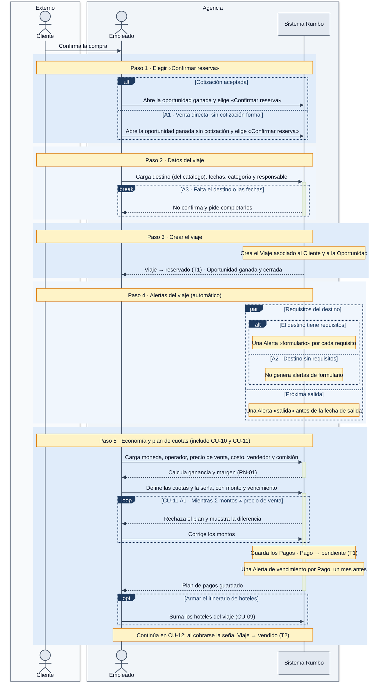

# DGM-ACT — Confirmar reserva

tags:: #tipo/diagrama #estado/borrador #pc/pc1 #accion/revisar

## Qué representa
El **flujo de actividad** de [[CU-07 Confirmar reserva]]: el momento en que una [[Oportunidad]] ganada se convierte en [[Viaje]]. Es el punto más cargado del sistema: crea el viaje, genera en paralelo las alertas del destino y de la salida, e incluye el control económico ([[CU-10 Registrar economía del viaje]]) y el plan de cuotas ([[CU-11 Definir plan de cuotas]]) con su validación `Σ montos = precioVenta`.

Notas de origen: [[CU-07 Confirmar reserva]] · [[CU-10 Registrar economía del viaje]] · [[CU-11 Definir plan de cuotas]] · [[CU-09 Armar itinerario de hoteles]] · [[CU-15 Configurar recordatorios por destino]] · [[RN-01 Comisión automática]] · [[EST-Viaje]] · [[EST-Pago]] · [[EST-Alerta]] · [[EST-Oportunidad]]

## Diagrama

## Trazabilidad con el caso de uso
Cada franja azul es **un paso del camino principal** de [[CU-07 Confirmar reserva]], en el mismo orden. Los fragmentos son los desvíos y llevan el código del flujo alternativo que los origina.

| Paso de CU-07 | Franja del diagrama | Detalle | Estados que cambia |
|---|---|---|---|
| 1 · Elegir «Confirmar reserva» | Paso 1 | Precondición: oportunidad `ganada` o cotización `aceptada` | — |
| 2 · Cargar los datos del viaje | Paso 2 | Destino desde [[CU-26 Gestionar destinos]] | — |
| 3 · Crear el viaje | Paso 3 | — | [[EST-Viaje]] T1 |
| 4 · Generar alertas de formulario y salida | Paso 4 | Requisitos de [[CU-15 Configurar recordatorios por destino]] | [[EST-Alerta]] T1 |
| 5 · Economía, plan de cuotas e itinerario | Paso 5 | [[CU-10 Registrar economía del viaje]] pasos 2–6 · [[CU-11 Definir plan de cuotas]] pasos 2–6 · [[CU-09 Armar itinerario de hoteles]] | [[EST-Pago]] T1 · [[EST-Alerta]] T1 |

| Flujo alternativo | Fragmento |
|---|---|
| **A1** · Venta directa, sin cotización formal | rama `else` del `alt` en el paso 1 |
| **A2** · Destino sin requisitos | rama `else` del `alt` dentro del `par` en el paso 4 |
| **A3** · Datos faltantes | `break` en el paso 2: el viaje no se crea |
| *CU-11 A1* · La suma no coincide | `loop` en el paso 5 |

Los flujos alternativos propios de [[CU-10 Registrar economía del viaje]] (override de comisión, venta sin vendedor, costo mayor que la venta) **no se dibujan**: no desvían el flujo de CU-07 y quedan para un diagrama propio de CU-10 si se lo necesita.

## Convenciones del diagrama
Las mismas que [[DGM-ACT — De la consulta a la venta#Convenciones del diagrama]]. Además:
- **Nota ámbar sobre el Sistema Rumbo** = acción interna que el sistema hace solo, sin respuesta al empleado.
- El `par` del paso 4 indica que las dos familias de alertas se generan **de forma independiente**; no hay orden entre ellas.

## Cómo mantenerlo
- **Source → output:** la verdad vive en [[CU-07 Confirmar reserva]], [[CU-10 Registrar economía del viaje]] y [[CU-11 Definir plan de cuotas]]. Si cambia el camino principal o un flujo alternativo, se actualiza primero el CU y después este diagrama, **manteniendo la franja por paso** para no perder la trazabilidad.
- **PNG:** `bash "07-Entregables/build/render-diagramas-actividad.sh"` lo regenera en `img/`.
- **Un solo editor a la vez** (el bloque Mermaid es indivisible). Ver [[Guía del Vault#3 · Workflow colaborativo]].

## 🔎 Revisión
> [!warning] Huecos detectados al dibujar (25/09, Nahuel + Claude) — no se resolvieron; se dibujó lo que dice el CU. #accion/decidir
> 1. **Viaje sin seña: nunca pasa a `vendido`.** [[CU-11 Definir plan de cuotas]] dice que la seña es **opcional** y su A2 permite un **pago único** de `tipo = saldo`, pero la guarda de [[EST-Viaje]] T2 exige cobrar un [[Pago]] de `tipo = seña`. Con un plan sin seña, el viaje queda en `reservado` hasta que el saldo llegue a cero, y T3 solo sale de `vendido`: **el viaje quedaría trabado en `reservado` aun totalmente pagado.** Hay que decidir si el primer cobro de cualquier tipo cuenta como seña, o si la seña pasa a ser obligatoria.
> 2. **Precondición de [[CU-10 Registrar economía del viaje]] desactualizada.** Dice que el viaje fue «creado/`vendido` en CU-07», pero CU-07 lo crea en `reservado` y la economía se carga **antes** del cobro de la seña. Debería decir `reservado`.
> 3. **Quién cierra la oportunidad como `ganada`.** La precondición de CU-07 exige una oportunidad **ya** `ganada` (o una cotización `aceptada`), y su postcondición dice que «queda `ganada` y cerrada». Con la cotización aceptada pero la oportunidad todavía `cotizada`, no queda claro si CU-07 hace la transición T4 o si el empleado debe cerrarla antes en [[CU-05 Seguir oportunidad]]. Mismo hueco que el punto 4 de [[DGM-ACT — De la consulta a la venta]].
> 4. **La anticipación de la alerta `salida`** (7 días por default) sigue sin validar con la agencia; ya figura como pendiente en el [[Estado del proyecto]]. No se escribió el valor en el diagrama.
