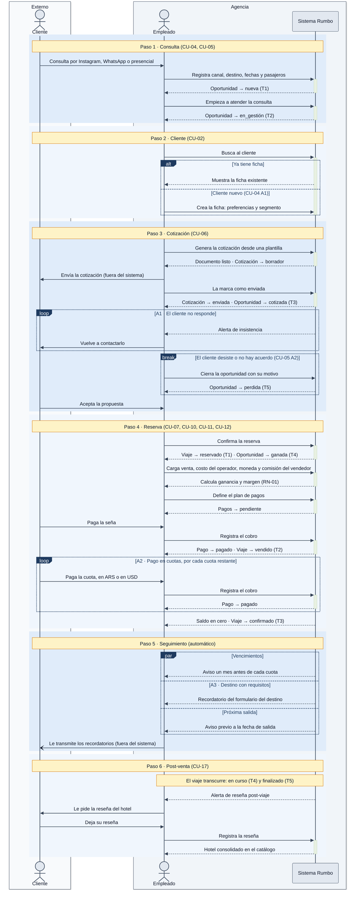

# DGM-ACT — De la consulta a la venta

tags:: #tipo/diagrama #estado/borrador #pc/pc1 #accion/revisar

## Qué representa
El **flujo de actividad** de [[CU-01 De la consulta a la venta]]: los seis pasos de su camino principal, en orden, con las decisiones y repeticiones que lo desvían (el cliente no responde, desiste, paga en cuotas, el destino tiene requisitos). Complementa a [[DGM-SEC — De la consulta a la venta]], que muestra solo el camino feliz en el tiempo: acá el foco está en **dónde se bifurca el flujo y por qué**.

Notas de origen: [[CU-01 De la consulta a la venta]] · [[CU-02 Registrar cliente]] · [[CU-04 Registrar consulta]] · [[CU-05 Seguir oportunidad]] · [[CU-06 Emitir cotización]] · [[CU-07 Confirmar reserva]] · [[CU-10 Registrar economía del viaje]] · [[CU-11 Definir plan de cuotas]] · [[CU-12 Registrar cobro de un pago]] · [[CU-17 Registrar reseña de hotel]] · [[EST-Oportunidad]] · [[EST-Cotización]] · [[EST-Viaje]] · [[EST-Pago]]

## Diagrama

## Trazabilidad con el caso de uso
Cada franja azul del diagrama es **un paso del camino principal** de [[CU-01 De la consulta a la venta]], en el mismo orden y con el mismo nombre. Los fragmentos (`alt`, `loop`, `break`, `par`) son los desvíos, y cada uno lleva el código del flujo alternativo que lo origina.

| Paso de CU-01 | Franja del diagrama | Casos de uso que lo detallan | Estados que cambia |
|---|---|---|---|
| 1 · Consulta | Paso 1 | [[CU-04 Registrar consulta]], [[CU-05 Seguir oportunidad]] | [[EST-Oportunidad]] T1, T2 |
| 2 · Cliente | Paso 2 | [[CU-02 Registrar cliente]] | — |
| 3 · Cotización | Paso 3 | [[CU-06 Emitir cotización]] | [[EST-Cotización]] T1, T2 · [[EST-Oportunidad]] T3 |
| 4 · Reserva | Paso 4 | [[CU-07 Confirmar reserva]], [[CU-10 Registrar economía del viaje]], [[CU-11 Definir plan de cuotas]], [[CU-12 Registrar cobro de un pago]] | [[EST-Viaje]] T1, T2, T3 · [[EST-Oportunidad]] T4 · [[EST-Pago]] T1, T2 |
| 5 · Seguimiento | Paso 5 | [[CU-07 Confirmar reserva]] (formulario y salida), [[CU-11 Definir plan de cuotas]] (vencimientos) | — |
| 6 · Post-venta | Paso 6 | [[CU-17 Registrar reseña de hotel]] | [[EST-Viaje]] T4, T5 |

| Flujo alternativo | Fragmento |
|---|---|
| **A1** · El cliente no responde | `loop` en el paso 3 |
| **A2** · Pago en cuotas | `loop` en el paso 4 |
| **A3** · Destino con requisitos | rama del `par` en el paso 5 |
| *CU-04 A1* · Cliente nuevo | `alt` en el paso 2 |
| *CU-05 A2* · Oportunidad perdida | `break` en el paso 3: el flujo termina ahí |

## Convenciones del diagrama
- **Notación:** diagrama de actividad expresado con la sintaxis de secuencia de Mermaid, a pedido de Nahuel (25/09). Equivalencias con UML de actividad: `alt` = decisión, `loop` = iteración, `break` = salida anticipada (final de flujo), `par` = bifurcación en paralelo (fork/join), `opt` = rama opcional.
- **Franjas alternadas** = pasos del camino principal. **Notas ámbar** = encabezado del paso o acción automática.
- **Barras de activación** sobre el Sistema Rumbo = el sistema está procesando el pedido del empleado.
- **Estados** con la flecha `→` y el número de transición de su nota `EST-*`, para cruzarlo con los diagramas de estado.
- **Flecha abierta** (`-)`) = comunicación con el cliente que ocurre fuera del sistema.

## Cómo mantenerlo
- **Source → output:** la verdad vive en [[CU-01 De la consulta a la venta]] y los CU que compone. Si cambia el camino principal o un flujo alternativo, se actualiza primero el CU y después este diagrama, **manteniendo la franja por paso** para no perder la trazabilidad.
- **PNG:** `bash "07-Entregables/build/render-diagramas-actividad.sh"` lo regenera en `img/`.
- **Un solo editor a la vez** (el bloque Mermaid es indivisible). Ver [[Guía del Vault#3 · Workflow colaborativo]].

## 🔎 Revisión
> [!warning] Huecos detectados al dibujar (25/09, Nahuel + Claude) — no se resolvieron; se dibujó lo que dice el CU. #accion/decidir
> 1. **Orden de los pasos 1 y 2.** CU-01 registra la oportunidad (paso 1) y *después* identifica al cliente (paso 2), pero [[CU-04 Registrar consulta]] hace al revés: identifica al cliente en su paso 2 y crea la [[Oportunidad]] en el paso 4, ya asociada a él. El diagrama sigue el orden de CU-01. ¿Se alinea CU-01 a CU-04?
> 2. **El paso 5 ocurre antes de lo que indica su número.** Las alertas de seguimiento no se generan después del cobro: las de formulario y salida nacen al confirmar la reserva ([[CU-07 Confirmar reserva]] paso 4) y las de vencimiento al definir el plan ([[CU-11 Definir plan de cuotas]] paso 6), es decir, **dentro del paso 4**. El diagrama respeta la numeración de CU-01; convendría aclararlo en el CU o reordenar.
> 3. **Precondición de [[CU-05 Seguir oportunidad]] incompleta.** Pide una oportunidad `nueva` o `cotizada`, pero omite `en_gestión`, que es justamente el estado en que se la sigue (T2). Parece un olvido de cuando se sumó el quinto estado el 18/09.
> 4. **Quién marca la oportunidad como `ganada`.** [[CU-05 Seguir oportunidad]] paso 6 la cierra a mano, pero la postcondición de [[CU-07 Confirmar reserva]] y el [[DGM-SEC — De la consulta a la venta|diagrama de secuencia]] la cierran al confirmar la reserva. El diagrama muestra el cierre al confirmar; hay que definir si es un paso manual previo o un efecto de CU-07.
