# DGM-ACT — Proceso automático diario

tags:: #tipo/diagrama #estado/borrador #pc/pc1 #accion/revisar

## Qué representa
El **diagrama de actividad** de lo que el sistema hace **solo, sin que nadie lo dispare**: vencer pagos y cotizaciones, sugerir el avance de los viajes según sus fechas y detectar clientes para recontactar. **No es un caso de uso**: no tiene actor humano. Junta en una sola corrida las transiciones marcadas con ⚙ en los diagramas de estado y los pasos automáticos de los CU. Las cuatro tareas son **independientes**, por eso van en paralelo.

**Qué no hace esta corrida:** no *genera* las alertas de pago, formulario y salida. Esas se crean con su fecha al confirmar la reserva y al definir el plan de cuotas ([[DGM-ACT — Confirmar reserva]]), y aparecen en la agenda cuando llega su fecha ([[CU-14 Ver y atender alertas del día]]).

Notas de origen: [[EST-Pago]] · [[EST-Cotización]] · [[EST-Viaje]] · [[EST-Alerta]] · [[CU-06 Emitir cotización]] · [[CU-08 Gestionar estado del viaje]] · [[CU-30 Sugerir recontacto de clientes]] · [[CU-14 Ver y atender alertas del día]]

## Diagrama

```mermaid
%%{init: {'theme':'base','flowchart':{'defaultRenderer':'elk','wrappingWidth':260},'themeVariables':{'fontFamily':'Segoe UI, Arial, sans-serif','fontSize':'14px','lineColor':'#334155','clusterBkg':'#f8fafc','clusterBorder':'#94a3b8','edgeLabelBackground':'#ffffff'},'themeCSS':'.state-start{fill:#0f172a !important;stroke:#0f172a !important} [id*=flowchart-fin] g path{fill:#ffffff !important;stroke:#0f172a !important} [id*=flowchart-fin] g g path{fill:#0f172a !important}'}}%%
flowchart TB
    ini@{ shape: sm-circ }
    ini --> s0

    subgraph P0["Inicio · Corrida diaria"]
        s0("(Sistema)<br/>Arranca la corrida del día")
        f0@{ shape: fork }
        s0 --> f0
    end

    subgraph T1["Tarea 1 · Vencer pagos"]
        s1("(Sistema)<br/>Busca Pagos pendientes con vencimiento anterior a hoy")
        d1{ }
        s1b("(Sistema)<br/>Pago → vencido (T3) y actualiza su alerta")
        m1{ }
        s1 --> d1
        d1 -- "[hay pagos vencidos]" --> s1b --> m1
        d1 -- "[no hay]" --> m1
    end

    subgraph T2["Tarea 2 · Vencer cotizaciones"]
        s2("(Sistema)<br/>Busca Cotizaciones enviadas con validez_hasta anterior a hoy")
        d2{ }
        s2b("(Sistema)<br/>Cotización → vencida (T5); la Oportunidad no cambia")
        m2{ }
        s2 --> d2
        d2 -- "[hay cotizaciones vencidas]" --> s2b --> m2
        d2 -- "[no hay]" --> m2
    end

    subgraph T3["Tarea 3 · Sugerir el avance de los viajes"]
        s3("(Sistema)<br/>Busca Viajes confirmados con salida hoy y Viajes en curso con regreso hoy")
        d3{ }
        s3b("(Sistema)<br/>Sugiere el cambio a en curso o finalizado; no lo aplica")
        m3{ }
        s3 --> d3
        d3 -- "[hay viajes en fecha]" --> s3b --> m3
        d3 -- "[no hay]" --> m3
    end

    subgraph T4["Tarea 4 · Detectar recontactos"]
        s4("(Sistema)<br/>Evalúa el historial de cada Cliente: fiel, inactivo y sin no_recontactar")
        d4{ }
        s4b("(Sistema)<br/>Genera una alerta «recontacto» por candidato · Alerta → pendiente (T1)")
        m4{ }
        s4 --> d4
        d4 -- "[hay candidatos]" --> s4b --> m4
        d4 -- "[sin candidatos] · CU-30 A4" --> m4
    end

    j0@{ shape: fork }
    fin@{ shape: fr-circ }

    f0 --> s1
    f0 --> s2
    f0 --> s3
    f0 --> s4
    m1 --> j0
    m2 --> j0
    m3 --> j0
    m4 --> j0
    j0 --> fin

    classDef cli fill:#fef3c7,stroke:#b45309,color:#0f172a
    classDef emp fill:#dbeafe,stroke:#1d4ed8,color:#0f172a
    classDef sis fill:#e2e8f0,stroke:#475569,color:#0f172a
    classDef ctl fill:#ffffff,stroke:#334155
    classDef barra fill:#0f172a,stroke:#0f172a
    class s0,s1,s1b,s2,s2b,s3,s3b,s4,s4b sis
    class d1,m1,d2,m2,d3,m3,d4,m4 ctl
    class f0,j0 barra
```

## Trazabilidad con las fuentes
Como no hay un caso de uso propio, cada marco es **una tarea** y se traza a la transición o al paso del CU que la define.

| Tarea | Fuente | Estados que cambia |
|---|---|---|
| 1 · Vencer pagos | [[EST-Pago]] T3 | [[EST-Pago]] T3 |
| 2 · Vencer cotizaciones | [[EST-Cotización]] T5 · [[CU-06 Emitir cotización]] A5 | [[EST-Cotización]] T5 |
| 3 · Sugerir el avance de los viajes | [[CU-08 Gestionar estado del viaje]] paso 3 y A1 · [[EST-Viaje]] T4, T5 | — (solo sugiere; confirma el empleado) |
| 4 · Detectar recontactos | [[CU-30 Sugerir recontacto de clientes]] pasos 1–2 y A4 | [[EST-Alerta]] T1 |

## Convenciones del diagrama
Las mismas que [[DGM-ACT — De la consulta a la venta#Convenciones del diagrama]]: notación UML de actividad, carril escrito en cada acción (`(Empleado)`, `(Sistema)`) con su color, marcos por paso y código del flujo alternativo en la guarda.
- **Todo en el carril del Sistema:** no hay acciones de personas. Lo que sigue (confirmar el cambio de estado sugerido, atender un recontacto) ya pertenece a [[CU-08 Gestionar estado del viaje]] y a [[CU-30 Sugerir recontacto de clientes]].

## Cómo mantenerlo
- **Source → output:** la verdad vive en las transiciones automáticas de los `EST-*` y los pasos automáticos de los CU de la tabla de trazabilidad. Si cambia el camino principal o un flujo alternativo, se actualiza primero la fuente y después este diagrama, **manteniendo un marco por paso** para no perder la trazabilidad.
- **PNG:** `bash "07-Entregables/build/render-diagramas-actividad.sh"` lo regenera en `img/`.
- **Un solo editor a la vez** (el bloque Mermaid es indivisible). Ver [[Guía del Vault#3 · Workflow colaborativo]].

## 🔎 Revisión
> [!warning] Huecos detectados al dibujar (25/09, Nahuel + Claude) — no se resolvieron. #accion/decidir
> 1. **Frecuencia y horario no definidos.** Los diagramas de estado hablan de «proceso automático» y [[CU-30 Sugerir recontacto de clientes]] de que el sistema evalúa «periódicamente». **Que sea una corrida diaria es un supuesto de este diagrama**, no algo acordado: hay que ratificarlo (y definir a qué hora).
> 2. **[[EST-Pago]] quedó desactualizada.** Dice que T3 es «la única transición automática de todo el modelo», pero desde el 21/09 también es automática la de [[EST-Cotización]] T5 (`enviada → vencida`).
> 3. **«Actualiza su alerta» no está definido.** [[EST-Pago]] T3 dice que al vencer el pago se actualiza la [[Alerta]] asociada, pero no qué cambia: la alerta no tiene estado `vencida` y [[CU-14 Ver y atender alertas del día]] ya muestra las que pasaron su fecha.
> 4. **Cómo llega la sugerencia de avance del viaje.** [[CU-08 Gestionar estado del viaje]] dice que el sistema sugiere pasar a `en curso` o `finalizado`, pero no por qué medio: no hay un tipo de [[Alerta]] para eso (los siete tipos no lo incluyen) ni una pantalla definida.
> 5. **Recontacto: duplicados y dueño de la alerta.** No está definido si la corrida vuelve a generar una alerta de `recontacto` para un cliente que ya tiene una pendiente o pospuesta, ni **a quién** se le asigna, siendo que las alertas son personales ([[EST-Alerta]]). ¿Al responsable del cliente?
