# DGM-ACT — Registrar cobro de un pago

tags:: #tipo/diagrama #estado/borrador #pc/pc1 #accion/revisar

## Qué representa
El **diagrama de actividad** de [[CU-12 Registrar cobro de un pago]]: el camino de la plata. El empleado registra un cobro (con tipo de cambio si se paga en otra moneda), el sistema marca el [[Pago]], cierra su [[Alerta]] y actualiza el saldo; según el caso, el [[Viaje]] avanza a `vendido` (seña) o a `confirmado` (saldo en cero). Incluye como **flujo aparte** la corrección de un cobro mal registrado (A3), que ocurre en otro momento y tiene su propio inicio.

Notas de origen: [[CU-12 Registrar cobro de un pago]] · [[CU-08 Gestionar estado del viaje]] · [[Pago]] · [[EST-Pago]] · [[EST-Viaje]] · [[EST-Alerta]] · [[DEC-0007 Modelo económico — ganancia, margen y comisión de vendedor]]

## Diagrama

```mermaid
%%{init: {'theme':'base','flowchart':{'defaultRenderer':'elk','wrappingWidth':260},'themeVariables':{'fontFamily':'Segoe UI, Arial, sans-serif','fontSize':'14px','lineColor':'#334155','clusterBkg':'#f8fafc','clusterBorder':'#94a3b8','edgeLabelBackground':'#ffffff'},'themeCSS':'.state-start{fill:#0f172a !important;stroke:#0f172a !important} [id*=flowchart-fin] g path{fill:#ffffff !important;stroke:#0f172a !important} [id*=flowchart-fin] g g path{fill:#0f172a !important}'}}%%
flowchart TB
    ini@{ shape: sm-circ }
    ini --> e1

    subgraph P1["Paso 1 · Ubicar el pago"]
        e1("(Empleado)<br/>Abre el Viaje y ubica el Pago a cobrar")
    end

    subgraph P2["Paso 2 · Registrar el cobro"]
        e2("(Empleado)<br/>Carga fecha efectiva, forma de pago y moneda del cobro")
        d2{ }
        e2b("(Empleado)<br/>Carga el tipo de cambio del día")
        m2{ }
        s2("(Sistema)<br/>Calcula el monto cobrado real")
        e2 --> d2
        d2 -- "[moneda del cobro ≠ moneda del viaje]" --> e2b --> m2
        d2 -- "[misma moneda]" --> m2
        m2 --> s2
    end

    subgraph P3["Paso 3 · Marcar el pago como pagado"]
        d3{ }
        s3a("(Sistema)<br/>Pago → pagado (T2)")
        s3b("(Sistema)<br/>Pago → pagado (T4)")
        m3{ }
        d3 -- "[estaba pendiente]" --> s3a --> m3
        d3 -- "[estaba vencido] · A1" --> s3b --> m3
    end

    subgraph P4["Paso 4 · Cerrar la alerta"]
        s4("(Sistema)<br/>Resuelve la alerta de vencimiento del pago · Alerta → resuelta (T5)")
    end

    subgraph P5["Paso 5 · Actualizar el saldo"]
        s5("(Sistema)<br/>Actualiza saldo pendiente, % pagado y checklist de pagos")
        d5{ }
        s5b("(Sistema)<br/>Viaje → vendido (T2)")
        m5{ }
        d5b{ }
        s5c("(Sistema)<br/>Viaje → confirmado (T3)")
        m5b{ }
        fin@{ shape: fr-circ }
        s5 --> d5
        d5 -- "[era la seña y el viaje estaba reservado] · A0" --> s5b --> m5
        d5 -- "[otro caso]" --> m5
        m5 --> d5b
        d5b -- "[saldo en cero y viaje vendido] · A2" --> s5c --> m5b
        d5b -- "[queda saldo]" --> m5b
        m5b --> fin
    end

    subgraph A3["A3 · Corregir un cobro mal registrado · flujo aparte"]
        ini3@{ shape: sm-circ }
        e6("(Empleado)<br/>Revierte el cobro")
        s6("(Sistema)<br/>Pago → pendiente o vencido, según su fecha (T6)")
        s6b("(Sistema)<br/>Reabre la alerta del pago · Alerta → pendiente (T6)")
        d6{ }
        s6c("(Sistema)<br/>Viaje → vendido (T8)")
        m6{ }
        fin3@{ shape: fr-circ }
        ini3 --> e6 --> s6 --> s6b --> d6
        d6 -- "[el viaje estaba confirmado]" --> s6c --> m6
        d6 -- "[otro caso]" --> m6
        m6 --> fin3
    end

    e1 --> e2
    s2 --> d3
    m3 --> s4
    s4 --> s5
    fin ~~~ ini3

    classDef cli fill:#fef3c7,stroke:#b45309,color:#0f172a
    classDef emp fill:#dbeafe,stroke:#1d4ed8,color:#0f172a
    classDef sis fill:#e2e8f0,stroke:#475569,color:#0f172a
    classDef ctl fill:#ffffff,stroke:#334155
    classDef barra fill:#0f172a,stroke:#0f172a
    class e1,e2,e2b,e6 emp
    class s2,s3a,s3b,s4,s5,s5b,s5c,s6,s6b,s6c sis
    class d2,m2,d3,m3,d5,m5,d5b,m5b,d6,m6 ctl
```

## Trazabilidad con el caso de uso
Cada marco es **un paso del camino principal** de [[CU-12 Registrar cobro de un pago]], en el mismo orden.

| Paso de CU-12 | Marco del diagrama | Estados que cambia |
|---|---|---|
| 1 · Ubicar el pago | Paso 1 | — |
| 2 · Registrar el cobro (fecha, forma de pago, moneda, tipo de cambio) | Paso 2 | — |
| 3 · Marcar el pago como pagado | Paso 3 | [[EST-Pago]] T2 o T4 |
| 4 · Resolver la alerta del pago | Paso 4 | [[EST-Alerta]] T5 |
| 5 · Actualizar saldo, % pagado y checklist | Paso 5 | [[EST-Viaje]] T2, T3 |

| Flujo alternativo | Dónde está |
|---|---|
| **A0** · Cobro de la seña | Paso 5: rama `[era la seña y el viaje estaba reservado]` |
| **A1** · Pago vencido | Paso 3: rama `[estaba vencido]` |
| **A2** · Último pago, viaje saldado | Paso 5: rama `[saldo en cero y viaje vendido]` |
| **A3** · Corregir el cobro | Flujo aparte, con su propio inicio y final · [[EST-Pago]] T6 · [[EST-Alerta]] T6 · [[EST-Viaje]] T8 |

## Convenciones del diagrama
Las mismas que [[DGM-ACT — De la consulta a la venta#Convenciones del diagrama]]: notación UML de actividad, carril escrito en cada acción (`(Empleado)`, `(Sistema)`) con su color, marcos por paso y código del flujo alternativo en la guarda.
- **Flujo aparte:** A3 no es una rama del cobro sino una acción posterior (revertir un cobro ya registrado), por eso se dibuja como una segunda actividad con su propio nodo inicial.

## Cómo mantenerlo
- **Source → output:** la verdad vive en [[CU-12 Registrar cobro de un pago]]. Si cambia el camino principal o un flujo alternativo, se actualiza primero la fuente y después este diagrama, **manteniendo un marco por paso** para no perder la trazabilidad.
- **PNG:** `bash "07-Entregables/build/render-diagramas-actividad.sh"` lo regenera en `img/`.
- **Un solo editor a la vez** (el bloque Mermaid es indivisible). Ver [[Guía del Vault#3 · Workflow colaborativo]].

## 🔎 Revisión
> [!warning] Huecos detectados al dibujar (25/09, Nahuel + Claude) — no se resolvieron; se dibujó lo que dice el CU. #accion/decidir
> 1. **Revertir el cobro de la seña deja el viaje en `vendido` sin seña.** A3 solo contempla volver de `confirmado` a `vendido` ([[EST-Viaje]] T8); no hay transición `vendido → reservado`. Sin embargo, [[EST-Viaje]] (hueco 2, resuelto el 21/09) dice que revertir el cobro existe justamente para evitar estados incoherentes, y dejar `vendido` un viaje cuya seña se revirtió es el caso simétrico. ¿Se agrega esa reversión a A3 y a EST-Viaje?
> 2. **Viaje sin seña.** La rama A0 exige que el pago cobrado sea la seña; con un plan de pago único no hay seña y el viaje nunca pasa a `vendido`. Mismo hueco que el punto 1 de [[DGM-ACT — Confirmar reserva]].
> 3. **Enum de forma de pago distinto.** El paso 2 de CU-12 lista `efectivo · transferencia · tarjeta · cheque · depósito`, pero el enum cerrado el 18/09 en [[Pago]] separa `tarjeta_credito` y `tarjeta_debito`. El diagrama dice «forma de pago» sin detallar; hay que alinear el CU.
> 4. **Cobros parciales no contemplados.** El flujo supone que cada cobro salda **exactamente un** [[Pago]] del plan. No está definido qué pasa si el cliente paga una parte de una cuota, o si con el tipo de cambio el monto cobrado no coincide con el planificado.
