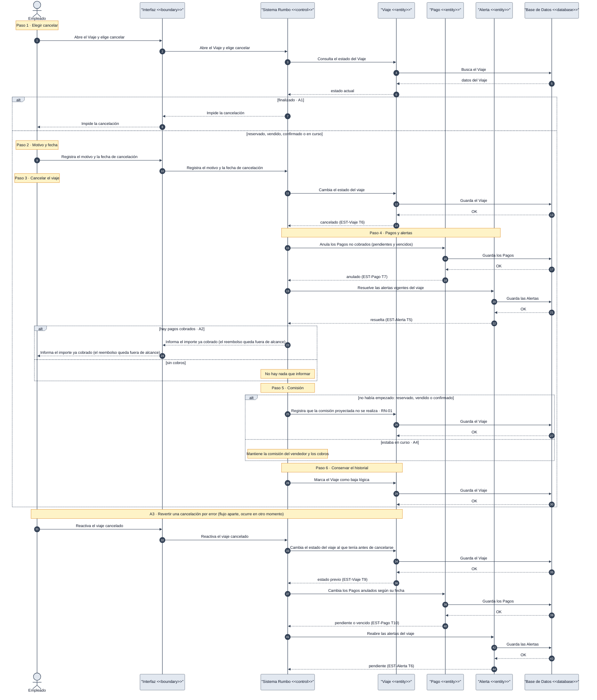

# DGM-SEC — Cancelar viaje

tags:: #tipo/diagrama #estado/borrador #pc/pc1 #accion/revisar

## Qué representa
El **diagrama de secuencia** de [[CU-27 Cancelar viaje]]: los mensajes entre el empleado y las clases del sistema al cancelar un [[Viaje]], anular sus [[Pago|Pagos]] no cobrados, resolver sus [[Alerta|Alertas]] y dejar constancia sobre la comisión según el viaje hubiera empezado o no. Incluye como continuación cronológica (no como rama) revertir una cancelación hecha por error (A3). Vista de secuencia **de análisis** (clases como participantes), complementaria de [[DGM-ACT — Cancelar viaje]] (mismo CU, notación de actividad). Es el tercero y último de los `DGM-SEC` de análisis acordados, después de [[DGM-SEC — Confirmar reserva]] y [[DGM-SEC — Registrar cobro de un pago]].

Notas de origen: [[CU-27 Cancelar viaje]] · [[CU-08 Gestionar estado del viaje]] · [[RN-01 Comisión automática]] · [[EST-Viaje]] · [[EST-Pago]] · [[EST-Alerta]] · [[Alcance y fuera de alcance]] · [[DEC-0010 Notación de los diagramas de actividad y de secuencia]]

## Diagrama

## Trazabilidad con el caso de uso
Cada `Note over` marca **un paso del camino principal** de [[CU-27 Cancelar viaje]], en el mismo orden que [[DGM-ACT — Cancelar viaje]].

| Paso de CU-27 | Marco del diagrama | Mensajes clave | Estados que cambia |
|---|---|---|---|
| 1 · Elegir cancelar | Paso 1 | `E->>I->>S` · `S->>V` (busca en BD) | — |
| 2 · Registrar motivo y fecha | Paso 2 | `E->>I->>S` | — |
| 3 · Cambiar el estado del viaje | Paso 3 | `S->>V` (guarda en BD) | [[EST-Viaje]] T6 |
| 4 · Anular pagos no cobrados y resolver alertas | Paso 4 | `S->>P` · `S->>A` (guardan en BD) | [[EST-Pago]] T7 · [[EST-Alerta]] T5 |
| 5 · Constancia sobre la comisión | Paso 5 | `S->>V` (guarda en BD) si no había empezado | — |
| 6 · Conservar el historial | Paso 6 | `S->>V` (guarda en BD) | — |

| Flujo alternativo | Dónde está |
|---|---|
| **A1** · Viaje finalizado | Paso 1: rama `alt finalizado`, no llega a cancelar |
| **A2** · Pagos ya cobrados | Paso 4: rama `alt hay pagos cobrados` |
| **A3** · Revertir la cancelación | Continuación cronológica al final, sin rama · [[EST-Viaje]] T9 · [[EST-Pago]] T10 · [[EST-Alerta]] T6 |
| **A4** · Viaje ya iniciado | Paso 5: rama `else estaba en curso` |

## Convenciones del diagrama
Ver [[DEC-0010 Notación de los diagramas de actividad y de secuencia]] y [[DGM-SEC — Confirmar reserva#Convenciones del diagrama]] (mismas reglas: la **Interfaz** entre el Empleado y `Sistema Rumbo`, y la **Base de Datos** como participante final para toda búsqueda o guardado de una entidad).
- **Flujo aparte (A3):** igual que en [[DGM-SEC — Registrar cobro de un pago]], no necesita el truco de layout de [[DGM-ACT — Cancelar viaje]] (nodo inicial separado): al ser cronológico de arriba a abajo, alcanza con dibujarlo más abajo y anunciarlo con un `Note`.
- **Paso 5 sin rama dibujada en el "no había empezado":** la constancia de la comisión (RN-01) es una anotación del sistema, no una decisión del empleado; por eso el `alt` está del lado de `Sistema Rumbo`, no del actor.

## Cómo mantenerlo
- **Source → output:** la verdad vive en [[CU-27 Cancelar viaje]]. Si cambia el camino principal o un flujo alternativo, se actualiza primero el CU y después este diagrama.
- **PNG:** `bash "07-Entregables/build/render-diagramas-secuencia.sh"` lo regenera en `img/`.
- **Un solo editor a la vez** (el bloque Mermaid es indivisible). Ver [[Guía del Vault#3 · Workflow colaborativo]].

## 🔎 Revisión
> [!warning] Mismos huecos que [[DGM-ACT — Cancelar viaje#🔎 Revisión]] (no se resolvieron; se dibujó lo que dice el CU): revertir la cancelación no dice qué pasa con la constancia de la comisión que dejó el Paso 5; el CU no distingue qué alertas reabre A3 (las que cerró la cancelación) de las que ya estaban resueltas por otro motivo; la postcondición de CU-27 sigue sin mencionar que el Paso 4 también anula los Pagos `vencidos` (dice solo `pendientes`). #accion/decidir
