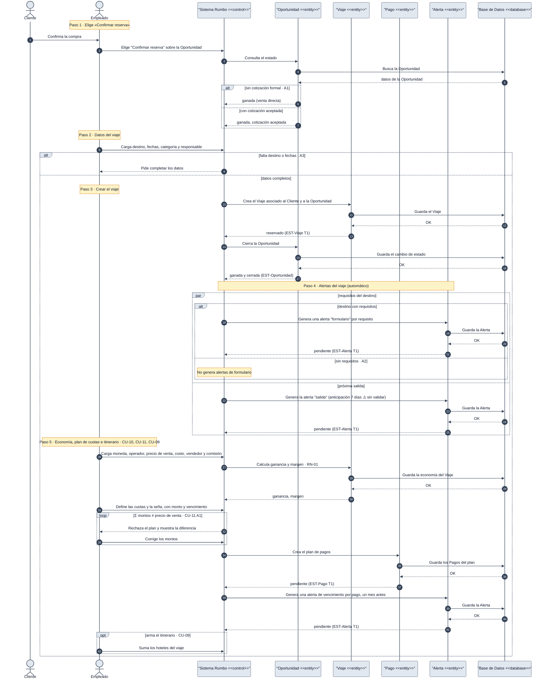

# DGM-SEC — Confirmar reserva

tags:: #tipo/diagrama #estado/borrador #pc/pc1 #accion/revisar

## Qué representa
El **diagrama de secuencia** de [[CU-07 Confirmar reserva]]: los mensajes entre el empleado y las clases del sistema al convertir una [[Oportunidad]] ganada en [[Viaje]], con las alertas generadas en paralelo y el plan de cuotas ([[CU-10 Registrar economía del viaje]], [[CU-11 Definir plan de cuotas]]). Es la vista de secuencia **de análisis** (clases como participantes), distinta de [[DGM-SEC — De la consulta a la venta]] (vista de negocio, con "Sistema Rumbo" como caja negra) y complementaria de [[DGM-ACT — Confirmar reserva]] (mismo CU, notación de actividad).

Notas de origen: [[CU-07 Confirmar reserva]] · [[CU-10 Registrar economía del viaje]] · [[CU-11 Definir plan de cuotas]] · [[RN-01 Comisión automática]] · [[EST-Viaje]] · [[EST-Pago]] · [[EST-Alerta]] · [[EST-Oportunidad]] · [[DEC-0010 Notación de los diagramas de actividad y de secuencia]]

## Diagrama

## Trazabilidad con el caso de uso
Cada `Note over` marca **un paso del camino principal** de [[CU-07 Confirmar reserva]], en el mismo orden que [[DGM-ACT — Confirmar reserva]].

| Paso de CU-07 | Marco del diagrama | Mensajes clave | Estados que cambia |
|---|---|---|---|
| 1 · Elegir «Confirmar reserva» | Paso 1 | `E->>S` · `S->>O` (busca en BD) | — |
| 2 · Cargar los datos del viaje | Paso 2 | `E->>S` | — |
| 3 · Crear el viaje | Paso 3 | `S->>V` · `S->>O` (ambas guardan en BD) | [[EST-Viaje]] T1 |
| 4 · Generar alertas de formulario y salida | Paso 4 | `par` → `S->>A` ×2 (guardan en BD) | [[EST-Alerta]] T1 |
| 5 · Economía, plan de cuotas e itinerario | Paso 5 | `S->>V` · `S->>P` · `S->>A` (todas guardan en BD) | [[EST-Pago]] T1 · [[EST-Alerta]] T1 |

| Flujo alternativo | Dónde está |
|---|---|
| **A1** · Venta directa, sin cotización formal | Paso 1: rama `alt sin cotización formal` |
| **A2** · Destino sin requisitos | Paso 4: rama `else sin requisitos` dentro del `par` |
| **A3** · Datos faltantes | Paso 2: rama `alt falta destino o fechas` |
| *CU-11 A1* · La suma no coincide | Paso 5: `loop Σ montos ≠ precio de venta` |

Los flujos alternativos propios de [[CU-10 Registrar economía del viaje]] (override de comisión, venta sin vendedor, costo mayor que la venta) **no se dibujan**: no desvían el flujo de CU-07, igual que en [[DGM-ACT — Confirmar reserva]].

## Convenciones del diagrama
Ver [[DEC-0010 Notación de los diagramas de actividad y de secuencia]]:
- Participantes: actores (`Cliente`, `Empleado`) + una única clase de **control** (`Sistema Rumbo`) + las clases de **entidad** del dominio que este CU manipula (`Oportunidad`, `Viaje`, `Pago`, `Alerta`) + la **Base de Datos**. No hay clase *boundary*.
- Mensajes en **español, lenguaje natural** (no firmas de método): describen la interacción, no un contrato de API.
- **Toda búsqueda o guardado pasa por la Base de Datos:** cada vez que una entidad consulta o persiste algo, se agrega su propio ida y vuelta con `BD` (`V->>BD: Guarda el Viaje` / `BD-->>V: OK`), debajo del mensaje entidad↔control correspondiente.
- **Un `Note over` por paso** del camino principal, con su número y nombre. Las ramas usan `alt`/`opt`; el paralelo real de las dos alertas usa `par`/`and`.
- Los cambios de estado citan su transición: `V-->>S: reservado (EST-Viaje T1)`.
- `autonumber` y la misma paleta que [[DGM-SEC — De la consulta a la venta]].

## Cómo mantenerlo
- **Source → output:** la verdad vive en [[CU-07 Confirmar reserva]], [[CU-10 Registrar economía del viaje]] y [[CU-11 Definir plan de cuotas]]. Si cambia el camino principal o un flujo alternativo, se actualiza primero el CU y después este diagrama.
- **PNG:** `bash "07-Entregables/build/render-diagramas-secuencia.sh"` lo regenera en `img/`.
- **Un solo editor a la vez** (el bloque Mermaid es indivisible). Ver [[Guía del Vault#3 · Workflow colaborativo]].

## 🔎 Revisión
> [!warning] Mismos huecos que [[DGM-ACT — Confirmar reserva#🔎 Revisión]] (no se resolvieron; se dibujó lo que dice el CU): un viaje sin seña nunca pasa a `vendido`; la precondición de CU-10 dice `vendido` en vez de `reservado`; no está claro quién hace la transición de la Oportunidad a `ganada` cuando la cotización está `aceptada` pero la oportunidad sigue `cotizada`; la anticipación de la alerta `salida` (7 días) sigue sin validar con la agencia. #accion/decidir
