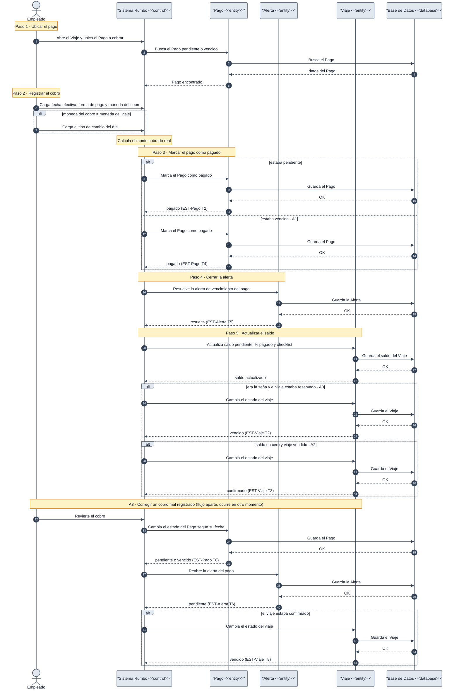

# DGM-SEC — Registrar cobro de un pago

tags:: #tipo/diagrama #estado/borrador #pc/pc1 #accion/revisar

## Qué representa
El **diagrama de secuencia** de [[CU-12 Registrar cobro de un pago]]: los mensajes entre el empleado y las clases del sistema al registrar un cobro, resolver la alerta de vencimiento y avanzar el [[Viaje]] a `vendido` o `confirmado` según corresponda. Incluye como continuación cronológica (no como rama) la corrección de un cobro mal registrado (A3). Vista de secuencia **de análisis** (clases como participantes), complementaria de [[DGM-ACT — Registrar cobro de un pago]] (mismo CU, notación de actividad).

Notas de origen: [[CU-12 Registrar cobro de un pago]] · [[CU-08 Gestionar estado del viaje]] · [[Pago]] · [[EST-Pago]] · [[EST-Viaje]] · [[EST-Alerta]] · [[DEC-0007 Modelo económico — ganancia, margen y comisión de vendedor]] · [[DEC-0010 Notación de los diagramas de actividad y de secuencia]]

## Diagrama

## Trazabilidad con el caso de uso
Cada `Note over` marca **un paso del camino principal** de [[CU-12 Registrar cobro de un pago]], en el mismo orden que [[DGM-ACT — Registrar cobro de un pago]].

| Paso de CU-12 | Marco del diagrama | Mensajes clave | Estados que cambia |
|---|---|---|---|
| 1 · Ubicar el pago | Paso 1 | `E->>S` · `S->>P` (busca en BD) | — |
| 2 · Registrar el cobro (fecha, forma de pago, moneda, tipo de cambio) | Paso 2 | `E->>S` ×2 | — |
| 3 · Marcar el pago como pagado | Paso 3 | `S->>P` (guarda en BD) | [[EST-Pago]] T2 o T4 |
| 4 · Resolver la alerta del pago | Paso 4 | `S->>A` (guarda en BD) | [[EST-Alerta]] T5 |
| 5 · Actualizar saldo, % pagado y checklist | Paso 5 | `S->>V` (guarda en BD) | [[EST-Viaje]] T2, T3 |

| Flujo alternativo | Dónde está |
|---|---|
| **A0** · Cobro de la seña | Paso 5: `alt era la seña y el viaje estaba reservado` |
| **A1** · Pago vencido | Paso 3: rama `else estaba vencido` |
| **A2** · Último pago, viaje saldado | Paso 5: `alt saldo en cero y viaje vendido` |
| **A3** · Corregir el cobro | Continuación cronológica al final, sin rama · [[EST-Pago]] T6 · [[EST-Alerta]] T6 · [[EST-Viaje]] T8 |

## Convenciones del diagrama
Ver [[DEC-0010 Notación de los diagramas de actividad y de secuencia]] y [[DGM-SEC — Confirmar reserva#Convenciones del diagrama]] (mismas reglas, incluida la **Base de Datos** como participante final: toda búsqueda o guardado de una entidad tiene su ida y vuelta con `BD`).
- **Flujo aparte (A3):** a diferencia de [[DGM-ACT — Registrar cobro de un pago]] (que necesita un nodo inicial separado por el layout de `flowchart`), en `sequenceDiagram` alcanza con dibujarlo **más abajo**, con un `Note` que lo anuncia: la secuencia ya es cronológica de arriba a abajo.

## Cómo mantenerlo
- **Source → output:** la verdad vive en [[CU-12 Registrar cobro de un pago]]. Si cambia el camino principal o un flujo alternativo, se actualiza primero la fuente y después este diagrama.
- **PNG:** `bash "07-Entregables/build/render-diagramas-secuencia.sh"` lo regenera en `img/`.
- **Un solo editor a la vez** (el bloque Mermaid es indivisible). Ver [[Guía del Vault#3 · Workflow colaborativo]].

## 🔎 Revisión
> [!warning] Mismos huecos que [[DGM-ACT — Registrar cobro de un pago#🔎 Revisión]] (no se resolvieron; se dibujó lo que dice el CU): revertir el cobro de la seña deja el viaje `vendido` sin seña; un plan sin seña nunca hace que el viaje pase a `vendido`; el enum `forma_pago` del CU no coincide con el de [[Pago]]; los cobros parciales no están contemplados. #accion/decidir
