# DGM-ACT — Confirmar reserva

tags:: #tipo/diagrama #estado/formalizado #pc/pc1

## Qué representa
El **diagrama de actividad** de [[CU-07 Confirmar reserva]]: el momento en que una [[Oportunidad]] ganada se convierte en [[Viaje]]. Crea el viaje, genera en paralelo las alertas del destino y de la salida, e incluye el control económico ([[CU-10 Registrar economía del viaje]]) y el plan de cuotas ([[CU-11 Definir plan de cuotas]]) con su validación `Σ montos = precioVenta`.

Notas de origen: [[CU-07 Confirmar reserva]] · [[CU-10 Registrar economía del viaje]] · [[CU-11 Definir plan de cuotas]] · [[CU-09 Armar itinerario de hoteles]] · [[CU-15 Configurar recordatorios por destino]] · [[RN-01 Comisión automática]] · [[EST-Viaje]] · [[EST-Pago]] · [[EST-Alerta]] · [[EST-Oportunidad]]

## Diagrama

```mermaid
%%{init: {'theme':'base','flowchart':{'defaultRenderer':'elk','wrappingWidth':260},'themeVariables':{'fontFamily':'Segoe UI, Arial, sans-serif','fontSize':'14px','lineColor':'#334155','clusterBkg':'#f8fafc','clusterBorder':'#94a3b8','edgeLabelBackground':'#ffffff'},'themeCSS':'.state-start{fill:#0f172a !important;stroke:#0f172a !important} [id*=flowchart-fin] g path{fill:#ffffff !important;stroke:#0f172a !important} [id*=flowchart-fin] g g path{fill:#0f172a !important}'}}%%
flowchart TB
    ini@{ shape: sm-circ }
    c0("(Cliente)<br/>Confirma la compra")
    ini --> c0 --> d1

    subgraph P1["Paso 1 · Elegir «Confirmar reserva»"]
        d1{ }
        e1a("(Empleado)<br/>Abre la oportunidad desde la cotización aceptada")
        e1b("(Empleado)<br/>Abre la oportunidad ganada sin cotización")
        m1{ }
        e1("(Empleado)<br/>Elige «Confirmar reserva»")
        d1 -- "[con cotización aceptada]" --> e1a --> m1
        d1 -- "[venta directa] · A1" --> e1b --> m1
        m1 --> e1
    end

    subgraph P2["Paso 2 · Datos del viaje"]
        m2{ }
        e2("(Empleado)<br/>Carga destino del catálogo, fechas, categoría y responsable")
        d2{ }
        s2("(Sistema)<br/>No confirma y pide completar los datos")
        m2 --> e2 --> d2
        d2 -- "[falta destino o fechas] · A3" --> s2 --> m2
    end

    subgraph P3["Paso 3 · Crear el viaje"]
        s3("(Sistema)<br/>Crea el Viaje asociado al Cliente y a la Oportunidad · Viaje → reservado (T1)")
        s3b("(Sistema)<br/>Cierra la Oportunidad · Oportunidad → ganada (T4)")
        s3 --> s3b
    end

    subgraph P4["Paso 4 · Alertas del viaje"]
        f4@{ shape: fork }
        d4{ }
        s4a("(Sistema)<br/>Genera una alerta «formulario» por cada requisito del destino")
        m4{ }
        s4b("(Sistema)<br/>Genera la alerta «salida» previa a la fecha de salida")
        j4@{ shape: fork }
        f4 --> d4
        d4 -- "[destino con requisitos]" --> s4a --> m4
        d4 -- "[sin requisitos] · A2" --> m4
        m4 --> j4
        f4 --> s4b --> j4
    end

    subgraph P5["Paso 5 · Economía y plan de cuotas · incluye CU-10 y CU-11"]
        e5("(Empleado)<br/>Carga moneda, operador, precio de venta, costo, vendedor y comisión")
        s5("(Sistema)<br/>Calcula ganancia y margen · RN-01")
        e5b("(Empleado)<br/>Define las cuotas y, si hay, la seña, con monto y vencimiento")
        m5{ }
        d5{ }
        s5c("(Sistema)<br/>Rechaza el plan y muestra la diferencia")
        e5c("(Empleado)<br/>Corrige los montos")
        s5d("(Sistema)<br/>Guarda los Pagos · Pago → pendiente (T1)")
        s5e("(Sistema)<br/>Genera una alerta de vencimiento por pago, un mes antes")
        d5b{ }
        e5d("(Empleado)<br/>Suma los hoteles del viaje · CU-09")
        m5b{ }
        fin@{ shape: fr-circ }
        e5 --> s5 --> e5b --> m5 --> d5
        d5 -- "[Σ montos ≠ precio de venta] · CU-11 A1" --> s5c --> e5c --> m5
        d5 -- "[Σ montos = precio de venta]" --> s5d --> s5e --> d5b
        d5b -- "[arma el itinerario]" --> e5d --> m5b
        d5b -- "[lo deja para después]" --> m5b
        m5b --> fin
    end

    e1 --> m2
    d2 -- "[datos completos]" --> s3
    s3b --> f4
    j4 --> e5

    classDef cli fill:#fef3c7,stroke:#b45309,color:#0f172a
    classDef emp fill:#dbeafe,stroke:#1d4ed8,color:#0f172a
    classDef sis fill:#e2e8f0,stroke:#475569,color:#0f172a
    classDef ctl fill:#ffffff,stroke:#334155
    classDef barra fill:#0f172a,stroke:#0f172a
    class c0 cli
    class e1,e1a,e1b,e2,e5,e5b,e5c,e5d emp
    class s2,s3,s3b,s4a,s4b,s5,s5c,s5d,s5e sis
    class d1,m1,m2,d2,d4,m4,m5,d5,d5b,m5b ctl
    class f4,j4 barra
```

## Trazabilidad con el caso de uso
Cada marco es **un paso del camino principal** de [[CU-07 Confirmar reserva]], en el mismo orden. Cada rama alternativa lleva en su guarda el código del flujo alternativo que la origina.

| Paso de CU-07 | Marco del diagrama | Detalle | Estados que cambia |
|---|---|---|---|
| 1 · Elegir «Confirmar reserva» | Paso 1 | Precondición: cotización `aceptada`, u oportunidad `ganada` por venta directa | — |
| 2 · Cargar los datos del viaje | Paso 2 | Destino desde [[CU-26 Gestionar destinos]] | — |
| 3 · Crear el viaje | Paso 3 | — | [[EST-Viaje]] T1 · [[EST-Oportunidad]] T4 |
| 4 · Generar alertas de formulario y salida | Paso 4 | Requisitos de [[CU-15 Configurar recordatorios por destino]] | [[EST-Alerta]] T1 |
| 5 · Economía, plan de cuotas e itinerario | Paso 5 | [[CU-10 Registrar economía del viaje]] pasos 2–6 · [[CU-11 Definir plan de cuotas]] pasos 2–6 · [[CU-09 Armar itinerario de hoteles]] | [[EST-Pago]] T1 · [[EST-Alerta]] T1 |

| Flujo alternativo | Dónde está |
|---|---|
| **A1** · Venta directa, sin cotización formal | Paso 1: rama `[venta directa]` |
| **A2** · Destino sin requisitos | Paso 4: rama `[sin requisitos]` de la decisión dentro del paralelo |
| **A3** · Datos faltantes | Paso 2: bucle que vuelve a pedir los datos |
| *CU-11 A1* · La suma no coincide | Paso 5: bucle `[Σ montos ≠ precio de venta]` |

Los flujos alternativos propios de [[CU-10 Registrar economía del viaje]] (override de comisión, venta sin vendedor, costo mayor que la venta) **no se dibujan**: no desvían el flujo de CU-07.

## Convenciones del diagrama
- **Notación UML de actividad**, dibujada con `flowchart` de Mermaid: nodo inicial ●, final de actividad ◉, acciones con bordes redondeados, rombo vacío para **decisión** y para **fusión**, barra negra para **bifurcación y unión en paralelo** (fork/join). Las guardas van entre corchetes sobre la flecha: `[saldo en cero]`.
- **Carriles:** Mermaid no dibuja carriles en columnas (se probó el 25/09 con tres variantes y todas los apilan), así que se usa la **notación de partición dentro de la acción** que admite UML: `(Empleado) Registra el cobro`. Refuerza cada carril un color: **amarillo = Cliente**, **azul = Empleado**, **gris = Sistema Rumbo**.
- **Marcos = pasos del camino principal** del caso de uso, con su número y nombre. No son un elemento UML: están para la trazabilidad.
- **Código del flujo alternativo** en la guarda de la rama que lo origina (`· A1`), y **cambios de estado** con la flecha `→` y la transición de su nota `EST-*`.
- Encabezado común (`%%{init}%%`): motor ELK y un `themeCSS` que pinta el nodo inicial y el final. Copiarlo tal cual en los diagramas nuevos.

## Cómo mantenerlo
- **Source → output:** la verdad vive en [[CU-07 Confirmar reserva]], [[CU-10 Registrar economía del viaje]] y [[CU-11 Definir plan de cuotas]]. Si cambia el camino principal o un flujo alternativo, se actualiza primero el CU y después este diagrama, **manteniendo un marco por paso** para no perder la trazabilidad.
- **PNG:** `bash "07-Entregables/build/render-diagramas-actividad.sh"` lo regenera en `img/`.
- **Un solo editor a la vez** (el bloque Mermaid es indivisible). Ver [[Guía del Vault#3 · Workflow colaborativo]].

## 🔎 Revisión
> [!success] **Resueltos en la sync del 29/09** (Francisco, Nahuel y Paloma): (1) el **primer cobro, de cualquier tipo**, pasa el viaje a `vendido` ([[EST-Viaje]] T2, [[CU-12 Registrar cobro de un pago]] A0); (2) la precondición de CU-10 dice `reservado`; (3) **CU-07 cierra la Oportunidad como `ganada`** al crear el viaje (paso 3, [[EST-Oportunidad]] T4); (4) la anticipación de 7 días de la alerta `salida` **quedó verificada con la agencia**. El diagrama ya refleja (1) y (3).
>
> [!note] Huecos detectados al dibujar (25/09, Nahuel + Claude), conservados como historial:
> 1. **Viaje sin seña: nunca pasa a `vendido`.** [[CU-11 Definir plan de cuotas]] dice que la seña es **opcional** y su A2 permite un **pago único** de `tipo = saldo`, pero la guarda de [[EST-Viaje]] T2 exige cobrar un [[Pago]] de `tipo = seña`. Con un plan sin seña, el viaje queda en `reservado` hasta que el saldo llegue a cero, y T3 solo sale de `vendido`: **el viaje quedaría trabado en `reservado` aun totalmente pagado.** Hay que decidir si el primer cobro de cualquier tipo cuenta como seña, o si la seña pasa a ser obligatoria.
> 2. **Precondición de [[CU-10 Registrar economía del viaje]] desactualizada.** Dice que el viaje fue «creado/`vendido` en CU-07», pero CU-07 lo crea en `reservado` y la economía se carga **antes** del cobro de la seña. Debería decir `reservado`.
> 3. **Quién cierra la oportunidad como `ganada`.** La precondición de CU-07 exige una oportunidad **ya** `ganada` (o una cotización `aceptada`), y su postcondición dice que «queda `ganada` y cerrada». Con la cotización aceptada pero la oportunidad todavía `cotizada`, no queda claro si CU-07 hace la transición T4 o si el empleado debe cerrarla antes en [[CU-05 Seguir oportunidad]]. Mismo hueco que el punto 4 de [[DGM-ACT — De la consulta a la venta]].
> 4. **La anticipación de la alerta `salida`** (7 días por default) sigue sin validar con la agencia; ya figura como pendiente en el [[Estado del proyecto]]. No se escribió el valor en el diagrama.
