# DGM-ACT — De la consulta a la venta

tags:: #tipo/diagrama #estado/formalizado #pc/pc1

## Qué representa
El **diagrama de actividad** de [[CU-01 De la consulta a la venta]]: los cinco pasos de su camino principal, en orden, con las decisiones, bucles y acciones en paralelo que lo desvían (el cliente no responde, desiste, paga en cuotas, el destino tiene requisitos) y quién hace cada acción: Cliente, Empleado o Sistema Rumbo.

Notas de origen: [[CU-01 De la consulta a la venta]] · [[CU-02 Registrar cliente]] · [[CU-04 Registrar consulta]] · [[CU-05 Seguir oportunidad]] · [[CU-06 Emitir cotización]] · [[CU-07 Confirmar reserva]] · [[CU-10 Registrar economía del viaje]] · [[CU-11 Definir plan de cuotas]] · [[CU-12 Registrar cobro de un pago]] · [[CU-17 Registrar reseña de hotel]] · [[EST-Oportunidad]] · [[EST-Cotización]] · [[EST-Viaje]] · [[EST-Pago]]

## Diagrama

```mermaid
%%{init: {'theme':'base','flowchart':{'defaultRenderer':'elk','wrappingWidth':260},'themeVariables':{'fontFamily':'Segoe UI, Arial, sans-serif','fontSize':'14px','lineColor':'#334155','clusterBkg':'#f8fafc','clusterBorder':'#94a3b8','edgeLabelBackground':'#ffffff'},'themeCSS':'.state-start{fill:#0f172a !important;stroke:#0f172a !important} [id*=flowchart-fin] g path{fill:#ffffff !important;stroke:#0f172a !important} [id*=flowchart-fin] g g path{fill:#0f172a !important}'}}%%
flowchart TB
    ini@{ shape: sm-circ }
    ini --> c1

    subgraph P1["Paso 1 · Cliente"]
        c1("(Cliente)<br/>Hace una consulta por Instagram, WhatsApp o presencial")
        e2("(Empleado)<br/>Busca al cliente")
        d2{ }
        e2b("(Empleado)<br/>Crea la ficha: preferencias y segmento")
        m2{ }
        c1 --> e2 --> d2
        d2 -- "[no tiene ficha] · CU-04 A1" --> e2b --> m2
        d2 -- "[tiene ficha]" --> m2
    end

    subgraph P2["Paso 2 · Consulta"]
        e1("(Empleado)<br/>Registra canal, destino, fechas y pasajeros")
        s1("(Sistema)<br/>Crea la Oportunidad asociada al cliente · Oportunidad → nueva (T1)")
        e1b("(Empleado)<br/>Empieza a atender la consulta")
        s1b("(Sistema)<br/>Oportunidad → en_gestión (T2)")
        e1 --> s1 --> e1b --> s1b
    end

    subgraph P3["Paso 3 · Cotización"]
        e3("(Empleado)<br/>Genera la cotización desde una plantilla")
        s3("(Sistema)<br/>Genera el documento · Cotización → borrador")
        e3b("(Empleado)<br/>Envía la cotización y la marca como enviada")
        s3b("(Sistema)<br/>Cotización → enviada · Oportunidad → cotizada (T3)")
        m3{ }
        d3{ }
        s3c("(Sistema)<br/>Genera una alerta de insistencia")
        e3c("(Empleado)<br/>Vuelve a contactar al cliente")
        d3b{ }
        e3d("(Empleado)<br/>Cierra la oportunidad con su motivo")
        s3d("(Sistema)<br/>Oportunidad → perdida (T5)")
        fin1@{ shape: fr-circ }
        e3 --> s3 --> e3b --> s3b --> m3 --> d3
        d3 -- "[no responde] · A1" --> s3c --> e3c --> m3
        d3 -- "[responde]" --> d3b
        d3b -- "[desiste o no hay acuerdo] · CU-05 A2" --> e3d --> s3d --> fin1
    end

    subgraph P4["Paso 4 · Reserva y seguimiento"]
        e4("(Empleado)<br/>Confirma la reserva")
        s4("(Sistema)<br/>Viaje → reservado (T1) · Oportunidad → ganada (T4)")
        d5{ }
        s5b("(Sistema)<br/>Genera las alertas de formulario del destino")
        m5{ }
        s5c("(Sistema)<br/>Genera la alerta de salida")
        e4b("(Empleado)<br/>Carga venta, costo del operador, moneda y comisión del vendedor")
        s4b("(Sistema)<br/>Calcula ganancia y margen · RN-01")
        e4c("(Empleado)<br/>Define el plan de pagos")
        s4c("(Sistema)<br/>Pagos → pendiente · genera una alerta por vencimiento")
        f5@{ shape: fork }
        c4("(Cliente)<br/>Paga la seña o la primera cuota")
        e4d("(Empleado)<br/>Registra el cobro")
        s4d("(Sistema)<br/>Pago → pagado · Viaje → vendido (T2)")
        m4{ }
        d4{ }
        c4b("(Cliente)<br/>Paga la cuota, en ARS o en USD")
        e4e("(Empleado)<br/>Registra el cobro")
        s4e("(Sistema)<br/>Viaje → confirmado (T3)")
        s5a("(Sistema)<br/>Avisa antes de cada vencimiento, del formulario y de la salida")
        e5("(Empleado)<br/>Transmite los recordatorios al pasajero")
        j5@{ shape: fork }
        e4 --> s4 --> d5
        d5 -- "[destino con requisitos] · A3" --> s5b --> m5
        d5 -- "[sin requisitos]" --> m5
        m5 --> s5c --> e4b --> s4b --> e4c --> s4c --> f5
        f5 --> c4 --> e4d --> s4d --> m4 --> d4
        d4 -- "[queda saldo] · A2" --> c4b --> e4e --> m4
        d4 -- "[saldo en cero]" --> s4e --> j5
        f5 --> s5a --> e5 --> j5
    end

    subgraph P5["Paso 5 · Post-venta"]
        s6("(Sistema)<br/>Viaje → en curso (T4) y → finalizado (T5)")
        s6b("(Sistema)<br/>Genera la alerta de reseña")
        e6("(Empleado)<br/>Le pide la reseña del hotel al cliente")
        c6("(Cliente)<br/>Deja su reseña")
        e6b("(Empleado)<br/>Registra la reseña")
        s6c("(Sistema)<br/>Consolida el hotel en el catálogo")
        fin2@{ shape: fr-circ }
        s6 --> s6b --> e6 --> c6 --> e6b --> s6c --> fin2
    end

    m2 --> e1
    s1b --> e3
    d3b -- "[acepta]" --> e4
    j5 --> s6

    classDef cli fill:#fef3c7,stroke:#b45309,color:#0f172a
    classDef emp fill:#dbeafe,stroke:#1d4ed8,color:#0f172a
    classDef sis fill:#e2e8f0,stroke:#475569,color:#0f172a
    classDef ctl fill:#ffffff,stroke:#334155
    classDef barra fill:#0f172a,stroke:#0f172a
    class c1,c4,c4b,c6 cli
    class e1,e1b,e2,e2b,e3,e3b,e3c,e3d,e4,e4b,e4c,e4d,e4e,e5,e6,e6b emp
    class s1,s1b,s3,s3b,s3c,s3d,s4,s4b,s4c,s4d,s4e,s5a,s5b,s5c,s6,s6b,s6c sis
    class d2,m2,m3,d3,d3b,m4,d4,d5,m5 ctl
    class f5,j5 barra
```

## Trazabilidad con el caso de uso
Cada marco del diagrama es **un paso del camino principal** de [[CU-01 De la consulta a la venta]], en el mismo orden y con el mismo nombre. Cada rama alternativa lleva en su guarda el código del flujo alternativo que la origina.

| Paso de CU-01 | Marco del diagrama | Casos de uso que lo detallan | Estados que cambia |
|---|---|---|---|
| 1 · Cliente | Paso 1 | [[CU-02 Registrar cliente]] | — |
| 2 · Consulta | Paso 2 | [[CU-04 Registrar consulta]], [[CU-05 Seguir oportunidad]] | [[EST-Oportunidad]] T1, T2 |
| 3 · Cotización | Paso 3 | [[CU-06 Emitir cotización]] | [[EST-Cotización]] T1, T2 · [[EST-Oportunidad]] T3, T5 |
| 4 · Reserva y seguimiento | Paso 4 | [[CU-07 Confirmar reserva]] (formulario y salida), [[CU-10 Registrar economía del viaje]], [[CU-11 Definir plan de cuotas]] (vencimientos), [[CU-12 Registrar cobro de un pago]] | [[EST-Viaje]] T1, T2, T3 · [[EST-Oportunidad]] T4 · [[EST-Pago]] T1, T2 |
| 5 · Post-venta | Paso 5 | [[CU-17 Registrar reseña de hotel]] | [[EST-Viaje]] T4, T5 |

| Flujo alternativo | Dónde está |
|---|---|
| **A1** · El cliente no responde | Paso 3: bucle de insistencia que vuelve a la decisión «¿responde?» |
| **A2** · Pago en cuotas | Paso 4: bucle `[queda saldo]`, en paralelo con los avisos |
| **A3** · Destino con requisitos | Paso 4: decisión `[destino con requisitos]` al confirmar la reserva |
| *CU-04 A1* · Cliente nuevo | Paso 1: rama `[no tiene ficha]` |
| *CU-05 A2* · Oportunidad perdida | Paso 3: rama que termina en un final de actividad |

## Convenciones del diagrama
- **Notación UML de actividad**, dibujada con `flowchart` de Mermaid: nodo inicial ●, final de actividad ◉, acciones con bordes redondeados, rombo vacío para **decisión** y para **fusión**, barra negra para **bifurcación y unión en paralelo** (fork/join). Las guardas van entre corchetes sobre la flecha: `[saldo en cero]`.
- **Carriles:** Mermaid no dibuja carriles en columnas (se probó el 25/09 con tres variantes y todas los apilan), así que se usa la **notación de partición dentro de la acción** que admite UML: `(Empleado) Registra el cobro`. Refuerza cada carril un color: **amarillo = Cliente**, **azul = Empleado**, **gris = Sistema Rumbo**.
- **Marcos = pasos del camino principal** del caso de uso, con su número y nombre. No son un elemento UML: están para la trazabilidad.
- **Código del flujo alternativo** en la guarda de la rama que lo origina (`· A1`), y **cambios de estado** con la flecha `→` y la transición de su nota `EST-*`.
- Encabezado común (`%%{init}%%`): motor ELK y un `themeCSS` que pinta el nodo inicial y el final. Copiarlo tal cual en los diagramas nuevos.

## Cómo mantenerlo
- **Source → output:** la verdad vive en [[CU-01 De la consulta a la venta]] y los CU que compone. Si cambia el camino principal o un flujo alternativo, se actualiza primero el CU y después este diagrama, **manteniendo un marco por paso** para no perder la trazabilidad.
- **PNG:** `bash "07-Entregables/build/render-diagramas-actividad.sh"` lo regenera en `img/`.
- **Un solo editor a la vez** (el bloque Mermaid es indivisible). Ver [[Guía del Vault#3 · Workflow colaborativo]].

## 🔎 Revisión
> [!success] **Resueltos en la sync del 29/09** (Francisco, Nahuel y Paloma). Los cuatro huecos que quedan abajo se cerraron así: (1) CU-01 se alineó a CU-04: primero el cliente, después la consulta; (2) el seguimiento se fusionó en el paso 4, que pasó a llamarse *Reserva y seguimiento*, y la post-venta quedó como paso 5; (3) la precondición de CU-05 suma `en_gestión`; (4) la Oportunidad pasa a `ganada` **en CU-07 al confirmar la reserva**. El diagrama ya está redibujado con los cinco pasos.
>
> [!note] Huecos detectados al dibujar (25/09, Nahuel + Claude), conservados como historial:
> 1. **Orden de los pasos 1 y 2.** CU-01 registra la oportunidad (paso 1) y *después* identifica al cliente (paso 2), pero [[CU-04 Registrar consulta]] hace al revés: identifica al cliente en su paso 2 y crea la [[Oportunidad]] en el paso 4, ya asociada a él. El diagrama sigue el orden de CU-01. ¿Se alinea CU-01 a CU-04?
> 2. **El paso 5 ocurre antes de lo que indica su número.** Las alertas de seguimiento no se generan después del cobro: las de formulario y salida nacen al confirmar la reserva ([[CU-07 Confirmar reserva]] paso 4) y las de vencimiento al definir el plan ([[CU-11 Definir plan de cuotas]] paso 6), es decir, **dentro del paso 4**. El diagrama respeta la numeración de CU-01; convendría aclararlo en el CU o reordenar.
> 3. **Precondición de [[CU-05 Seguir oportunidad]] incompleta.** Pide una oportunidad `nueva` o `cotizada`, pero omite `en_gestión`, que es justamente el estado en que se la sigue (T2). Parece un olvido de cuando se sumó el quinto estado el 18/09.
> 4. **Quién marca la oportunidad como `ganada`.** [[CU-05 Seguir oportunidad]] paso 6 la cierra a mano, pero la postcondición de [[CU-07 Confirmar reserva]] y el [[DGM-SEC — De la consulta a la venta|diagrama de secuencia]] la cierran al confirmar la reserva. El diagrama muestra el cierre al confirmar; hay que definir si es un paso manual previo o un efecto de CU-07.
