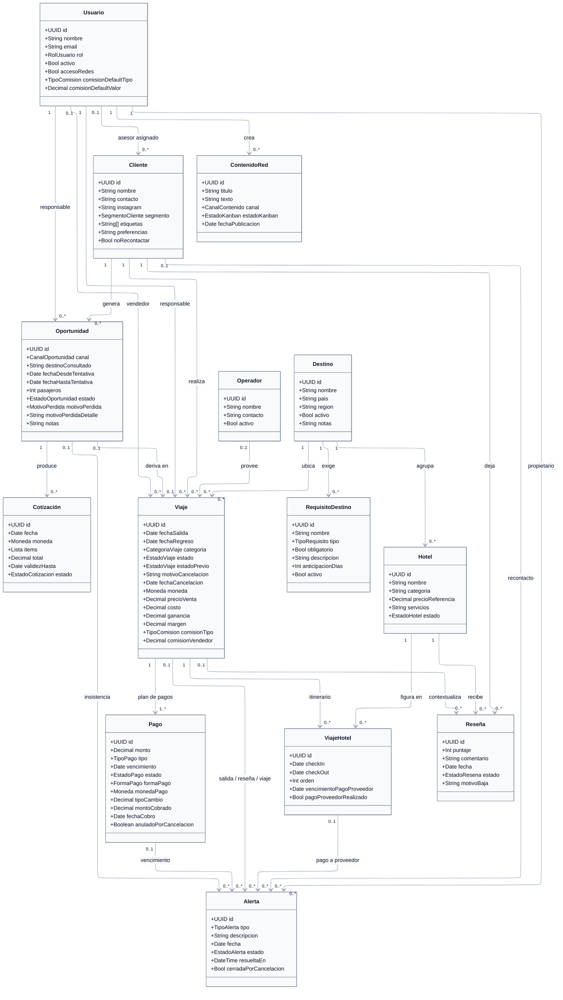
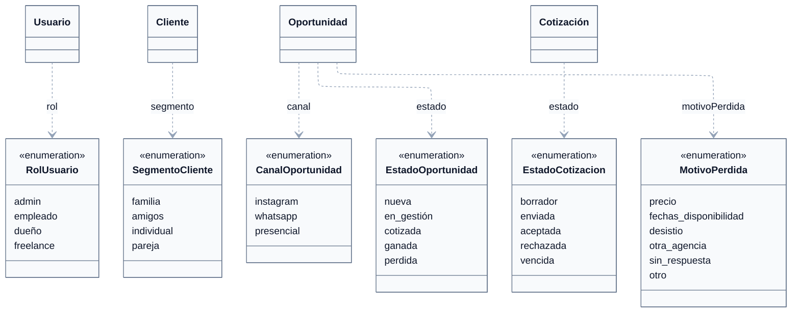
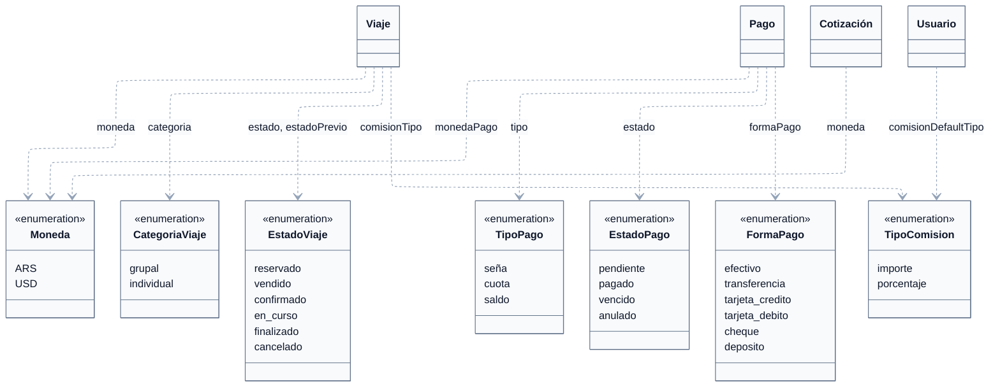
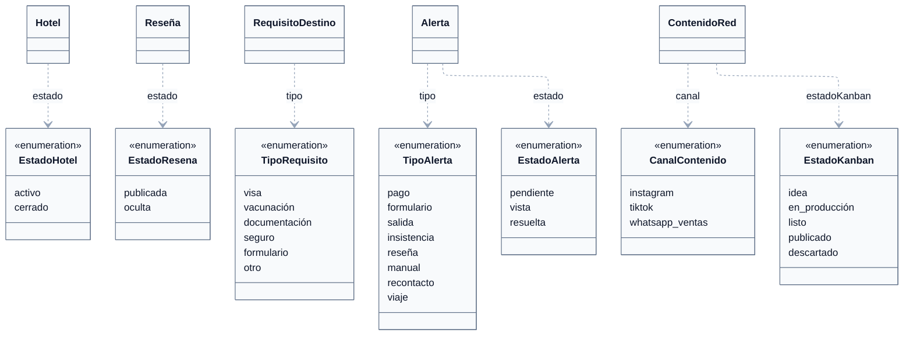

# DGM — Diagrama de clases

tags:: #tipo/diagrama #estado/formalizado #pc/pc1

> **Diagrama de clases de dominio** de Rumbo: las **13 entidades** del [[MOC — Modelo de dominio]] más la clase asociativa `ViajeHotel`. Es una **salida derivada**: la verdad de cada clase vive en su nota de entidad (`03-Dominio/Entidades/`). Al cambiar una entidad, actualizar primero su nota y después este diagrama.
>
> Su par relacional es [[DGM-ER]] (modelo para PostgreSQL). Ambos deben quedar coherentes: **este describe objetos, aquel describe tablas.**
>
> **Render:** los cuatro bloques usan el motor **ELK** (routing ortogonal, líneas rectas), igual que [[DGM — Casos de uso]] y [[DGM-ER]]. ⚠️ Si Obsidian no soporta `layout: elk`, la vista previa del vault puede fallar; el render de referencia se genera con `mermaid-cli` (comando en [[CONTINUAR — entregable Casos de uso]]).

## Convenciones de lectura

Acordadas con Nahuel el 21/09 antes de armar el diagrama:

| Convención | Criterio |
|---|---|
| **Nivel** | Dominio: **solo atributos**, sin operaciones. El comportamiento vive en los casos de uso; no se inventan métodos. |
| **Claves foráneas** | **No se listan como atributos.** En UML la asociación ya expresa la relación; el rol va como etiqueta del vínculo (`responsable`, `vendedor`, `asesor asignado`). Los `*_id` sí aparecen en [[DGM-ER]], que es el modelo relacional. |
| **Enumeraciones** | Todas modeladas como clases `<<enumeration>>`, en **tres bandas aparte** (agrupadas por módulo) para no cargar la vista principal. El tipo del atributo nombra la enumeración (`estado : EstadoViaje`). |
| **Nomenclatura** | `PascalCase` para clases y `camelCase` para atributos (modelo de objetos). [[DGM-ER]] usa `snake_case` (modelo relacional). Es la convención que ya venían usando ambos diagramas. |
| **Multiplicidades** | Notación UML `1`, `0..1`, `0..*`, `1..*` en ambos extremos. |
| **Layout** | Motor **ELK** con `nodePlacementStrategy: BRANDES_KOEPF`: las líneas salen **ortogonales** (tramos rectos en ángulo recto) en vez de curvas, que es mucho más legible con 24 asociaciones. Mismo criterio que [[DGM — Casos de uso]]. |

## Diagrama de clases — vista principal

### Cómo leerlo

- **Circuito comercial.** [[Cliente]] → [[Oportunidad]] → [[Cotización]] → [[Viaje]]. La `Oportunidad` deriva en **a lo sumo un** `Viaje` cuando se gana ([[DEC-0002 Modelar la consulta como Oportunidad]]).
- **`ViajeHotel` es una clase asociativa.** Resuelve el N:M [[Viaje]]–[[Hotel]] y **tiene identidad propia** (`id` UUID), porque el mismo hotel puede figurar en dos tramos no consecutivos del mismo viaje, cada uno con su `vencimientoPagoProveedor` — ver [[DEC-0003 Relación Viaje–Hotel y Reseña]] y el addendum del 21/09 en [[DGM-ER]].
- **`Reseña` cuelga de tres lados.** Obligatoriamente de [[Cliente]] y [[Hotel]]; el vínculo con [[Viaje]] es **opcional**, solo para trazabilidad ([[DEC-0003 Relación Viaje–Hotel y Reseña]]).
- **Bloque económico en `Viaje`.** `ganancia` y `margen` son **derivados** (`ganancia = precioVenta − costo`; `margen = ganancia / precioVenta`), y `comisionVendedor` va **aparte** de la ganancia — [[DEC-0007 Modelo económico — ganancia, margen y comisión de vendedor]]. El [[Operador]] es la contraparte del `costo` ([[DEC-0009 Operador-Proveedor como entidad de catálogo]]).
- **Multimoneda.** `Viaje.moneda` es la **moneda de referencia** (el plan de cuotas se denomina en ella); `Pago.monedaPago`, `tipoCambio` y `montoCobrado` registran el **cobro real**, que puede diferir ([[Pago]], [[CU-12 Registrar cobro de un pago]]).
- **`Usuario` no es `Cliente`.** El `Usuario` opera el sistema; aparece con cuatro roles distintos (`responsable` de oportunidad y de viaje, `vendedor`, `asesor asignado`) más `propietario` de la alerta — es lo que sostiene el modelo de visibilidad de [[DEC-0005 Autenticación y modelo de roles]] y [[DEC-0008 Autenticación propia y rol de vendedor freelance]].
- **`Alerta` tiene cuatro orígenes posibles**, todos opcionales, según su `tipo`: [[Viaje]] (`salida`, `reseña`), [[Pago]] (`pago`), [[Oportunidad]] (`insistencia`) y [[Cliente]] (`recontacto`). Una alerta `manual` puede además quedar **suelta**, sin ningún origen ([[CU-28 Crear recordatorio manual]]).

## Enumeraciones del dominio

Las **20 enumeraciones** son parte del mismo modelo; se muestran en tres bandas agrupadas por módulo para que cada una entre legible en una hoja. La caja de la clase va **sin atributos** (ya están en la vista principal) y cada **dependencia punteada** indica qué atributo usa la enumeración. `Moneda` es la única compartida: la usan [[Viaje]], [[Cotización]] y [[Pago]].

### 1 · CRM y seguridad

### 2 · Viaje, economía y pagos

### 3 · Catálogo, post-venta, alertas y redes

> ✅ **Todas las enumeraciones están cerradas** (sync 29/09): `FormaPago` con 6 valores y `CategoriaViaje` con `grupal · individual`.

## Refinamientos introducidos al pasar del borrador al diagrama

Estos puntos **no cambian el dominio**, solo lo expresan en términos de clases. Quedan anotados para que la sync los valide de un vistazo:

1. **Los rangos de fechas se desdoblan.** [[Viaje]]`.fechas` (Rango) → `fechaSalida` + `fechaRegreso`; [[Oportunidad]]`.fechas` (Rango) → `fechaDesdeTentativa` + `fechaHastaTentativa`. "Rango" no es un tipo; el ER los necesitaba desdoblados igual.
2. **`Oportunidad.destino` se renombra a `destinoConsultado`.** Sigue siendo **texto libre** (se normaliza a [[Destino]] recién al derivar en [[Viaje]], [[DEC-0006 Destino como entidad de catálogo]]); el nombre nuevo evita confundirlo con una asociación a `Destino` que en `Oportunidad` **no** existe.
3. **`ViajeHotel` se promueve a clase asociativa** con nombre propio, porque tiene identidad y cinco atributos. Antes era solo la etiqueta `viaje_hotel` sobre una relación N:M.
4. **Los FK desaparecen de las cajas** (ver Convenciones). El borrador del MOC los listaba; acá los expresan las asociaciones.

## Incoherencias detectadas

Se señalaron sin elegir una versión en silencio, según [[CLAUDE|CLAUDE.md#Orden de autoridad del cerebro]]. **Nahuel las resolvió las cuatro el 21/09** y ya están propagadas a [[DGM-ER]] y a la nota de [[Viaje]]; quedan **a ratificar en la sync**.

1. ✅ **`Viaje`–`Pago` = `1..*`** (resuelto 21/09, Nahuel). **Todo `Viaje` tiene al menos un `Pago`.** Vale la nota de [[Viaje]], no el `||--o{` del [[DGM-ER]]: [[CU-07 Confirmar reserva]] es el **único** CU que crea un `Viaje` y encadena [[CU-10 Registrar economía del viaje|CU-10]] y [[CU-11 Definir plan de cuotas|CU-11]] como `<<include>>` (no está completo sin ellos); su postcondición exige el plan cargado, el estado inicial `reservado` se define como *"economía y plan cargados"*, y [[CU-11 Definir plan de cuotas|CU-11]] A2 cubre el mínimo (sin cuotas se crea igual un `Pago` de tipo `saldo` por el total). El hueco entre "se crea el viaje" y "se carga el plan" es **intra-transacción**, no un estado válido del dominio, que es lo que modela un diagrama de clases conceptual. → **Corregir [[DGM-ER]]:** `VIAJE ||--o{ PAGO` pasa a **`VIAJE ||--|{ PAGO`**. La obligatoriedad se hace cumplir en la lógica de aplicación (una FK no puede exigir "al menos una fila hija").
2. ✅ **`Viaje`–`Alerta` = `0..1` → `0..*`** (resuelto 21/09, Nahuel). La nota de [[Viaje]] dice `1..*`, pero [[Alerta]] admite alertas que **no** cuelgan de un viaje (insistencia sobre [[Oportunidad]], recontacto sobre [[Cliente]], vencimiento sobre [[Pago]], y las `manual` sueltas de [[CU-28 Crear recordatorio manual]]). → **Corregir la nota de [[Viaje]]**.
3. ✅ **Origen de la `Alerta` en el ER: cuatro FK nullable + CHECK** (resuelto 21/09, Nahuel). El [[DGM-ER]] declaraba **un solo** origen (`VIAJE ||--o{ ALERTA`), así que no había dónde guardar de qué [[Oportunidad]], [[Pago]] o [[Cliente]] venía una alerta. Se optó por que `ALERTA` lleve `viaje_id`, `pago_id`, `oportunidad_id` y `cliente_id` **nullable**, con un **CHECK de que a lo sumo una esté cargada** (ninguna si es `manual` suelta). Se descartó el origen polimórfico (`origen_tipo` + `origen_id`) porque **pierde la FK** y deja la integridad en la aplicación; con 4 orígenes cerrados, la tabla más ancha es un costo menor frente a la integridad referencial real de PostgreSQL. → **Ya propagado al [[DGM-ER]]**. [[DEC-0013 Datos que faltaban en el ER|DEC-0013]] sumó un quinto origen, el tramo del itinerario (`viaje_hotel_id`), para la alerta de pago al proveedor.
4. ✅ **`Cotización.items` queda como atributo `Lista`** (decidido 21/09, Nahuel): no se promueve a una 14.ª entidad `ItemCotizacion`. Si más adelante hacen falta reportes por concepto, se reabre.

## Pendientes

- ✅ Ratificado en la sync del 29/09 (Francisco, Nahuel y Paloma), con el batch del 18/09 y la PK de `viaje_hotel`. En la misma sync se sumaron el tipo de alerta `viaje` y el atributo `cerradaPorCancelacion`.
- ✅ `FormaPago` (6 valores; las billeteras virtuales van como `transferencia`) y `CategoriaViaje` (`grupal · individual`) cerrados el 29/09.
- ✅ Lo resuelto el 21/09 ya está propagado a [[DGM-ER]] (`VIAJE ||--|{ PAGO` y los 4 orígenes de `ALERTA`) y a la nota de [[Viaje]].
- ✅ El [[DGM-ER]] quedó **completo y coherente** con este diagrama el 21/09: sumó los atributos de las 14 tablas y las 4 relaciones que le faltaban (`USUARIO`–`ALERTA`, `USUARIO`–`CLIENTE`, `USUARIO`–`OPORTUNIDAD`, `DESTINO`–`REQUISITO_DESTINO`).
- ✅ Auditoría (sync 29/09): `created_by`/`updated_by`/`created_at`/`updated_at` en **todas** las tablas de entidad (operativas y catálogos); no se dibujan para no multiplicar las líneas hacia `Usuario`. Ver [[DGM-ER]].
- ✅ [[DEC-0013 Datos que faltaban en el ER]] (29/09, ratificada el 30/09): `Pago.fechaCobro`, `Viaje.comisionTipo`, `Viaje.estadoPrevio`, `Usuario.activo`, `Usuario.accesoRedes`, la comisión por defecto del vendedor (enum `TipoComision`), `Oportunidad.notas` y `motivoPerdida` (enum `MotivoPerdida`), `Viaje.motivoCancelacion` y `fechaCancelacion`, `Reseña.motivoBaja`, el tramo (`ViajeHotel`) como quinto origen de la `Alerta`, `Alerta.descripcion`, `Alerta.resueltaEn` y `ContenidoRed.texto`.
- Renderizar el PNG (mermaid-cli, motor ELK) cuando el diagrama se incorpore a un entregable — ver [[Entregables — índice]].

## Relacionado

- [[MOC — Modelo de dominio]] · [[DGM-ER]] · [[MOC — Casos de uso]] · [[ARQ — Vista general]]
- Decisiones que lo gobiernan: [[DEC-0002 Modelar la consulta como Oportunidad|DEC-0002]] · [[DEC-0003 Relación Viaje–Hotel y Reseña|DEC-0003]] · [[DEC-0005 Autenticación y modelo de roles|DEC-0005]] · [[DEC-0006 Destino como entidad de catálogo|DEC-0006]] · [[DEC-0007 Modelo económico — ganancia, margen y comisión de vendedor|DEC-0007]] · [[DEC-0008 Autenticación propia y rol de vendedor freelance|DEC-0008]] · [[DEC-0009 Operador-Proveedor como entidad de catálogo|DEC-0009]]
