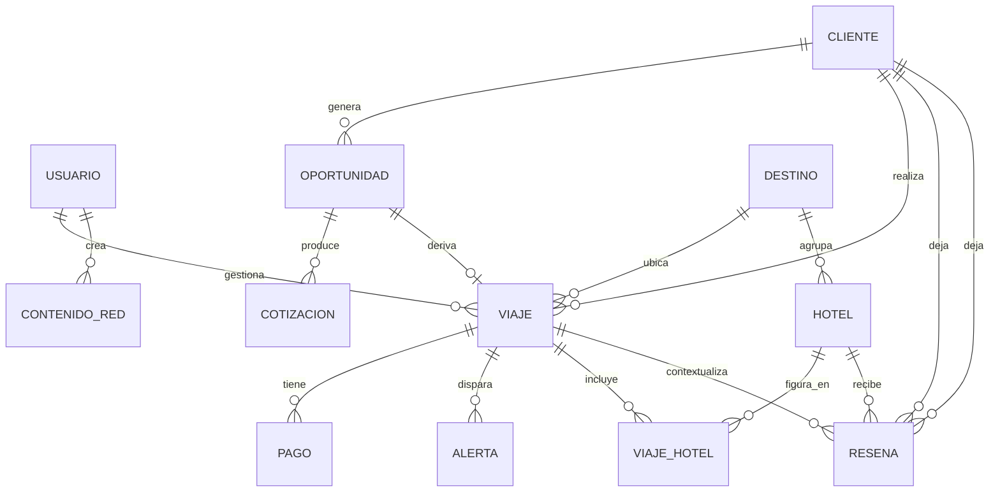

# DGM-ER

tags:: #tipo/diagrama #estado/borrador #pc/pc1

> Modelo entidad-relación para **PostgreSQL**. Salida del [[MOC — Modelo de dominio|modelo de dominio]]; mantener sincronizado con las notas de entidad.

> Relación N:M Viaje–Hotel modelada con la tabla intermedia `VIAJE_HOTEL`, y objeto de la Reseña (Hotel + Cliente, con Viaje opcional): ver [[DEC-0003 Relación Viaje–Hotel y Reseña]].
> `VIAJE.destino_id` y `HOTEL.destino_id` son FK a `DESTINO` (antes texto libre): ver [[DEC-0006 Destino como entidad de catálogo]].

## Tabla intermedia VIAJE_HOTEL
- FK `viaje_id` → VIAJE, FK `hotel_id` → HOTEL.
- Atributos: `check_in` (date), `check_out` (date), `orden` (int, itinerario).
- La RESENA lleva FK `cliente_id`, `hotel_id` y `viaje_id` **nullable** (trazabilidad opcional).

## Pendiente
- Confirmar si `VIAJE_HOTEL` usa PK compuesta `(viaje_id, hotel_id)` o `id` propio (necesario si el mismo hotel se repite en dos tramos del itinerario).
