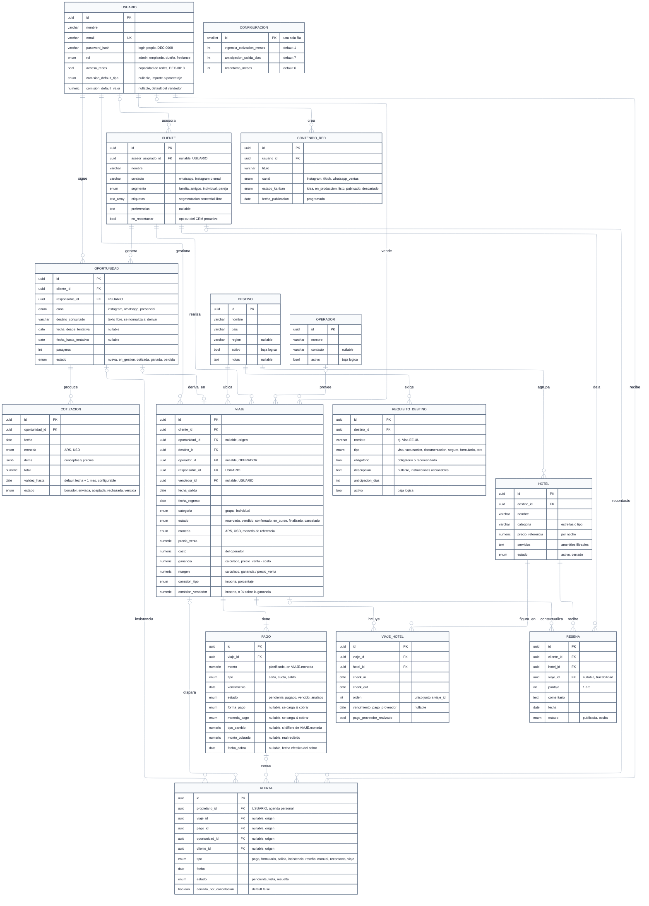

# DGM-ER

tags:: #tipo/diagrama #estado/formalizado #pc/pc1

> Modelo entidad-relación para **PostgreSQL**. Salida del [[MOC — Modelo de dominio|modelo de dominio]]; su par conceptual es [[DGM — Diagrama de clases]]. Mantener sincronizado con las notas de entidad: **este describe tablas, aquel describe objetos.**
>
> **Render:** el diagrama usa el motor **ELK** (routing ortogonal, líneas rectas), igual que [[DGM — Casos de uso]]. ⚠️ Si Obsidian no soporta `layout: elk`, la vista previa del vault puede fallar; el render de referencia se genera con `mermaid-cli` (comando en [[CONTINUAR — entregable Casos de uso]]).

## Convenciones

| Convención | Criterio |
|---|---|
| **Nomenclatura** | `SNAKE_CASE` para tablas y `snake_case` para columnas (modelo relacional). [[DGM — Diagrama de clases]] usa `PascalCase`/`camelCase` (modelo de objetos). |
| **Claves** | `PK` = clave primaria (siempre `uuid`), `FK` = clave foránea, `UK` = único. Los FK **sí** se listan acá; en el diagrama de clases no, porque allá los expresan las asociaciones. |
| **Enums** | Se declaran como `enum` con sus valores en el comentario. El catálogo completo está en las bandas de enumeraciones de [[DGM — Diagrama de clases]]. |
| **Nullable** | Se aclara en el comentario de la columna. Sin aclaración, `NOT NULL`. |
| **Layout** | Motor **ELK** (líneas ortogonales) y fuente **12px** — un punto menos que el diagrama de clases, para compensar que acá hay 14 tablas y ~110 columnas. Ver "Sobre el tamaño" al final. |

## Notas del modelo

- **`VIAJE ||--|{ PAGO` — todo viaje tiene al menos un pago** (resuelto 21/09, ver [[DGM — Diagrama de clases]]). [[CU-07 Confirmar reserva]] es el único CU que crea un `VIAJE` e incluye (`<<include>>`) [[CU-11 Definir plan de cuotas]], y aun sin cuotas se crea un `PAGO` de tipo `saldo` (A2). ⚠️ Una FK no puede exigir "al menos una fila hija": la obligatoriedad la hace cumplir la **lógica de aplicación**, no el motor.
- **`ALERTA` tiene cuatro orígenes posibles y excluyentes** (resuelto 21/09): `viaje_id`, `pago_id`, `oportunidad_id` y `cliente_id`, **las cuatro nullable**, con un **CHECK de que a lo sumo una esté cargada** — ninguna cuando es una alerta `manual` suelta ([[CU-28 Crear recordatorio manual]]). Se descartó el origen polimórfico (`origen_tipo` + `origen_id`) porque pierde la integridad referencial; con 4 orígenes cerrados, la tabla más ancha es un costo menor.
- **`USUARIO` aparece cinco veces** (`responsable` de viaje y de oportunidad, `vendedor`, `asesor_asignado`, `propietario` de alerta): es lo que implementa el modelo de visibilidad *lectura global + propiedad* de [[DEC-0005 Autenticación y modelo de roles]] y la restricción del rol `freelance` de [[DEC-0008 Autenticación propia y rol de vendedor freelance]].
- **Auditoría:** [[DEC-0008 Autenticación propia y rol de vendedor freelance]] exige registrar **autor y fecha** de las acciones. **Decidido en la sync del 29/09:** `created_by` / `updated_by` (FK a `USUARIO`) y `created_at` / `updated_at` van en **todas las tablas de entidad**, operativas y catálogos (las 13 entidades; la tabla asociativa `VIAJE_HOTEL` hereda la auditoría de `VIAJE`). No se dibujan en el diagrama para no multiplicar las líneas hacia `USUARIO`. **`created_by` y `updated_by` son nullable** (aprobado el 29/09): lo que hace el proceso automático diario los deja **vacíos**, y un autor vacío se lee como «lo hizo el sistema». `created_at` y `updated_at` siempre se cargan.
- `VIAJE.destino_id` y `HOTEL.destino_id` son FK a `DESTINO` (antes texto libre): ver [[DEC-0006 Destino como entidad de catálogo]]. `OPORTUNIDAD.destino_consultado` sigue siendo **texto libre** y se normaliza recién al derivar en `VIAJE`.
- `VIAJE` suma `operador_id`, `vendedor_id`, `moneda`, `costo`, `ganancia`, `margen` y `comision_vendedor` — ver [[DEC-0007 Modelo económico — ganancia, margen y comisión de vendedor]] y [[DEC-0009 Operador-Proveedor como entidad de catálogo]] (sync 17/09). `ganancia` y `margen` son **calculados**: se pueden materializar como columnas generadas o resolver en la vista.
- **Datos sumados al escribir el SQL** ([[DEC-0013 Datos que faltaban en el ER]], 29/09, a ratificar): `PAGO.fecha_cobro`; `VIAJE.comision_tipo` (`importe` o `porcentaje`); en `USUARIO`, `acceso_redes` y la comisión por defecto del vendedor (`comision_default_tipo` y `comision_default_valor`); y la tabla **`CONFIGURACION`**, de una sola fila, con los parámetros que edita `admin` (vigencia de la cotización, anticipación de la alerta `salida` y plazo del recontacto). `CONFIGURACION` es una tabla de parámetros, no una entidad del dominio, y no se relaciona con las demás. Con ella el esquema tiene **15 tablas**.
- `COTIZACION.items` se modela como **`jsonb`**, no como tabla propia: decidido el 21/09 no promoverlo a entidad ([[DGM — Diagrama de clases]], punto 4). Si más adelante hacen falta reportes por concepto, se reabre.
- Relación N:M `VIAJE`–`HOTEL` y objeto de la `RESENA` (Hotel + Cliente, con Viaje opcional): ver [[DEC-0003 Relación Viaje–Hotel y Reseña]].

## Tabla intermedia VIAJE_HOTEL
- **PK: `id` propio (UUID)** — no compuesta (ver "Resuelto 21/09" más abajo).
- FK `viaje_id` → VIAJE, FK `hotel_id` → HOTEL (índice no-único en el par, para consultas).
- Atributos: `check_in` (date), `check_out` (date), `orden` (int, itinerario; único junto a `viaje_id`), `vencimiento_pago_proveedor` (date, nullable) y `pago_proveedor_realizado` (bool) — vencimiento de pago al proveedor por hotel, con [[Alerta]] un mes antes ([[CU-09 Armar itinerario de hoteles]], [[DEC-0003 Relación Viaje–Hotel y Reseña]]).
- La RESENA lleva FK `cliente_id`, `hotel_id` y `viaje_id` **nullable** (trazabilidad opcional).

## Resuelto 21/09 (Nahuel, a ratificar en sync)
- **`VIAJE_HOTEL` usa `id` propio, no PK compuesta `(viaje_id, hotel_id)`.** Motivo: un mismo `HOTEL` puede aparecer en **más de un tramo** del mismo `VIAJE` (ej. Buenos Aires → Bariloche → Buenos Aires, con el mismo hotel porteño en ida y vuelta), y cada tramo puede llevar su propio `vencimiento_pago_proveedor` — la PK compuesta lo impedía. Detalle y justificación completa en [[DEC-0003 Relación Viaje–Hotel y Reseña]] (refinamiento sobre el `#accion/decidir` que esa DEC había dejado abierto).
- **ER completado:** se agregaron los **atributos de las 14 tablas** y las **4 relaciones que faltaban** (`USUARIO`–`ALERTA` propietario, `USUARIO`–`CLIENTE` asesor asignado, `USUARIO`–`OPORTUNIDAD` responsable y `DESTINO`–`REQUISITO_DESTINO`), se corrigió `VIAJE`–`PAGO` a `||--|{`, se sumaron los 4 orígenes de `ALERTA` y se eliminó una línea `CLIENTE`–`RESENA` duplicada. El diagrama pasó al motor **ELK**.

## Sobre el tamaño del diagrama

El ER es grande (≈ 2650 × 3133 px) porque el modelo **es** grande: 14 tablas, ~110 columnas y 24 relaciones. Se midieron las alternativas antes de dejarlo así (21/09):

| Variante | Tamaño | Veredicto |
|---|---|---|
| Original (fuente 14px) | 2940 × 3265 | — |
| **Fuente 12px** ✅ **aplicada** | **2650 × 3133** | **−14% de área, no se pierde nada** |
| `mergeEdges: true` | 3454 × 3165 | ❌ queda **más ancho**, no menos |
| Sin los valores de enum en los comentarios | 2373 × 3133 | −23%, pero se pierde info útil de un vistazo |
| Partirlo en vistas por módulo | ≈ 1265 × 2048 c/u | La única reducción real; se pierde la vista global |

**La altura (~3133) es estructural:** la fija la cantidad de capas que arma ELK a partir de las 14 tablas y sus 24 relaciones, y no baja recortando texto. Si en algún momento molesta para imprimirlo, la salida es **partirlo en 3 vistas** (comercial · economía · catálogo y post-venta) y conservar esta como vista global — igual que se hizo con las bandas de enumeraciones en [[DGM — Diagrama de clases]]. Queda como opción, no como pendiente.

## Pendientes
- ✅ Ratificado en la sync del 29/09 (Francisco, Nahuel y Paloma).
- ✅ Alcance de la auditoría definido en la sync del 29/09: todas las tablas de entidad.
- ✅ `forma_pago` y `categoria` de `VIAJE` (`grupal, individual`) cerrados el 29/09.
- Índices y constraints finos (además de los ya anotados en `VIAJE_HOTEL` y el CHECK de `ALERTA`) al pasar a las migraciones de PC2.
