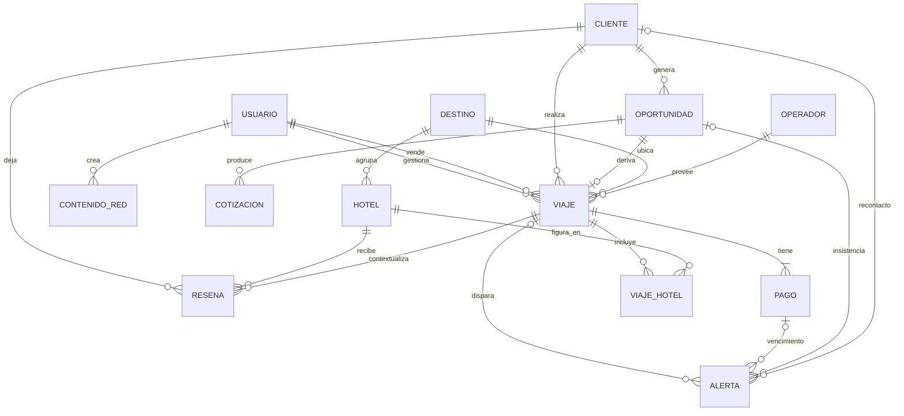

# DGM-ER

tags:: #tipo/diagrama #estado/borrador #pc/pc1

> Modelo entidad-relación para **PostgreSQL**. Salida del [[MOC — Modelo de dominio|modelo de dominio]]; mantener sincronizado con las notas de entidad.

> Relación N:M Viaje–Hotel modelada con la tabla intermedia `VIAJE_HOTEL`, y objeto de la Reseña (Hotel + Cliente, con Viaje opcional): ver [[DEC-0003 Relación Viaje–Hotel y Reseña]].
> `VIAJE.destino_id` y `HOTEL.destino_id` son FK a `DESTINO` (antes texto libre): ver [[DEC-0006 Destino como entidad de catálogo]].
> `VIAJE` suma `operador_id` (FK a `OPERADOR`), `vendedor_id` (FK a `USUARIO`), `moneda`, `costo`, `ganancia`, `margen`, `comision_vendedor` — ver [[DEC-0007 Modelo económico — ganancia, margen y comisión de vendedor]] y [[DEC-0009 Operador-Proveedor como entidad de catálogo]] (sync 17/09).
> `VIAJE ||--|{ PAGO`: **todo viaje tiene al menos un pago** (resuelto 21/09 — ver [[DGM — Diagrama de clases]], punto 1 de sus incoherencias). [[CU-07 Confirmar reserva]] es el único CU que crea un `Viaje` e incluye (`<<include>>`) [[CU-11 Definir plan de cuotas]], y aun sin cuotas se crea un `PAGO` de tipo `saldo` (A2). ⚠️ Una FK no puede exigir "al menos una fila hija": la obligatoriedad la hace cumplir la **lógica de aplicación**, no el motor.
> `ALERTA` tiene **cuatro orígenes posibles y excluyentes** (resuelto 21/09): lleva `viaje_id`, `pago_id`, `oportunidad_id` y `cliente_id`, **las cuatro nullable**, con un **CHECK de que a lo sumo una esté cargada** (ninguna cuando es una alerta `manual` suelta, [[CU-28 Crear recordatorio manual]]). Se eligió esta forma sobre un origen polimórfico (`origen_tipo` + `origen_id`) para conservar la **integridad referencial real** en PostgreSQL y consultas directas con JOIN; el costo es una tabla más ancha, aceptable porque los orígenes son 4 y están cerrados. Ver el enum `tipo` en [[Alerta]].
> `PAGO` lleva `monto` (en la moneda del viaje), `tipo`, `vencimiento`, `estado` (`pendiente · pagado · vencido · anulado`) y, cargados al cobrar, `forma_pago`, `moneda_pago`, `tipo_cambio` y `monto_cobrado` (multimoneda por pago, Q6.1/Q4/Q7 del 18/09 — ver [[Pago]]).

## Tabla intermedia VIAJE_HOTEL
- **PK: `id` propio (UUID)** — no compuesta (ver "Resuelto 21/09" más abajo).
- FK `viaje_id` → VIAJE, FK `hotel_id` → HOTEL (índice no-único en el par, para consultas).
- Atributos: `check_in` (date), `check_out` (date), `orden` (int, itinerario; único junto a `viaje_id`), `vencimiento_pago_proveedor` (date, nullable) y `pago_proveedor_realizado` (bool) — vencimiento de pago al proveedor por hotel, con [[Alerta]] un mes antes ([[CU-09 Armar itinerario de hoteles]], [[DEC-0003 Relación Viaje–Hotel y Reseña]]).
- La RESENA lleva FK `cliente_id`, `hotel_id` y `viaje_id` **nullable** (trazabilidad opcional).

## Resuelto 21/09 (Nahuel, a ratificar en sync)
- **`VIAJE_HOTEL` usa `id` propio, no PK compuesta `(viaje_id, hotel_id)`.** Motivo: un mismo `HOTEL` puede aparecer en **más de un tramo** del mismo `VIAJE` (ej. Buenos Aires → Bariloche → Buenos Aires, con el mismo hotel porteño en ida y vuelta), y cada tramo puede llevar su propio `vencimiento_pago_proveedor` — la PK compuesta lo impedía. Detalle y justificación completa en [[DEC-0003 Relación Viaje–Hotel y Reseña]] (refinamiento sobre el `#accion/decidir` que esa DEC había dejado abierto).
