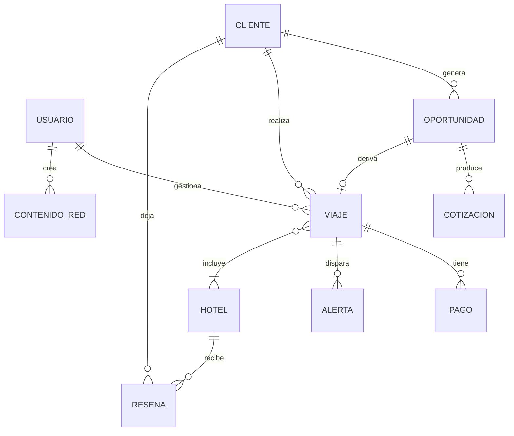

# DGM-ER

tags:: #tipo/diagrama #estado/borrador #pc/pc1

> Modelo entidad-relación para **PostgreSQL**. Salida del [[MOC — Modelo de dominio|modelo de dominio]]; mantener sincronizado con las notas de entidad.

## Pendiente
- Tabla intermedia Viaje–Hotel (N:M). Claves foráneas y tipos. `#accion/decidir`
