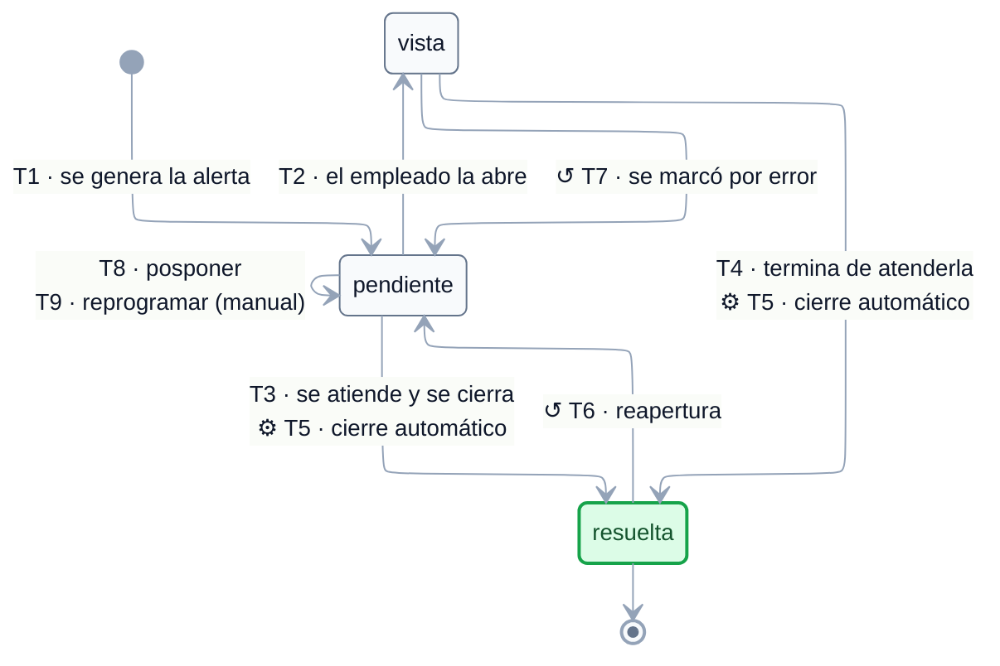

# EST-Alerta — Especificación de estados

tags:: #tipo/diagrama #estado/borrador #pc/pc1

> **Especificación** del ciclo de vida de [[Alerta]], lista para dibujar. Derivada de [[CU-14 Ver y atender alertas del día]], [[CU-28 Crear recordatorio manual]], [[CU-12 Registrar cobro de un pago]], [[CU-11 Definir plan de cuotas]], [[CU-05 Seguir oportunidad]] y [[CU-27 Cancelar viaje]]. El enum vive en [[DGM — Diagrama de clases]] (`EstadoAlerta`).
>
> ✅ **Diagrama dibujado el 21/09/26** (Nahuel) sobre esta especificación, con los 5 huecos ya resueltos incorporados. Sigue en `borrador`: se ratifica en la sync junto con el resto.
>
> ✅ **El diagrama va con 3 estados.** La contradicción con [[CU-14 Ver y atender alertas del día]] (el estado `vencida`) se resolvió el 21/09: era un filtro de la vista, no un estado. Ver hueco 1.

## Convenciones del diagrama

El diagrama de abajo se dibujó el 21/09/26 siguiendo estas convenciones, comunes a los seis `EST-*`:

1. **Motor ELK** (`nodePlacementStrategy: BRANDES_KOEPF`), líneas ortogonales, paleta slate y Segoe UI — igual que [[DGM — Diagrama de clases]] y [[DGM-ER]].
2. **Cada flecha lleva `Tn · <evento>`**: el evento disparador y, delante, el código de la fila correspondiente en la tabla de *Transiciones*, para poder cruzar diagrama ↔ tabla (actor, CU, guarda y efectos completos).
3. **Símbolos en la etiqueta:** `⚙` = transición **automática** del sistema (sin acción humana) · `↺` = **corrección o reversión** de un error de carga · sin símbolo = acción de una persona dentro del flujo normal. Acá aparecen los dos: `⚙` en T5 y `↺` en T6 y T7.
4. **Dos disparadores con el mismo salto van en una sola flecha, con las dos etiquetas** (T3 y T5 hacia `resuelta`; T8 y T9 sobre `pendiente`): es el mismo cambio de estado, cambia el motivo.
5. **Color de los estados:** verde = cierre (terminal). Esta máquina no tiene bajas lógicas ni estados de atraso, así que no usa rojo ni ámbar.

> ℹ️ Las automáticas y las correcciones se distinguen por símbolo y no por estilo de línea porque **Mermaid no permite estilar flechas individuales en `stateDiagram-v2`**: `linkStyle` se parsea sin error pero no se aplica (verificado renderizando). El color sí funciona sobre los estados, vía `classDef`.

## Estados

| Estado | Significado | Cómo se entra | ¿Terminal? |
|---|---|---|---|
| `pendiente` | Agendada y **sin atender**. Aparece en la agenda del día. | Estado inicial: la crea cualquiera de los generadores de T1 | No |
| `vista` | El empleado **la miró** pero todavía no la dio por cerrada. | [[CU-14 Ver y atender alertas del día]] paso 5 | No |
| `resuelta` | **Cerrada**: se hizo lo que había que hacer, o el evento que la motivaba dejó de aplicar. | [[CU-14 Ver y atender alertas del día]] paso 5, o automáticamente por otro CU | **Sí** (reversible, T6) |

**Estado inicial:** `pendiente`.
**Estado final:** `resuelta`.

## Transiciones

| # | Origen | Destino | Evento / disparador | Actor | CU | Guarda / condición | Efectos colaterales |
|---|---|---|---|---|---|---|---|
| T1 | *(inicial)* | `pendiente` | Se genera la alerta. **Siete orígenes** según el `tipo` (ver tabla de abajo) | sistema o empleado | varios | — | Queda en la agenda del propietario ([[CU-14 Ver y atender alertas del día]]) |
| T2 | `pendiente` | `vista` | El empleado **abre** la alerta y la marca como vista | empleado | [[CU-14 Ver y atender alertas del día]] paso 5 | — | — |
| T3 | `pendiente` | `resuelta` | El empleado la atiende y **la cierra directamente** | empleado | [[CU-14 Ver y atender alertas del día]] paso 5 | — | — |
| T4 | `vista` | `resuelta` | El empleado **termina** de atenderla | empleado | [[CU-14 Ver y atender alertas del día]] paso 5 | Confirmada el 21/09 | — |
| T5 | `pendiente` · `vista` | `resuelta` | **Cierre automático**: el evento que la motivaba se cumplió o dejó de aplicar | **sistema** | ver tabla de cierres automáticos | — | Ninguno |
| T6 | `resuelta` | `pendiente` | **Reapertura**: se revirtió el hecho que la había cerrado | sistema | [[CU-12 Registrar cobro de un pago]] A3 · [[CU-27 Cancelar viaje]] A3 | Aplica a **cualquier `tipo`** (generalizada el 21/09): si se deshace el cobro o la cancelación, la alerta vuelve | El [[Pago]] vuelve a `pendiente`/`vencido`, o el [[Viaje]] a su estado previo |
| T7 | `vista` | `pendiente` | **Corrección**: el empleado la había marcado por error | empleado | — *(sumado el 21/09)* | — | Se marca con `↺` en el diagrama (es corrección, no flujo) |
| T8 | `pendiente` | *(se mantiene)* | **Posponer**: el empleado reprograma la `fecha` a un día posterior | empleado | [[CU-14 Ver y atender alertas del día]] A4 | — | **No cambia el estado.** Dibujar como auto-transición |
| T9 | `pendiente` | *(se mantiene)* | **Reprogramar/editar** una alerta `manual` (fecha o descripción) | empleado | [[CU-28 Crear recordatorio manual]] A2 | Solo mientras esté `pendiente` | **No cambia el estado.** Auto-transición |

### Los siete orígenes de T1

| `tipo` | Quién la genera | CU |
|---|---|---|
| `pago` | Al definir el plan de cuotas: **una por cada [[Pago]]**, con aviso un mes antes. También el vencimiento de pago a proveedor por hotel. | [[CU-11 Definir plan de cuotas]] paso 6 · [[CU-09 Armar itinerario de hoteles]] |
| `formulario` | Al confirmar la reserva, según los [[RequisitoDestino|requisitos del destino]] | [[CU-07 Confirmar reserva]] paso 4 · [[CU-15 Configurar recordatorios por destino]] |
| `salida` | Al confirmar la reserva, con anticipación configurable (**default 7 días** ⚠️ sin validar) | [[CU-07 Confirmar reserva]] paso 4 |
| `insistencia` | Al agendar un recontacto sobre una [[Oportunidad]] | [[CU-05 Seguir oportunidad]] paso 4 |
| `reseña` | Al pasar el [[Viaje]] a `finalizado` | [[CU-08 Gestionar estado del viaje]] paso 5 |
| `manual` | La crea el empleado a mano | [[CU-28 Crear recordatorio manual]] paso 4 |
| `recontacto` | Cliente fiel inactivo (≈ 6 meses, configurable) | [[CU-30 Sugerir recontacto de clientes]] |

### Los cierres automáticos de T5

| Qué pasa | Qué alertas cierra | CU |
|---|---|---|
| Se **cobra** un [[Pago]] | La de vencimiento de ese pago | [[CU-12 Registrar cobro de un pago]] paso 4 |
| Se **anula** un [[Pago]] del plan | La de ese pago | [[CU-11 Definir plan de cuotas]] A4 |
| Se **cierra** una [[Oportunidad]] (`ganada` o `perdida`) | Las de `insistencia` pendientes | [[CU-05 Seguir oportunidad]] paso 7 |
| Se **cancela** un [[Viaje]] | Todas las vigentes de ese viaje | [[CU-27 Cancelar viaje]] paso 4 |

## Invariantes y reglas

- **Fase 1: aviso interno, envío manual.** La alerta se genera **dentro del sistema**; el mensaje al pasajero (WhatsApp) lo manda **una persona** cuando decide. La automatización de WhatsApp está **fuera de PC1** ([[Alcance y fuera de alcance]]).
- **El `tipo` es inmutable**: se fija al crearla y no cambia. No es un estado.
- **Visibilidad por propietario:** cada empleado ve **sus** alertas (agenda del día); `admin` y `dueño` ven las de toda la empresa ([[CU-14 Ver y atender alertas del día]] A1, [[DEC-0005 Autenticación y modelo de roles]]).
- Una alerta `manual` puede quedar **suelta**, sin asociación a ninguna entidad ([[CU-28 Crear recordatorio manual]] A1).
- El listado de la agenda se ordena por `fecha` ([[CU-14 Ver y atender alertas del día]] paso 2).

## Para qué se creó cada transición poco obvia

> 📌 Los ejemplos de abajo son **ilustrativos**, para que se entienda en qué situación se pensó cada transición. **No son casos reales de la agencia ni salen del relevamiento**: sirven para leer el diagrama, no como fuente de verdad ([[Relevamiento — Fuente de verdad]] manda).

### `⚙ T5` — la alerta se cierra sola porque ya no tiene sentido
**Situación.** Una cuota vence el 10/10 y tiene su alerta agendada para el 10/09. El cliente paga por adelantado el 02/09.
**Qué pasa.** Al registrar el cobro, el sistema **resuelve la alerta solo** ([[CU-12 Registrar cobro de un pago]] paso 4). Nadie la marca a mano.
**Por qué existe.** Sin T5, la agenda del día se llenaría de recordatorios de cosas **ya hechas**, y el empleado tendría que cerrarlas una por una. Los otros tres casos son los mismos: anular una cuota, cerrar una [[Oportunidad]] (cierra sus `insistencia`) y cancelar un [[Viaje]] (cierra todas las suyas).
**Por qué comparte flecha con T3/T4.** Llegan al mismo estado: cambia **quién** lo dispara, no a dónde va.

### `↺ T6 — resuelta → pendiente` — la alerta que vuelve
**Situación.** Se marca cobrada la cuota de septiembre y su alerta se cierra sola. A los tres días se ve que la transferencia nunca entró y se revierte el cobro ([[CU-12 Registrar cobro de un pago]] A3).
**Qué pasa.** La cuota vuelve a `pendiente`/`vencido` **y su alerta se reabre**. Si no, quedaría una deuda viva sin nadie avisando de ella.
**Por qué se generalizó a cualquier `tipo`.** Vale igual para la cancelación revertida de un [[Viaje]] ([[CU-27 Cancelar viaje]] A3, que repone las alertas). La regla es una sola: **si se deshace el hecho que cerró la alerta, la alerta vuelve** (hueco 4).

### `↺ T7 — vista → pendiente` — se marcó por error
**Situación.** El empleado abre la agenda, clickea la alerta equivocada y queda marcada como `vista`.
**Por qué existe.** Sin T7 esa alerta quedaría marcada para siempre sin haberla mirado en serio, y podría perderse entre las ya atendidas.
**Qué no es.** No es "volver a atenderla más tarde" — eso es **posponer** (T8), que cambia la fecha y la deja `pendiente`.

### T8 y T9 — posponer y reprogramar **no** mueven el estado
**Situación (T8).** Llega la alerta de un formulario, el empleado llama, no atienden, la patea al día siguiente ([[CU-14 Ver y atender alertas del día]] A4).
**Situación (T9).** Un recordatorio `manual` al que hay que corregirle la fecha o el texto ([[CU-28 Crear recordatorio manual]] A2).
**Por qué se dibujan aunque no cambien nada.** Para dejar explícito que **son acciones válidas sobre una alerta abierta**. Si no estuvieran, alguien podría pensar que hay que cerrarla y crear otra, y se perdería el historial de que se intentó.

### Por qué **no** hay estado `vencida`
**Situación.** Una alerta de formulario agendada para el 05/09 sigue sin atenderse el 12/09.
**Qué pasa.** **Sigue `pendiente`.** Aparece más arriba en la agenda del día porque el listado se ordena por `fecha`, y nada más.
**Por qué no se agregó el estado** (a diferencia de [[Pago]], donde sí existe `vencido`). En el [[Pago]] el atraso tiene **consecuencia de negocio**: cambia si la cuota está en mora, y de eso dependen la deuda y los reclamos. En la [[Alerta]] el atraso no cambia nada: la tarea sigue siendo la misma, solo es más urgente. Un estado que no cambia ninguna regla es un estado de más. Se corrigió [[CU-14 Ver y atender alertas del día]], que lo nombraba por error (hueco 1).

## Huecos y ambigüedades — resueltos el 21/09

Se detectaron al especificar y **Nahuel los resolvió el mismo día**. Quedan **a ratificar en la sync**; lo que dice acá ya es lo que hay que dibujar.

1. ✅ **Resuelto 21/09 (Nahuel): el enum se queda con 3 estados, no se agrega `vencida`.** [[CU-14 Ver y atender alertas del día]] paso 2 decía que el sistema lista las alertas *"vigentes (`pendiente` y `vencida`)"*, pero `EstadoAlerta` es `pendiente · vista · resuelta`. Se resolvió que **"vencida" era un filtro de la vista, no un estado**: una [[Alerta]] que pasó su `fecha` sin atenderse **sigue `pendiente`** (por eso aparece en la agenda del día, más arriba en el orden), y el ciclo cierra igual en `resuelta`. **A diferencia de [[Pago]], la [[Alerta]] no necesita un estado de atraso**: el `Pago` lo necesita porque el atraso tiene consecuencias de negocio (exigibilidad), mientras que en la alerta el atraso es solo un criterio de orden. Se corrigió la redacción de [[CU-14 Ver y atender alertas del día]]. **El diagrama se dibuja con 3 estados.**
2. ✅ **Resuelto 21/09 (Nahuel): T4 (`vista → resuelta`) existe.** Es lo lógico: si no, `vista` sería un callejón sin salida. El "`vista` **o** `resuelta`" del paso 5 de [[CU-14 Ver y atender alertas del día]] son dos formas de cerrar el paso, no alternativas excluyentes del ciclo.
3. ✅ **Resuelto 21/09 (Nahuel): sí, `vista` se puede desmarcar.** Se agrega `vista → pendiente` como **corrección** (**T7** en la tabla), para el caso de que el empleado la marque por error.
4. ✅ **Resuelto 21/09 (Nahuel): la reapertura aplica a cualquier `tipo`, no solo a `pago`.** Sigue la misma regla que el resto: **si se revierte el hecho que cerró la alerta, la alerta se reabre**. Vale para el cobro revertido ([[CU-12 Registrar cobro de un pago]] A3) y también para la cancelación revertida de un [[Viaje]] ([[CU-27 Cancelar viaje]] A3, "se reponen sus [[Alerta|Alertas]]"). T6 queda generalizada en la tabla de arriba.
5. ✅ **Resuelto 21/09 (Nahuel): `resuelta` no se desdobla.** No se diferencia "la atendí" de "ya no aplicaba": no hay ningún reporte que lo pida y agregar un estado más solo complica el modelo. Si en algún momento quieren un **reporte de cumplimiento** (cuántas alertas se atendieron de verdad), se reabre — queda anotado como **posible fase 2**.

## Diagrama

**Leyenda:** `⚙` automática del sistema · `↺` corrección/reversión · sin símbolo, acción de una persona. 🟩 `resuelta` = cerrada. El texto completo de cada evento, con actor, CU, guarda y efectos, está en la tabla de *Transiciones*.

**Lo que el diagrama deja ver de un vistazo:**
- **Son 3 estados, no 4.** No existe `vencida`: una [[Alerta]] que pasó su `fecha` sigue `pendiente` y solo sube en el orden de la agenda. El atraso es un **filtro de la vista**, no un estado (hueco 1) — al revés que en [[EST-Pago]], donde el atraso sí cambia si la cuota es exigible.
- **`vista` no es obligatorio.** Se puede cerrar directo desde `pendiente` (T3): el estado intermedio existe para la alerta que se miró y quedó a medio atender.
- **Hacia `resuelta` llegan dos caminos por flecha**: lo hace una persona (T3/T4) o lo hace el sistema al cumplirse el evento (`⚙ T5`).
- **`resuelta` no es del todo terminal**: `↺ T6` la reabre si se revierte el hecho que la cerró. Es la misma regla que rige a [[Pago]] y [[Viaje]] — **si se deshace la causa, se deshace el efecto**.
- **Las auto-transiciones sobre `pendiente`** (T8 y T9) muestran que posponer o reprogramar **no mueve la alerta de estado**: sigue pendiente, con otra fecha.
- El `tipo` (`pago`, `formulario`, `salida`…) **no está en el diagrama a propósito**: es un atributo fijo que se define al crearla. Determina quién la genera y qué se hace al atenderla, no por qué estados pasa.

## Fuentes

- Entidad: [[Alerta]] · enum `EstadoAlerta` en [[DGM — Diagrama de clases]]
- CU generadores: [[CU-05 Seguir oportunidad]] · [[CU-07 Confirmar reserva]] · [[CU-08 Gestionar estado del viaje]] · [[CU-09 Armar itinerario de hoteles]] · [[CU-11 Definir plan de cuotas]] · [[CU-28 Crear recordatorio manual]] · [[CU-30 Sugerir recontacto de clientes]]
- CU que la atienden o cierran: [[CU-14 Ver y atender alertas del día]] · [[CU-12 Registrar cobro de un pago]] · [[CU-27 Cancelar viaje]]
- Decisiones: [[DEC-0005 Autenticación y modelo de roles]]
