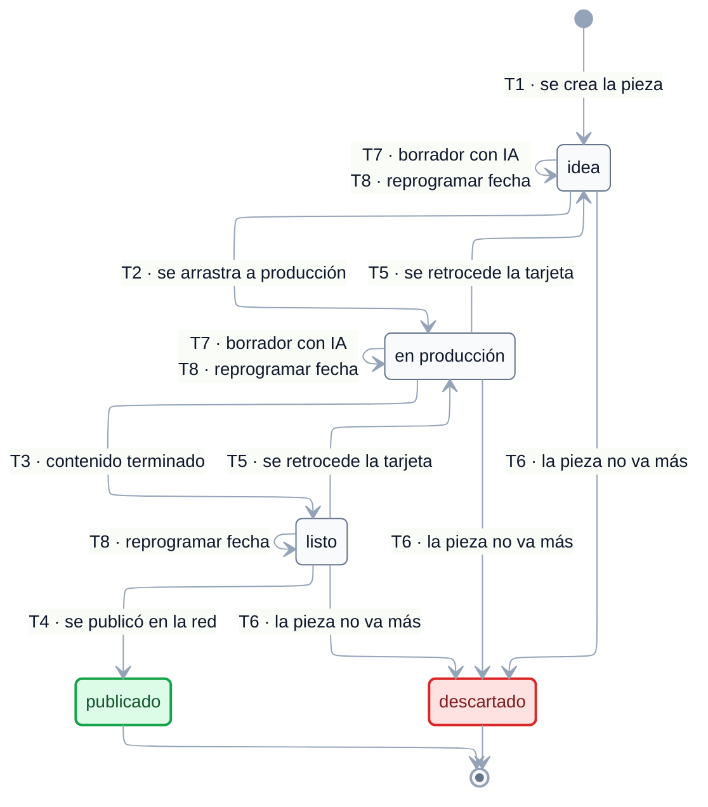

# EST-ContenidoRed — Especificación de estados

tags:: #tipo/diagrama #estado/formalizado #pc/pc1

> **Especificación** del flujo kanban de [[ContenidoRed]], lista para dibujar. Derivada de [[CU-19 Planificar contenido en redes]] y [[CU-20 Generar propuesta de contenido con IA]]. El enum vive en [[DGM — Diagrama de clases]] (`EstadoKanban`).
>
> ✅ **Diagrama dibujado el 21/09/26** (Nahuel) sobre esta especificación, con los 4 huecos ya resueltos incorporados. ✅ **Ratificado en la sync del 29/09/26** (Francisco, Nahuel y Paloma).

## Convenciones del diagrama

El diagrama de abajo se dibujó el 21/09/26 siguiendo estas convenciones, comunes a los seis `EST-*`:

1. **Motor ELK** (`nodePlacementStrategy: BRANDES_KOEPF`), líneas ortogonales, paleta slate y Segoe UI — igual que [[DGM — Diagrama de clases]] y [[DGM-ER]].
2. **Cada flecha lleva `Tn · <evento>`**: el evento disparador y, delante, el código de la fila correspondiente en la tabla de *Transiciones*, para poder cruzar diagrama ↔ tabla (actor, CU, guarda y efectos completos).
3. **Los orígenes múltiples se dibujan desplegados.** T5 (retroceso) y T6 (descarte) tienen una flecha por cada columna de origen; el diagrama es así literal y no hay que interpretarlo.
4. **Dos disparadores con el mismo salto van en una sola flecha, con las dos etiquetas** (T7 y T8 sobre `idea` y `en producción`): es el mismo cambio de estado, cambia el motivo.
5. **Sin símbolos `⚙` ni `↺`.** Es la única de las seis máquinas donde **el sistema nunca cambia el estado por su cuenta** y donde el retroceso (T5) es **flujo normal de un kanban**, no la corrección de un error. Todas las flechas son acciones de una persona.
6. **Color de los estados:** verde = cierre exitoso (`publicado`) · rojo = baja lógica (`descartado`).
7. **Los cinco estados se declaran en orden antes de las transiciones**, para que ELK dibuje la cascada del tablero de arriba abajo; sin eso el retroceso del kanban le daba vuelta el orden de las columnas.

> ℹ️ En los otros cinco diagramas las automáticas y las correcciones se distinguen por símbolo y no por estilo de línea, porque **Mermaid no permite estilar flechas individuales en `stateDiagram-v2`** (`linkStyle` se parsea sin error pero no se aplica). Acá no hace falta: no hay ninguna de las dos.

## Estados

| Estado | Significado | Cómo se entra | ¿Terminal? |
|---|---|---|---|
| `idea` | Pieza anotada, **sin producir**. Primera columna del tablero. | Estado inicial: la crea [[CU-19 Planificar contenido en redes]] paso 2 | No |
| `en producción` | Se está **armando** el contenido (texto, imágenes). | El empleado mueve la tarjeta ([[CU-19 Planificar contenido en redes]] paso 3) | No |
| `listo` | Contenido **terminado**, esperando su fecha de publicación. | El empleado mueve la tarjeta | No |
| `publicado` | Ya se **publicó manualmente** en la red. | El empleado mueve la tarjeta después de publicar ([[CU-19 Planificar contenido en redes]] A3) | **Sí** |
| `descartado` ⚠️ | **Baja lógica**: la pieza no va más. Se conserva el registro, no se borra. | El empleado la descarta desde cualquier columna previa a `publicado` | **Sí** |

**Estado inicial:** `idea`.
**Estados finales:** `publicado` y `descartado`.

> ⚠️ **`descartado` es nuevo (21/09, Nahuel).** `EstadoKanban` pasa de 4 a **5 valores**. Motivo: hoy la única forma de sacar una idea que no sirve sería borrarla físicamente, lo que rompe el criterio de **baja lógica** que el equipo aplicó a [[Hotel]], [[Reseña]], [[Destino]] y [[Operador]].

> Es un **flujo kanban**, no una máquina de estados de negocio: los estados son columnas de un tablero que mueve una persona. No hay transiciones automáticas ni disparadas por el sistema. Es la única de las seis máquinas donde **el sistema nunca cambia el estado por su cuenta**.

## Transiciones

| # | Origen | Destino | Evento / disparador | Actor | CU | Guarda / condición | Efectos colaterales |
|---|---|---|---|---|---|---|---|
| T1 | *(inicial)* | `idea` | El empleado crea una pieza con **título/idea**, **canal** y **fecha de publicación** programada | empleado | [[CU-19 Planificar contenido en redes]] paso 2 | — | Aparece en la primera columna del tablero y en el calendario |
| T2 | `idea` | `en producción` | El empleado **arrastra la tarjeta** a la siguiente columna | empleado | [[CU-19 Planificar contenido en redes]] paso 3 | — | — |
| T3 | `en producción` | `listo` | El empleado arrastra la tarjeta | empleado | [[CU-19 Planificar contenido en redes]] paso 3 | El contenido está terminado | — |
| T4 | `listo` | `publicado` | El empleado **publicó manualmente** en la red y mueve la tarjeta | empleado | [[CU-19 Planificar contenido en redes]] A3 | **Rumbo no publica por sí mismo** ([[Alcance y fuera de alcance]]) | — |
| T5 | `en producción` · `listo` | *columna anterior* | El empleado **retrocede** la tarjeta | empleado | [[CU-19 Planificar contenido en redes]] paso 3 | Confirmado el 21/09: el kanban se arrastra en **las dos direcciones** | — |
| T6 | `idea` · `en producción` · `listo` | `descartado` | La pieza **no va más** | empleado | — *(sumado el 21/09)* | **Baja lógica**: no se borra físicamente. **No** sale desde `publicado` | — |
| T7 | `idea` · `en producción` | *(se mantiene)* | **Generar un borrador con IA** y guardarlo en la pieza | empleado + servicio de IA (Claude) | [[CU-20 Generar propuesta de contenido con IA]] / [[CU-19 Planificar contenido en redes]] A1 | Solo desde `idea` o `en producción` | **No cambia el estado.** Dibujar como auto-transición. La IA usa solo tema/canal/tono: **no accede a datos del negocio** |
| T8 | `idea` · `en producción` · `listo` | *(se mantiene)* | **Reprogramar** la fecha de publicación | empleado | [[CU-19 Planificar contenido en redes]] A2 | — | **No cambia el estado**; se actualiza el calendario |

## Invariantes y reglas

- **Sin publicación automática.** El sistema planifica y organiza; **la publicación en la red la hace una persona** ([[Alcance y fuera de alcance]]). Por eso T4 la ejecuta el empleado *después* de publicar, no antes.
- **La IA propone, la persona decide.** [[CU-20 Generar propuesta de contenido con IA]] genera **borradores** que el empleado revisa y edita; nada se guarda sin intervención humana (A2: si ninguna propuesta sirve, no se guarda nada).
- **La IA no accede a datos del negocio** (clientes, catálogo, ventas): solo usa el tema, canal y tono que indica el empleado ([[CU-20 Generar propuesta de contenido con IA]] paso 3).
- La pieza tiene un `canal` (`instagram · tiktok · whatsapp_ventas`) que **no** es parte de la máquina de estados.
- La gestión **no está restringida a un rol**: cualquier empleado con acceso al módulo puede mover tarjetas ([[DEC-0005 Autenticación y modelo de roles]]).

## Para qué se creó cada transición poco obvia

> 📌 Los ejemplos de abajo son **ilustrativos**, para que se entienda en qué situación se pensó cada transición. **No son casos reales de la agencia ni salen del relevamiento**: sirven para leer el diagrama, no como fuente de verdad ([[Relevamiento — Fuente de verdad]] manda).

### T5 — retroceder la tarjeta
**Situación.** Una pieza sobre Brasil pasa a `listo` y, al releerla, se ve que los precios que menciona quedaron viejos. Vuelve a `en producción` para reescribirla.
**Por qué es flujo normal y no una corrección.** En un kanban las tarjetas se arrastran para los dos lados: no es que alguien se equivocó al cargar, es que el trabajo volvió atrás. Por eso T5 **no lleva `↺`**, a diferencia de las correcciones de [[EST-Viaje]] o [[EST-Pago]].
**Alcance.** Solo entre las tres columnas activas. De `publicado` no se vuelve.

### T6 — descartar en vez de borrar
**Situación.** Se anota una idea para una promo de invierno que finalmente no se hace.
**Qué pasa.** Pasa a `descartado` y **queda registrada**. No se borra.
**Por qué se agregó el estado.** Antes la única forma de sacar una idea del tablero era **borrarla físicamente**, lo que rompía el criterio de **baja lógica** que el equipo ya había aplicado a [[Hotel]], [[Reseña]], [[Destino]] y [[Operador]]. Era la única entidad del vault sin forma de darse de baja sin perder el dato (hueco 2).
**Límite.** No sale desde `publicado`: lo que ya salió en la red, salió.

### T7 — pedirle un borrador a la IA no mueve la tarjeta
**Situación.** Una pieza en `idea` sobre "escapadas de fin de semana". El empleado le pide a la IA tres propuestas de copy, elige una y la guarda en la tarjeta.
**Por qué es auto-transición.** Generar el borrador **no avanza el trabajo de columna**: la pieza sigue donde estaba hasta que una persona decida moverla. Si la IA moviera la tarjeta sola, estaría decidiendo por el equipo.
**Límites importantes.** La IA **propone, no publica ni decide** ([[CU-20 Generar propuesta de contenido con IA]]), y **no accede a datos del negocio** — clientes, ventas ni catálogo: solo usa el tema, el canal y el tono que le indica el empleado. Si ninguna propuesta sirve, no se guarda nada (A2).

### T4 — publicar es un registro, no una acción del sistema
**Situación.** Llega la fecha, el empleado entra a Instagram desde el celular, sube el posteo y después mueve la tarjeta a `publicado`.
**Por qué el orden importa.** Rumbo **no publica en redes** ([[Alcance y fuera de alcance]]). La tarjeta se mueve **después** de publicar, para dejar constancia de un hecho que ya pasó afuera del sistema. Si alguien mueve la tarjeta antes, el tablero miente.
**Relacionado.** Por eso tampoco se generó una [[Alerta]] de "pieza programada para hoy sin publicar": se evaluó y se descartó por no estar en el relevamiento (hueco 4).

## Huecos y ambigüedades — resueltos el 21/09

Se detectaron al especificar y **Nahuel los resolvió el mismo día**. Quedan **a ratificar en la sync**; lo que dice acá ya es lo que hay que dibujar.

1. ✅ **Resuelto 21/09 (Nahuel): sí, se puede retroceder.** Es un tablero kanban y se arrastra en las dos direcciones (ej. una pieza `listo` que hay que rehacer vuelve a `en producción`). **Para dibujar:** flechas **bidireccionales** entre `idea`, `en producción` y `listo`. T5 queda confirmada.
2. ✅ **Resuelto 21/09 (Nahuel): se suma `descartado` al enum.** Es el único cambio de modelo de esta máquina. Motivo: hoy la única forma de sacar una idea que no sirve sería **borrarla físicamente**, lo que rompe el criterio de **baja lógica** que el equipo aplicó a [[Hotel]], [[Reseña]], [[Destino]] y [[Operador]]. `EstadoKanban` pasa a `idea · en producción · listo · publicado · descartado`. Ver la transición **T6**.
3. ✅ **Resuelto 21/09 (Nahuel): `publicado` es terminal.** No se modela despublicar: Rumbo **no publica** ([[Alcance y fuera de alcance]]), así que tampoco despublica. Si hiciera falta rehacer una pieza ya publicada, se crea una nueva.
4. ✅ **Resuelto 21/09 (Nahuel): no hace falta aviso por `fecha_publicacion`.** Se evaluó generar una [[Alerta]] del tipo "pieza programada para hoy sin publicar" y **se descartó**: no está en el relevamiento y no lo pidieron. La `fecha_publicacion` sigue siendo solo informativa para el calendario. Si más adelante la agencia lo pide, se reabre.

## Diagrama

**Leyenda:** todas las flechas son acciones de una persona — acá el sistema nunca mueve una tarjeta. 🟩 `publicado` = salió en la red · 🟥 `descartado` = baja lógica, no se borra. El texto completo de cada evento, con actor, CU, guarda y efectos, está en la tabla de *Transiciones*.

**Lo que el diagrama deja ver de un vistazo:**
- **Es un tablero, no una máquina de negocio.** Las tres primeras columnas se recorren **en los dos sentidos** (T2/T3 para avanzar, T5 para retroceder): una pieza `listo` que hay que rehacer vuelve a `en producción` (hueco 1).
- **`descartado` recibe tres flechas y `publicado` una sola.** Se puede descartar desde cualquier columna previa, pero solo se publica desde `listo`.
- **De `publicado` no sale nada.** Rumbo **no publica** en la red, así que tampoco despublica: si hay que rehacer una pieza ya salida, se crea otra (hueco 3).
- **Ninguna flecha la dispara el sistema.** Es la única de las seis así. `T4` la ejecuta el empleado **después** de haber publicado a mano: el sistema registra el hecho, no lo produce.
- **Las auto-transiciones** muestran que pedirle un borrador a la IA (T7) o correr la fecha de publicación (T8) **no mueven la tarjeta de columna**.

> ✅ **Precisión sobre T8 (sync 29/09).** Reprogramar la fecha aplica solo a las tres columnas activas (`idea`, `en producción`, `listo`): sobre algo ya `publicado` o `descartado` no tiene sentido. La fila T8 ya lo dice.

## Fuentes

- Entidad: [[ContenidoRed]] · enum `EstadoKanban` en [[DGM — Diagrama de clases]]
- CU: [[CU-19 Planificar contenido en redes]] · [[CU-20 Generar propuesta de contenido con IA]]
- Decisiones: [[DEC-0001 Stack tecnológico]] (la IA del producto es Claude) · [[DEC-0005 Autenticación y modelo de roles]]
- Alcance: [[Alcance y fuera de alcance]] (sin publicación automática)
