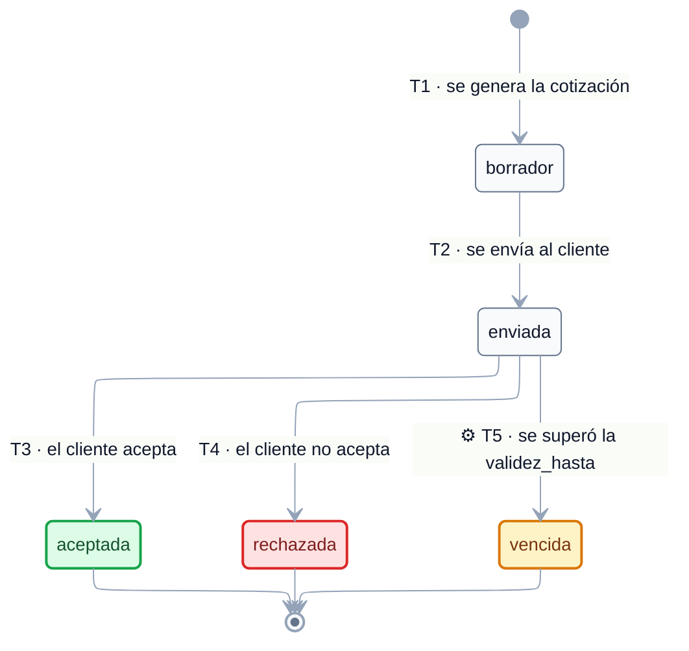

# EST-Cotización — Especificación de estados

tags:: #tipo/diagrama #estado/borrador #pc/pc1

> **Especificación** del ciclo de vida de [[Cotización]], lista para dibujar. Derivada de [[CU-06 Emitir cotización]] y [[CU-07 Confirmar reserva]]. El enum vive en [[DGM — Diagrama de clases]] (`EstadoCotizacion`).
>
> ✅ **Diagrama dibujado el 21/09/26** (Nahuel) sobre esta especificación, con los 4 huecos ya resueltos incorporados. Sigue en `borrador`: se ratifica en la sync junto con el resto, y el **default de 1 mes de vigencia sigue sin validar con la agencia**.

## Convenciones del diagrama

El diagrama de abajo se dibujó el 21/09/26 siguiendo estas convenciones, comunes a los seis `EST-*`:

1. **Motor ELK** (`nodePlacementStrategy: BRANDES_KOEPF`), líneas ortogonales, paleta slate y Segoe UI — igual que [[DGM — Diagrama de clases]] y [[DGM-ER]].
2. **Cada flecha lleva `Tn · <evento>`**: el evento disparador y, delante, el código de la fila correspondiente en la tabla de *Transiciones*, para poder cruzar diagrama ↔ tabla (actor, CU, guarda y efectos completos).
3. **Símbolos en la etiqueta:** `⚙` = transición **automática** del sistema (sin acción humana) · `↺` = **corrección o reversión** de un error de carga · sin símbolo = acción de una persona dentro del flujo normal. Acá solo aparece `⚙`, en T5.
4. **Color de los estados:** verde = cierre exitoso (terminal) · rojo = cierre sin venta · ámbar = vencimiento.

> ℹ️ Las automáticas y las correcciones se distinguen por símbolo y no por estilo de línea porque **Mermaid no permite estilar flechas individuales en `stateDiagram-v2`**: `linkStyle` se parsea sin error pero no se aplica (verificado renderizando). El color sí funciona sobre los estados, vía `classDef`.

## Estados

| Estado | Significado | Cómo se entra | ¿Terminal? |
|---|---|---|---|
| `borrador` | El documento está generado pero **todavía no se envió** al cliente. | Estado inicial: lo crea [[CU-06 Emitir cotización]] paso 3 | No |
| `enviada` | Se le pasó al cliente (por WhatsApp o email, **fuera del sistema**) y el empleado la marcó como enviada. | [[CU-06 Emitir cotización]] paso 4 | No |
| `aceptada` | El cliente aceptó. **Habilita confirmar la reserva.** | [[CU-06 Emitir cotización]] A2 | **Sí** |
| `rechazada` | El cliente no aceptó. | [[CU-06 Emitir cotización]] A3 | **Sí** |
| `vencida` ⚠️ | Pasó su `validez_hasta` sin que el cliente se decidiera. Los precios ya no se sostienen. | **Proceso automático del sistema** | **Sí** |

**Estado inicial:** `borrador`.
**Estados finales:** `aceptada`, `rechazada` y `vencida`.

> ⚠️ **`vencida` es nuevo (21/09, Nahuel).** El enum pasa de 4 a **5 valores** y [[Cotización]] gana el atributo **`validez_hasta`**. Motivo: en turismo los precios cambian, así que una cotización no puede quedar vigente para siempre. **Default: 1 mes** desde la `fecha` de emisión, como parámetro global configurable por `admin` (mismo patrón que la anticipación de la [[Alerta]] `salida`). ⚠️ **El valor de 1 mes es una propuesta de Nahuel, sin validar con la agencia** — igual que se hizo con `forma_pago` y los 7 días de `salida`. #accion/decidir

## Transiciones

| # | Origen | Destino | Evento / disparador | Actor | CU | Guarda / condición | Efectos colaterales |
|---|---|---|---|---|---|---|---|
| T1 | *(inicial)* | `borrador` | El empleado genera la cotización desde una **plantilla + formulario** | empleado | [[CU-06 Emitir cotización]] pasos 1-3 | Existe una [[Oportunidad]]; se cargan `moneda`, ítems y el sistema calcula el `total` | Se genera el **documento** y queda asociada a la [[Oportunidad]] |
| T2 | `borrador` | `enviada` | El empleado **envía** la cotización al cliente y la marca como enviada | empleado | [[CU-06 Emitir cotización]] paso 4 | El envío ocurre **por fuera del sistema** (WhatsApp/email); el sistema solo registra el hecho | La [[Oportunidad]] pasa a `cotizada` ([[EST-Oportunidad]] T3) |
| T3 | `enviada` | `aceptada` | El cliente **acepta** | empleado (lo registra) | [[CU-06 Emitir cotización]] A2 | — | Habilita [[CU-07 Confirmar reserva]]; la `moneda` de esta cotización queda como **moneda de referencia del [[Viaje]]**; la [[Oportunidad]] se cierra `ganada` |
| T4 | `enviada` | `rechazada` | El cliente **no acepta** | empleado (lo registra) | [[CU-06 Emitir cotización]] A3 | — | El seguimiento continúa o la [[Oportunidad]] se cierra `perdida` ([[CU-05 Seguir oportunidad]]) |
| T5 | `enviada` | `vencida` | **Pasó la `validez_hasta`** sin respuesta del cliente | **sistema** (proceso automático) | *ninguno* — no es un CU con actor | Solo desde `enviada`: un `borrador` nunca vence porque el cliente no lo vio | La [[Oportunidad]] **no cambia de estado** (sigue `cotizada`). Para retomar hay que emitir una cotización nueva |

## Invariantes y reglas

- **Cotizador asistido, no automático.** Los precios los carga el empleado; **no hay scraping** ni integración con proveedores ([[Alcance y fuera de alcance]]).
- **Una [[Oportunidad]] puede tener varias [[Cotización|Cotizaciones]]**: cada revisión es una **nueva** `Cotización` (nueva instancia, nueva máquina de estados), y la anterior **queda en el historial** ([[CU-06 Emitir cotización]] A1). Esto es importante para dibujar: *versionar no es una transición*, es crear otro objeto.
- **La moneda de la cotización aceptada define la moneda de referencia del [[Viaje]]** ([[DEC-0007 Modelo económico — ganancia, margen y comisión de vendedor]]).
- **Se puede vender sin cotización.** [[CU-05 Seguir oportunidad]] A4 y [[CU-07 Confirmar reserva]] A1 permiten cerrar `ganada` sin cotización escrita: esta máquina de estados **no siempre se ejecuta**.
- El `total` lo calcula el sistema a partir de los ítems ([[CU-06 Emitir cotización]] paso 2).
- **Vigencia (21/09):** la cotización vale hasta su `validez_hasta`, por default **1 mes** desde la `fecha` de emisión. Pasada esa fecha pasa a `vencida` sola (T5) y hay que emitir una nueva. Solo vencen las `enviada`: un `borrador` no vence. ⚠️ El default de 1 mes está **sin validar con la agencia**.

## Para qué se creó cada transición poco obvia

> 📌 Los ejemplos de abajo son **ilustrativos**, para que se entienda en qué situación se pensó cada transición. **No son casos reales de la agencia ni salen del relevamiento**: sirven para leer el diagrama, no como fuente de verdad ([[Relevamiento — Fuente de verdad]] manda). Los importes son inventados.

### `⚙ T5 → vencida` — el precio de hace dos meses ya no existe
**Situación.** Se cotiza un paquete a Europa el 03/05/26 por USD 2.400. El cliente no contesta. El 20/07 reaparece con la cotización en la mano y pide que se la respeten.
**Por qué se agregó el estado.** En turismo los precios se mueven todo el tiempo: tarifas aéreas, tipo de cambio, tarifas hoteleras. Sin `vencida`, esa cotización quedaba **vigente para siempre** y el sistema no tenía forma de decir que ya no vale.
**Cómo funciona.** La [[Cotización]] tiene `validez_hasta`, por default **1 mes** desde la emisión (parámetro global que configura el `admin`). Pasada esa fecha, un proceso del sistema la pasa a `vencida` sin que nadie haga nada.
**Efecto en la [[Oportunidad]].** **Ninguno**: sigue `cotizada`. Que la cotización venza no gana ni pierde la venta — el cliente puede seguir interesado, solo hay que cotizarle de nuevo.
> ⚠️ **El default de 1 mes es una propuesta sin validar con la agencia.** Es el valor más discutible de esta nota: si trabajan con vigencias más cortas para aéreos, habría que diferenciarlas por tipo de producto. #accion/decidir

### Por qué **no** se puede aceptar un `borrador`
**Situación.** El empleado arma la cotización, se la muestra al cliente en el mostrador desde la pantalla y el cliente dice que sí en el momento. Nunca se envió nada por WhatsApp ni por mail.
**Qué hay que hacer.** Marcarla `enviada` igual y después `aceptada`. Suena burocrático, pero conserva el dato de que **el cliente la vio**, que es lo que `enviada` significa en realidad (hueco 2).
**Por qué importa.** Si se pudiera aceptar un `borrador`, no habría forma de distinguir una cotización que el cliente aprobó de una que quedó a medio hacer en el sistema.

### Por qué `rechazada` y `vencida` no vuelven atrás
**Situación.** Un cliente rechaza por precio en mayo y en junio avisa que lo está pensando de nuevo.
**Qué se hace.** Se emite una **cotización nueva**; no se reactiva la vieja ([[CU-06 Emitir cotización]] A1). La anterior queda en el historial con su estado real.
**Por qué.** Los precios de mayo ya no sirven en junio: reactivarla sería mostrar un total que la agencia no puede sostener. Es el mismo criterio que justifica `vencida`.

### La máquina que a veces no corre
**Situación.** Cliente habitual que compra por WhatsApp sin pedir cotización escrita.
**Qué pasa.** **Esta máquina de estados nunca arranca.** La [[Oportunidad]] va directo a `ganada` y el [[Viaje]] se confirma igual ([[CU-05 Seguir oportunidad]] A4, [[CU-07 Confirmar reserva]] A1).
**Por qué anotarlo.** Es la única de las seis que puede **no ejecutarse nunca** en una venta completa. Al leer el modelo conviene no asumir que toda venta pasó por acá.

## Huecos y ambigüedades — resueltos el 21/09

Se detectaron al especificar y **Nahuel los resolvió el mismo día**. Quedan **a ratificar en la sync**; lo que dice acá ya es lo que hay que dibujar.

1. ✅ **Resuelto 21/09 (Nahuel): la cotización vieja se queda `enviada`.** No se inventa un estado `reemplazada`. La **vigente es la de `fecha` más reciente**; las anteriores quedan `enviada` en el historial, que además es cierto (se enviaron). Sí, una [[Oportunidad]] puede tener varias `enviada` a la vez: es su historial de versiones, no una inconsistencia. *(Con `vencida` esto se resuelve solo en la práctica: las versiones viejas terminan venciendo por T5.)*
2. ✅ **Resuelto 21/09 (Nahuel): no se puede aceptar ni rechazar un `borrador`.** Si el cliente la aceptó es porque alguien se la mostró, así que corresponde marcarla `enviada` y después `aceptada`. Mantiene el dato de que se envió y evita saltear el registro. **Para dibujar:** de `borrador` solo sale la flecha a `enviada`.
3. ✅ **Resuelto 21/09 (Nahuel): `rechazada` es terminal a propósito.** Si el cliente se arrepiente, se emite una cotización **nueva**; no se reactiva la vieja. Coherente con el criterio de versionado de A1.
4. ✅ **Resuelto 21/09 (Nahuel): las cotizaciones SÍ vencen.** Se suma el estado **`vencida`** al enum y el atributo **`validez_hasta`** a [[Cotización]], con **default 1 mes** desde la emisión (parámetro global configurable por `admin`). Ver la nota bajo la tabla de estados y la transición **T5**. ⚠️ **El valor de 1 mes está sin validar con la agencia** — queda `#accion/decidir` para la sync, igual que `forma_pago` y los 7 días de la [[Alerta]] `salida`.

## Diagrama

**Leyenda:** `⚙` automática del sistema · sin símbolo, acción de una persona. 🟩 `aceptada` = habilita la reserva · 🟥 `rechazada` = el cliente no aceptó · 🟧 `vencida` = se pasó la validez. El texto completo de cada evento, con actor, CU, guarda y efectos, está en la tabla de *Transiciones*.

**Lo que el diagrama deja ver de un vistazo:**
- Es la máquina **más simple de las seis**: un tramo lineal (`borrador → enviada`) y una **bifurcación triple** al final. No hay vueltas atrás.
- **De `borrador` sale una sola flecha.** No se puede aceptar ni rechazar algo que el cliente nunca vio (hueco 2): primero se marca `enviada`.
- **`⚙ T5` sale solo de `enviada`.** Un `borrador` no vence, porque nunca se le mostró a nadie.
- **Los tres finales son terminales de verdad**: no hay flecha de vuelta. Si el cliente se arrepiente o el precio venció, se emite una [[Cotización]] **nueva** — versionar es crear otro objeto, no mover éste (huecos 1 y 3).
- Por eso mismo, **este diagrama describe una sola versión**. Una [[Oportunidad]] con tres revisiones tiene tres instancias de esta máquina, cada una con su propio estado.

## Fuentes

- Entidad: [[Cotización]] · enum `EstadoCotizacion` en [[DGM — Diagrama de clases]]
- CU: [[CU-06 Emitir cotización]] · [[CU-05 Seguir oportunidad]] · [[CU-07 Confirmar reserva]] · [[CU-18 Buscar y recomendar hoteles]]
- Decisiones: [[DEC-0002 Modelar la consulta como Oportunidad]] · [[DEC-0007 Modelo económico — ganancia, margen y comisión de vendedor]]
- Relacionado: [[EST-Oportunidad]] (T2 de acá dispara T3 de allá)
