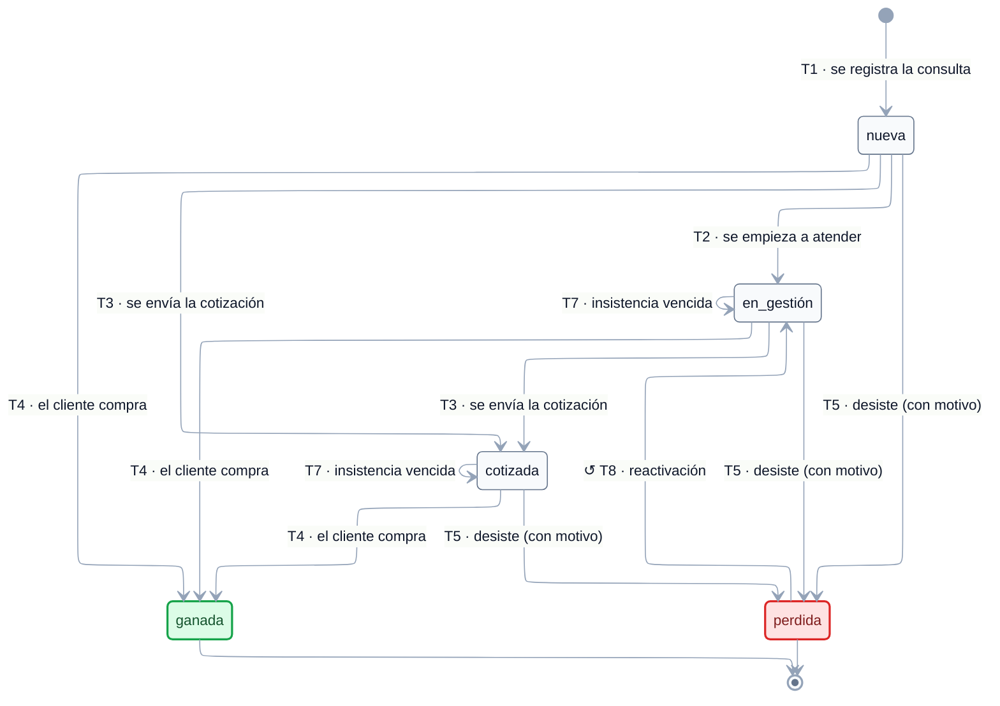

# EST-Oportunidad — Especificación de estados

tags:: #tipo/diagrama #estado/formalizado #pc/pc1

> **Especificación** del embudo de ventas de [[Oportunidad]], lista para dibujar. Derivada de [[CU-04 Registrar consulta]], [[CU-05 Seguir oportunidad]], [[CU-06 Emitir cotización]] y [[CU-07 Confirmar reserva]]. El enum vive en [[DGM — Diagrama de clases]] (`EstadoOportunidad`).
>
> ✅ **Diagrama dibujado el 21/09/26** (Nahuel) sobre esta especificación, con los 4 huecos ya resueltos incorporados. ✅ **Ratificado en la sync del 29/09/26** (Francisco, Nahuel y Paloma).

## Convenciones del diagrama

El diagrama de abajo se dibujó el 21/09/26 siguiendo estas convenciones, comunes a los seis `EST-*`:

1. **Motor ELK** (`nodePlacementStrategy: BRANDES_KOEPF`), líneas ortogonales, paleta slate y Segoe UI — igual que [[DGM — Diagrama de clases]] y [[DGM-ER]].
2. **Cada flecha lleva `Tn · <evento>`**: el evento disparador y, delante, el código de la fila correspondiente en la tabla de *Transiciones*, para poder cruzar diagrama ↔ tabla (actor, CU, guarda y efectos completos).
3. **Los orígenes múltiples se dibujan desplegados.** Donde la tabla lista varios estados de origen (T3, T4, T5) el diagrama tiene una flecha por cada uno; el diagrama es así literal y no hay que interpretarlo.
4. **Símbolos en la etiqueta:** `⚙` = transición **automática** del sistema (sin acción humana) · `↺` = **corrección o reversión** de un error de carga, no un paso del flujo de negocio · sin símbolo = acción de una persona dentro del flujo normal.
5. **Color de los estados:** verde = cierre exitoso (terminal) · rojo = baja lógica.

> ℹ️ Las correcciones se distinguen por símbolo y no por línea punteada porque **Mermaid no permite estilar flechas individuales en `stateDiagram-v2`**: `linkStyle` se parsea sin error pero no se aplica (verificado renderizando; todas las aristas salen `edge-pattern-solid`). El color sí funciona sobre los estados, vía `classDef`.

## Estados

| Estado | Significado | Cómo se entra | ¿Terminal? |
|---|---|---|---|
| `nueva` | Consulta recibida, **sin atender** todavía. | Estado inicial: la crea [[CU-04 Registrar consulta]] | No |
| `en_gestión` | Se está **atendiendo/asesorando**, antes de cotizar. | El empleado empieza a trabajarla ([[CU-05 Seguir oportunidad]]) | No |
| `cotizada` | Se emitió y **envió** una [[Cotización]]. | [[CU-06 Emitir cotización]] | No |
| `ganada` | El cliente compró. Deriva en [[Viaje]]. | Al confirmar la reserva ([[CU-07 Confirmar reserva]]), o a mano en una venta directa ([[CU-05 Seguir oportunidad]] A4) | **Sí** (no vuelve atrás ni si el [[Viaje]] se cancela) |
| `perdida` | No se concretó, **con motivo** registrado. | Cierre en [[CU-05 Seguir oportunidad]] | **Sí** (reabrible a `en_gestión`, T8) |

**Estado inicial:** `nueva`.
**Estados finales:** `ganada` y `perdida`.

> `en_gestión` se sumó el 18/09 en la entrevista de consistencia (Q1): cubre el período de atención previo a la cotización, que antes no tenía estado. Ver [[DEC-0002 Modelar la consulta como Oportunidad]].

## Transiciones

| # | Origen | Destino | Evento / disparador | Actor | CU | Guarda / condición | Efectos colaterales |
|---|---|---|---|---|---|---|---|
| T1 | *(inicial)* | `nueva` | Llega una consulta por Instagram, WhatsApp o presencial y se registra | empleado | [[CU-04 Registrar consulta]] | Hay que identificar o crear el [[Cliente]] ([[CU-02 Registrar cliente]]) | Se crea la [[Oportunidad]] asociada al `Cliente` y al empleado que la registra (`responsable`) |
| T2 | `nueva` | `en_gestión` | El empleado **empieza a atender** la consulta | empleado | [[CU-05 Seguir oportunidad]] paso 2 | — | Se registran interacciones; se puede agendar una [[Alerta]] de tipo `insistencia` |
| T3 | `nueva` · `en_gestión` | `cotizada` | Se **envía** la [[Cotización]] al cliente | empleado | [[CU-06 Emitir cotización]] paso 5 | Existe una [[Cotización]] que pasó a `enviada` | La [[Cotización]] queda asociada a la [[Oportunidad]] |
| T4 | `nueva` · `en_gestión` · `cotizada` | `ganada` | El cliente **confirma la compra** | empleado | [[CU-07 Confirmar reserva]] paso 3 (desde `cotizada`, con la [[Cotización]] aceptada) · [[CU-05 Seguir oportunidad]] A4 (venta directa, sin cotización) | — | **Resuelve las [[Alerta|Alertas]] de `insistencia` pendientes** ([[CU-05 Seguir oportunidad]] paso 7). En el caso normal la transición la hace **CU-07 al crear el [[Viaje]]** (sync 29/09); en la venta directa se cierra a mano y CU-07 A1 crea el viaje |
| T5 | `nueva` · `en_gestión` · `cotizada` | `perdida` | El cliente desiste o no hay acuerdo | empleado | [[CU-05 Seguir oportunidad]] paso 6 / A2 | **Obligatorio registrar el motivo** (ver Invariantes) | Resuelve las [[Alerta|Alertas]] de `insistencia` pendientes; queda en el historial para el embudo y los reportes |
| T7 | `en_gestión` · `cotizada` | *(se mantiene)* | **Insistencia vencida sin respuesta** | sistema / empleado | [[CU-05 Seguir oportunidad]] A1 | — | **No cambia el estado**: se reagenda o reprograma la [[Alerta]] de `insistencia`. Dibujar como auto-transición |
| T8 | `perdida` | `en_gestión` | **Reactivación**: un cliente que había desistido retoma | empleado | [[CU-05 Seguir oportunidad]] A3 | Vuelve a `en_gestión` porque se la está volviendo a trabajar. Alternativa: registrar una [[Oportunidad]] nueva ([[CU-04 Registrar consulta]]) | — |

## Invariantes y reglas

- **`perdida` exige motivo**, de una **lista fija**: `precio · fechas/disponibilidad · desistió · compró en otra agencia · sin respuesta · otro` (este último con texto libre) — [[CU-05 Seguir oportunidad]] paso 6.
- **Una `Oportunidad` puede tener varias [[Cotización|Cotizaciones]]** (versiones); se conserva el historial ([[CU-06 Emitir cotización]]). El estado `cotizada` no dice cuántas hay.
- **Se puede ganar sin cotización formal**: [[CU-05 Seguir oportunidad]] A4 permite cerrar `ganada` sin [[Cotización]] escrita, y [[CU-07 Confirmar reserva]] A1 lo acepta. Por eso T4 sale también de `nueva` y `en_gestión`.
- **Al cerrarse (T4 o T5) se resuelven las [[Alerta|Alertas]] de `insistencia` pendientes** ([[CU-05 Seguir oportunidad]] paso 7).
- **Los 5 estados alimentan el embudo** del dashboard ([[CU-21 Ver dashboard y embudo]]); alinearlos fue la Q1 del 18/09.
- Visibilidad: la gestiona el `responsable`; es legible por toda la agencia ([[DEC-0005 Autenticación y modelo de roles]]).

## Para qué se creó cada transición poco obvia

> 📌 Los ejemplos de abajo son **ilustrativos**, para que se entienda en qué situación se pensó cada transición. **No son casos reales de la agencia ni salen del relevamiento**: sirven para leer el diagrama, no como fuente de verdad ([[Relevamiento — Fuente de verdad]] manda).

### T3 directa `nueva → cotizada` — se cotiza sin etapa de asesoramiento
**Situación.** Entra un mensaje por Instagram preguntando por un paquete cerrado que la agencia ya vende. Se arma la [[Cotización]] el mismo día, sin ida y vuelta previa.
**Por qué existe.** Obligar a pasar por `en_gestión` sería burocracia: emitir una cotización **ya implica** haber trabajado la consulta. El estado intermedio existe para cuando hay asesoramiento real, no como peaje.

### T4 desde `nueva` o `en_gestión` — se vende sin cotización formal
**Situación.** Cliente habitual, ya viajó dos veces. Escribe por WhatsApp preguntando cuánto sale Río en enero, se le pasa el precio por el mismo chat y contesta "dale, reservame".
**Por qué existe.** `cotizada` significa que se **emitió una `Cotización` como documento** en el sistema ([[CU-06 Emitir cotización]]), no que se habló de precio. Acá hubo precio y hubo venta, pero nunca hubo documento.
**Respaldo.** [[CU-05 Seguir oportunidad]] A4 y [[CU-07 Confirmar reserva]] A1, que confirma la reserva igual.

### T7 — la insistencia vence y la oportunidad **no** se mueve
**Situación.** Se agenda una insistencia a 3 días. Llega el día, se llama, no atienden. Se reagenda para la semana que viene.
**Por qué es una auto-transición.** El seguimiento **no cambia el estado del embudo**: la oportunidad sigue exactamente donde estaba. Lo que se mueve es la [[Alerta]] de `insistencia`, que se reagenda.
**Por qué se dibuja igual.** Si no estuviera, alguien podría pensar que hay que mover la oportunidad de estado para registrar que se insistió — y eso ensuciaría el embudo del [[CU-21 Ver dashboard y embudo|dashboard]].

### T8 `perdida → en_gestión` — el cliente que volvió
**Situación.** En marzo se pierde una oportunidad con motivo *precio*. En junio el mismo cliente escribe de nuevo por el mismo destino.
**Por qué a `en_gestión` y no a `nueva`.** Ya no es una consulta sin atender: hay historia, interacciones registradas y se sabe por qué se cayó.
**Por qué no a `cotizada`.** La cotización de marzo ya no sirve — precios viejos y, desde el 21/09, probablemente **vencida** ([[EST-Cotización]]).
**Alternativa válida.** Si el destino o las fechas son otros, conviene registrar una [[Oportunidad]] nueva ([[CU-04 Registrar consulta]]) en vez de reactivar.

### `ganada` es terminal aunque después se caiga el viaje
**Situación.** Se gana una oportunidad el 15/05 y se confirma el [[Viaje]]. El 20/07 el cliente cancela.
**Qué pasa.** La [[Oportunidad]] **queda `ganada`**. La cancelación se registra en el [[Viaje]] (estado `cancelado`), que es donde corresponde.
**Por qué.** El embudo mide la **venta**, no la ejecución. Si la oportunidad volviera a `perdida`, el embudo de mayo **cambiaría en julio** y los reportes dejarían de ser comparables entre períodos ([[CU-21 Ver dashboard y embudo]], [[CU-22 Generar reportes y estadísticas]]).

## Huecos y ambigüedades — resueltos el 21/09

Se detectaron al especificar y **Nahuel los resolvió el mismo día**. Quedan **a ratificar en la sync**; lo que dice acá ya es lo que hay que dibujar.

1. ✅ **Resuelto 21/09 (Nahuel): sí, se permite `nueva → cotizada`.** Emitir una cotización ya implica haber trabajado la consulta; obligar a un paso intermedio no aporta nada. **Para dibujar:** va la flecha directa `nueva → cotizada`, además de la que pasa por `en_gestión`.
2. ✅ **Resuelto 21/09 (Nahuel): T6 no existe — la `Oportunidad` NO retrocede.** Al generar una versión nueva de la [[Cotización]] ([[CU-06 Emitir cotización]] A1), la `Oportunidad` **se queda en `cotizada`**. Versionar es crear otra [[Cotización]], no mover la oportunidad hacia atrás. **Para dibujar:** eliminar T6 de la tabla de arriba; no se dibuja.
3. ✅ **Resuelto 21/09 (Nahuel): T8 vuelve a `en_gestión`.** *(Propagado a [[CU-05 Seguir oportunidad]] A3 el 21/09, que todavía decía "vuelve a `nueva`/`cotizada`".)* Si un cliente que se había perdido retoma, la oportunidad se está **volviendo a trabajar**, así que corresponde `en_gestión` — no `nueva` (ya no es una consulta sin atender) ni `cotizada` (la cotización vieja probablemente ya no sirve). **Para dibujar:** una sola flecha `perdida → en_gestión`.
4. ✅ **Resuelto 21/09 (Nahuel): `ganada` es terminal, no vuelve atrás.** Si después se cancela el [[Viaje]], la `Oportunidad` **queda `ganada`**. El embudo mide la **venta**, no la ejecución: la cancelación se mide en [[Viaje]] (estado `cancelado`), que es donde corresponde. Si la oportunidad volviera a `perdida`, el embudo histórico del [[CU-21 Ver dashboard y embudo|dashboard]] cambiaría retroactivamente y dejaría de ser comparable entre períodos.

## Diagrama

**Leyenda:** `↺` corrección/reversión · sin símbolo, acción de una persona. 🟩 `ganada` = cierre exitoso · 🟥 `perdida` = cierre sin venta (reabrible). El texto completo de cada evento, con actor, CU, guarda y efectos, está en la tabla de *Transiciones*.

**Lo que el diagrama deja ver de un vistazo:**
- **`T4` y `T5` salen de los tres estados abiertos**: una [[Oportunidad]] se puede ganar o perder en cualquier momento, incluso sin [[Cotización]] formal (invariante de "se puede ganar sin cotización").
- Está la flecha directa **`nueva → cotizada`** además de la que pasa por `en_gestión` (hueco 1): cotizar ya implica haber trabajado la consulta.
- **`ganada` no tiene flechas de salida** salvo al estado final: es terminal aunque después se cancele el [[Viaje]], para que el embudo histórico del [[CU-21 Ver dashboard y embudo|dashboard]] no cambie retroactivamente (hueco 4).
- **`T7` son auto-transiciones**: la insistencia vencida reagenda la [[Alerta]] y **no mueve** la oportunidad de estado.
- La única vuelta atrás es **`↺ T8`, de `perdida` a `en_gestión`** (hueco 3), nunca a `nueva` ni a `cotizada`.

## Fuentes

- Entidad: [[Oportunidad]] · enum `EstadoOportunidad` en [[DGM — Diagrama de clases]]
- CU: [[CU-04 Registrar consulta]] · [[CU-05 Seguir oportunidad]] · [[CU-06 Emitir cotización]] · [[CU-07 Confirmar reserva]] · [[CU-21 Ver dashboard y embudo]]
- Decisiones: [[DEC-0002 Modelar la consulta como Oportunidad]] · [[DEC-0005 Autenticación y modelo de roles]]
