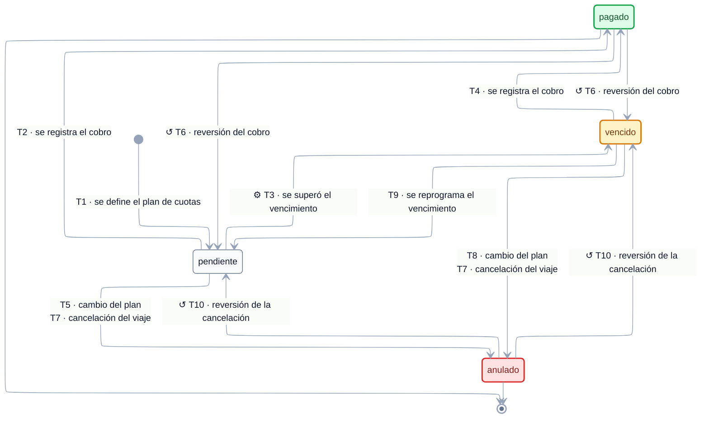

# EST-Pago — Especificación de estados

tags:: #tipo/diagrama #estado/formalizado #pc/pc1

> **Especificación** del ciclo de vida de [[Pago]], lista para dibujar. Derivada de [[CU-11 Definir plan de cuotas]], [[CU-12 Registrar cobro de un pago]] y [[CU-27 Cancelar viaje]], más la regla de vencimiento automático de la nota de [[Pago]]. El enum vive en [[DGM — Diagrama de clases]] (`EstadoPago`).
>
> ✅ **Diagrama dibujado el 21/09/26** (Nahuel) sobre esta especificación, con los 4 huecos resueltos ya incorporados. ✅ **Ratificado en la sync del 29/09/26** (Francisco, Nahuel y Paloma).

## Convenciones del diagrama

El diagrama de abajo se dibujó el 21/09/26 siguiendo estas convenciones, comunes a los seis `EST-*`:

1. **Motor ELK** (`nodePlacementStrategy: BRANDES_KOEPF`), líneas ortogonales, paleta slate y Segoe UI — igual que [[DGM — Diagrama de clases]] y [[DGM-ER]].
2. **Cada flecha lleva `Tn · <evento>`**: el evento disparador y, delante, el código de la fila correspondiente en la tabla de *Transiciones*, para poder cruzar diagrama ↔ tabla (actor, CU, guarda y efectos completos).
3. **Las reversiones se dibujan desplegadas.** Donde la tabla da dos destinos posibles según la fecha (T6 y T10) el diagrama tiene una flecha por cada uno; el diagrama es así literal y no hay que interpretarlo.
4. **Dos disparadores con el mismo salto van en una sola flecha, con las dos etiquetas.** `pendiente → anulado` se alcanza por T5 y por T7, y `vencido → anulado` por T8 y por T7: es el mismo cambio de estado, cambia el motivo.
5. **Símbolos en la etiqueta:** `⚙` = transición **automática** del sistema (sin acción humana) · `↺` = **corrección o reversión** de un error de carga, no un paso del flujo de negocio · sin símbolo = acción de una persona dentro del flujo normal.
6. **Color de los estados:** verde = cierre exitoso (terminal) · rojo = baja lógica · ámbar = atraso, sigue exigible.

> ℹ️ Las correcciones se distinguen por símbolo y no por línea punteada porque **Mermaid no permite estilar flechas individuales en `stateDiagram-v2`**: `linkStyle` se parsea sin error pero no se aplica (verificado renderizando; todas las aristas salen `edge-pattern-solid`). El color sí funciona sobre los estados, vía `classDef`.

## Estados

| Estado | Significado | Cómo se entra | ¿Terminal? |
|---|---|---|---|
| `pendiente` | Cuota planificada, **todavía no cobrada** y sin vencer. | Estado inicial: lo crea [[CU-11 Definir plan de cuotas]] | No |
| `pagado` | Se cobró **completo** (el `Pago` es indivisible). | [[CU-12 Registrar cobro de un pago]] | No (reversible, T6) |
| `vencido` | Pasó su `vencimiento` sin cobrarse. **Sigue siendo exigible.** Es **`pendiente` con la fecha pasada**, no un estado paralelo (regla 🔑). | **Proceso automático del sistema** | No |
| `anulado` | **Baja lógica**: se dio de baja del plan. Deja de ser exigible y de contar para `Σ montos = precioVenta`, pero se conserva el registro. | [[CU-11 Definir plan de cuotas]] A4 o [[CU-27 Cancelar viaje]] | **Sí** para el flujo de negocio (reversible solo por corrección, T10) |

**Estado inicial:** `pendiente`.
**Estados finales:** `pagado` y `anulado`.

## Transiciones

| # | Origen | Destino | Evento / disparador | Actor | CU | Guarda / condición | Efectos colaterales |
|---|---|---|---|---|---|---|---|
| T1 | *(inicial)* | `pendiente` | Se define el plan de cuotas del [[Viaje]] | empleado | [[CU-11 Definir plan de cuotas]] paso 5 | `Σ montos = precioVenta` en la moneda de referencia del [[Viaje]] | Se genera **una [[Alerta]] de vencimiento por cada `Pago`** (aviso un mes antes) |
| T2 | `pendiente` | `pagado` | El empleado **registra el cobro** | empleado | [[CU-12 Registrar cobro de un pago]] paso 3 | Se cargan `forma_pago`, `moneda_pago` y, si difiere de `Viaje.moneda`, el `tipo_cambio` | **Resuelve** la [[Alerta]] de vencimiento; actualiza saldo y **% pagado** del [[Viaje]]; si es la **seña** el [[Viaje]] pasa a `vendido`; si el saldo queda en **cero**, pasa a `confirmado` |
| T3 | `pendiente` | `vencido` | **Se superó la fecha de `vencimiento` sin cobro** | **sistema** (proceso automático) | *ninguno* — no es un CU con actor | — | La [[Alerta]] asociada **no cambia**: sigue `pendiente` y [[CU-14 Ver y atender alertas del día]] la muestra atrasada porque su fecha ya pasó. Corre en el proceso automático diario de las 00:00. **No requiere acción humana** |
| T4 | `vencido` | `pagado` | El empleado registra el cobro de una cuota ya vencida | empleado | [[CU-12 Registrar cobro de un pago]] A1 | Igual que T2 | Igual que T2: la [[Alerta]] se resuelve lo mismo |
| T5 | `pendiente` | `anulado` | Se **cambió el esquema** del plan de cuotas | empleado | [[CU-11 Definir plan de cuotas]] A4 | Solo mientras el `Pago` esté **`pendiente`** | Cierra su [[Alerta]]; vuelve a exigirse `Σ montos = precioVenta` **sobre los no anulados** |
| T6 | `pagado` | `pendiente` · `vencido` | **Reversión del cobro** (se registró por error) | empleado | [[CU-12 Registrar cobro de un pago]] A3 | Vuelve al estado que tenía según su `vencimiento` | Su [[Alerta]] **se reabre**; si el [[Viaje]] había pasado a `confirmado` por saldo cero, vuelve a `vendido` |
| T7 | `pendiente` · `vencido` | `anulado` | **Se canceló el [[Viaje]]** | empleado | [[CU-27 Cancelar viaje]] paso 4 | Aplica a los **no cobrados**, estén vencidos o no (regla 🔑) | Se resuelven las [[Alerta|Alertas]] vigentes del viaje |
| T8 | `vencido` | `anulado` | Se **cambió el esquema** del plan | empleado | [[CU-11 Definir plan de cuotas]] A4 | Ídem T5, pero para una cuota ya vencida (regla 🔑) | Cierra su [[Alerta]]; vuelve a exigirse `Σ montos = precioVenta` sobre los no anulados |
| T9 | `vencido` | `pendiente` | Se **reprograma el `vencimiento`** a una fecha futura | empleado | [[CU-11 Definir plan de cuotas]] A3 | La nueva fecha es posterior a hoy | Se reagenda su [[Alerta]] |
| T10 | `anulado` | `pendiente` · `vencido` | **Se revirtió la cancelación** del [[Viaje]] | empleado | [[CU-27 Cancelar viaje]] A3 | Vuelve a `pendiente` si su `vencimiento` es futuro, o a `vencido` si ya pasó | Se reponen sus [[Alerta|Alertas]] |

## Invariantes y reglas

- **El `Pago` es indivisible:** se cobra completo, **sin cobros parciales** ([[CU-12 Registrar cobro de un pago]], nota de [[Pago]]). Por eso no existe un estado "parcialmente pagado".
- **`Σ montos = precioVenta`** sobre los [[Pago|Pagos]] **no anulados**, en la **moneda de referencia** del [[Viaje]] ([[CU-11 Definir plan de cuotas]] paso 4 y A4).
- **Multimoneda por cobro:** el plan se denomina íntegro en `Viaje.moneda`; la moneda real (`moneda_pago`) y el `tipo_cambio` se eligen recién **al cobrar** (T2/T4). El **% pagado** y el saldo se calculan siempre sobre los `monto` planificados ([[DEC-0007 Modelo económico — ganancia, margen y comisión de vendedor]]).
- 🔑 **`vencido` es "`pendiente` con la fecha pasada"** (resuelto 21/09). Sigue siendo exigible: es un aviso de atraso, no una baja. La baja es `anulado`. **Toda regla de los CU que diga `pendiente` aplica también a `vencido`.**
- **Se puede reprogramar** monto o vencimiento mientras el `Pago` **no esté cobrado ni anulado**; el sistema reagenda su [[Alerta]] ([[CU-11 Definir plan de cuotas]] A3). Si sigue `pendiente` no cambia de estado (auto-transición); si estaba `vencido` y la fecha nueva es futura, vuelve a `pendiente` (T9).
- **T3 es una transición sin actor humano**: la corre el [[DGM-ACT — Proceso automático diario|proceso automático diario]] (00:00), igual que [[EST-Cotización]] T5 (`enviada → vencida`).

## Para qué se creó cada transición poco obvia

> 📌 Los ejemplos de abajo son **ilustrativos**, para que se entienda en qué situación se pensó cada transición. **No son casos reales de la agencia ni salen del relevamiento**: sirven para leer el diagrama, no como fuente de verdad ([[Relevamiento — Fuente de verdad]] manda). Los importes son inventados.

### T6 `pagado → vencido` — la transferencia que nunca entró
**Situación.** Cuota 2 de $150.000, vence el **10/09/26**. El 08/09 el cliente avisa que transfirió y el empleado la marca `pagado`. El **21/09**, al conciliar el banco, se ve que la transferencia nunca llegó.
**Qué es "revertir el cobro".** Es [[CU-12 Registrar cobro de un pago]] A3: **corregir un dato mal cargado**, no devolver plata. Los otros casos típicos son haber marcado la cuota equivocada, un cheque rechazado o un cobro cargado dos veces. El **reembolso real está fuera de alcance** ([[Alcance y fuera de alcance]]).
**Por qué a `vencido` y no a `pendiente`.** Porque el estado **no depende de la historia de la cuota sino de su `vencimiento` contra hoy**. El 21/09 esa cuota está impaga y venció hace once días: está **en mora**. Si volviera a `pendiente`, el sistema mostraría al día una cuota atrasada, no aparecería en las [[Alerta|Alertas]] ni en el checklist de deuda, y nadie la iría a reclamar.
**Efecto en cadena.** Se reabre su [[Alerta]] y, si ese cobro había dejado el saldo en cero, el [[Viaje]] vuelve de `confirmado` a `vendido` ([[EST-Viaje]] T8).

### T9 `vencido → pendiente` — se refinancia una cuota atrasada
**Situación.** La cuota venció el 10/09 y el cliente pide pasarla al 10/10. El empleado le cambia el `vencimiento` ([[CU-11 Definir plan de cuotas]] A3).
**Por qué "des-vence".** Con la fecha nueva **ya no está en mora**: la regla es siempre la misma, `vencido` es `pendiente` con la fecha pasada. Al correr la fecha a futuro, la condición deja de cumplirse.
**Qué más pasa.** Se reagenda su [[Alerta]] de vencimiento. Si la cuota estaba `pendiente` y solo se le corrige el monto o la fecha, **no cambia de estado**.

### T7 y T8 desde `vencido` — anular una cuota que ya está en mora
**Situación (T7).** Un viaje con la cuota 2 vencida el 10/09 se cancela el 15/09.
**Situación (T8).** Un cliente rearma el plan de pagos y la cuota vencida ya no va.
**Por qué hubo que agregarlas.** Los CU solo hablaban de anular pagos **`pendientes`**, así que una cuota **`vencida`** de un viaje cancelado **quedaba exigible para siempre**: seguía apareciendo como deuda de un viaje que no existe. Era el hueco más grave de esta nota y se cerró con la regla 🔑.

### T10 `anulado → pendiente` **o** `vencido` — se revirtió la cancelación del viaje
**Situación.** El 15/09 se cancela un viaje por error y se anulan sus tres cuotas. El 16/09 se revierte la cancelación ([[CU-27 Cancelar viaje]] A3).
**Por qué se bifurca.** Las cuotas **no vuelven al estado que tenían**, vuelven al que les corresponde **según la fecha de hoy**: la que vencía el 10/09 vuelve a `vencido`, y las de octubre y noviembre vuelven a `pendiente`. Mismo criterio que T6.

### T3 `pendiente → vencido` — sin actor humano
**Situación.** Nadie hace nada. Pasa la medianoche del `vencimiento` y la cuota queda en mora.
**Por qué importa señalarlo.** Es una de las **dos transiciones de todo el modelo de Rumbo** que no dispara una persona, sino un proceso del sistema (la otra es [[EST-Cotización]] T5). No tiene CU asociado porque no hay actor que la ejecute, y eso al leer la tabla de transiciones puede parecer un olvido.
**Ojo.** Pasar a `vencido` **no cobra nada extra**: el [[Pago]] sigue debiendo el mismo `monto`. El **recargo por mora** se propuso el 21/09 y **no está modelado** — sigue abierto.

## Huecos y ambigüedades — resueltos el 21/09

### ✅ Resueltos (Nahuel) — a ratificar en la sync

Los cuatro huecos tenían la misma raíz (**los CU trataban `vencido` como si no existiera** al anular o reprogramar) y se cerraron con **una sola regla**:

> 🔑 **`vencido` no es un estado paralelo: es "`pendiente` con la fecha pasada".** Donde los CU digan `pendiente`, leer **`pendiente` o `vencido`**.

De ahí salen las cuatro transiciones que faltaban, ya incorporadas a la tabla de arriba (T7 ampliada, T8, T9, T10):

1. **`vencido → anulado` al cancelar el [[Viaje]]** ([[CU-27 Cancelar viaje]] paso 4). Antes una cuota vencida de un viaje cancelado **quedaba exigible para siempre**.
2. **`vencido → anulado` al cambiar el plan** ([[CU-11 Definir plan de cuotas]] A4).
3. **`anulado → pendiente` o `vencido`** al revertir la cancelación ([[CU-27 Cancelar viaje]] A3): vuelve a `pendiente` si su `vencimiento` es futuro, o a `vencido` si ya pasó.
4. **`vencido → pendiente`** al reprogramar el `vencimiento` a una fecha futura ([[CU-11 Definir plan de cuotas]] A3).

> Es el mismo criterio que se aplicó a [[Alerta]] el mismo día (el atraso no crea un mundo aparte), con una diferencia: en `Pago` el atraso **sí** es un estado propio, porque cambia si la cuota está en mora o no. En `Alerta` el atraso es solo un criterio de orden.

### ❌ Descartado (sync 29/09)

5. **Recargo por mora.** Idea de Nahuel (21/09): si una cuota pasa a `vencido`, podría corresponder un **recargo**. **Descartada en la sync del 29/09** (Francisco, Nahuel y Paloma): no se modela. Una cuota vencida se cobra por su `monto` original.

## Diagrama

**Leyenda:** `⚙` automática del sistema · `↺` corrección/reversión · sin símbolo, acción de una persona. 🟩 `pagado` = cobrado · 🟥 `anulado` = baja lógica · 🟧 `vencido` = en atraso, **sigue exigible**. El texto completo de cada evento, con actor, CU, guarda y efectos, está en la tabla de *Transiciones*.

**Lo que el diagrama deja ver de un vistazo:**
- 🔑 **`pendiente` y `vencido` son el mismo mundo.** Tienen exactamente las mismas salidas — a `pagado` (T2/T4) y a `anulado` (T5-T7/T8-T7) — y `vencido` vuelve a `pendiente` si se reprograma la fecha (T9). Eso es la regla "`vencido` es `pendiente` con la fecha pasada" hecha dibujo: es la que cierra los 4 huecos que dejaban una cuota vencida de un viaje cancelado exigible para siempre.
- **`⚙ T3` es la única flecha automática de este diagrama**: ningún actor la dispara, la corre el proceso automático diario al pasar la fecha. En el resto del modelo también es automática [[EST-Cotización]] T5.
- **La única baja es `anulado`**, y se alcanza desde los dos estados no cobrados, nunca desde `pagado`.
- **No hay estado "parcialmente pagado"**: el [[Pago]] es indivisible, se cobra completo.
- Tanto `↺ T6` como `↺ T10` **se bifurcan según la fecha**: vuelven a `pendiente` si el `vencimiento` es futuro, o a `vencido` si ya pasó.

## Fuentes

- Entidad: [[Pago]] · enum `EstadoPago` en [[DGM — Diagrama de clases]]
- CU: [[CU-11 Definir plan de cuotas]] · [[CU-12 Registrar cobro de un pago]] · [[CU-27 Cancelar viaje]] · [[CU-10 Registrar economía del viaje]]
- Decisiones: [[DEC-0007 Modelo económico — ganancia, margen y comisión de vendedor]]
- Relacionado: [[EST-Viaje]] (T2 y T3 de acá disparan T2 y T3 de allá)
