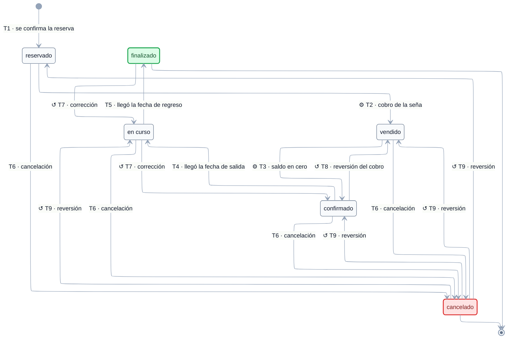

# EST-Viaje — Especificación de estados

tags:: #tipo/diagrama #estado/borrador #pc/pc1

> **Especificación** del ciclo de vida de [[Viaje]], lista para dibujar. Derivada de [[CU-07 Confirmar reserva]], [[CU-08 Gestionar estado del viaje]], [[CU-12 Registrar cobro de un pago]] y [[CU-27 Cancelar viaje]]. El enum vive en [[DGM — Diagrama de clases]] (`EstadoViaje`).
>
> ✅ **Diagrama dibujado el 21/09/26** (Nahuel) sobre esta especificación, con los huecos ya resueltos incorporados (los 4 originales + el 5.º detectado al dibujar). Sigue en `borrador`: se ratifica en la sync junto con el resto.

## Convenciones del diagrama

El diagrama de abajo se dibujó el 21/09/26 siguiendo estas convenciones, comunes a los seis `EST-*`:

1. **Motor ELK** (`nodePlacementStrategy: BRANDES_KOEPF`), líneas ortogonales, paleta slate y Segoe UI — igual que [[DGM — Diagrama de clases]] y [[DGM-ER]].
2. **Cada flecha lleva `Tn · <evento>`**: el evento disparador y, delante, el código de la fila correspondiente en la tabla de *Transiciones*, para poder cruzar diagrama ↔ tabla (actor, CU, guarda y efectos completos).
3. **Las reversiones se dibujan desplegadas.** Donde la tabla dice "vuelve al estado que tenía antes" (T7 y T9) el diagrama tiene una flecha por cada destino posible; el diagrama es así literal y no hay que interpretarlo.
4. **Símbolos en la etiqueta:** `⚙` = transición **automática** del sistema (sin acción humana) · `↺` = **corrección o reversión** de un error de carga, no un paso del flujo de negocio · sin símbolo = acción de una persona dentro del flujo normal.
5. **Color de los estados:** verde = cierre exitoso (terminal) · rojo = baja lógica.

> ℹ️ Las correcciones se distinguen por símbolo y no por línea punteada porque **Mermaid no permite estilar flechas individuales en `stateDiagram-v2`**: `linkStyle` se parsea sin error pero no se aplica (verificado renderizando; todas las aristas salen `edge-pattern-solid`). El color sí funciona sobre los estados, vía `classDef`.

## Estados

| Estado | Significado | Cómo se entra | ¿Terminal? |
|---|---|---|---|
| `reservado` | El cliente aceptó la cotización. Economía y plan de pagos cargados, **seña sin cobrar**. | Estado inicial: lo crea [[CU-07 Confirmar reserva]] | No |
| `vendido` | Se cobró la **seña**. | Cobro de la seña ([[CU-12 Registrar cobro de un pago]]) | No |
| `confirmado` | Se pagó el **total**: saldo en cero. Es el hito **económico**, no el operativo. | Último cobro que deja el saldo en cero ([[CU-12 Registrar cobro de un pago]]) | No |
| `en curso` | El viaje **inició** (pasó la fecha de salida y el empleado lo confirmó). | Sugerido por fecha, confirmado por el empleado ([[CU-08 Gestionar estado del viaje]]) | No |
| `finalizado` | El viaje **terminó**. Habilita la post-venta. | Sugerido por fecha, confirmado por el empleado ([[CU-08 Gestionar estado del viaje]]) | **Sí** |
| `cancelado` | Baja lógica: el viaje no se concreta. Se conserva el historial. | [[CU-27 Cancelar viaje]] | **Sí** (reversible solo por corrección, ver T9) |

**Estado inicial:** `reservado`.
**Estados finales:** `finalizado` y `cancelado`.

## Transiciones

| # | Origen | Destino | Evento / disparador | Actor | CU | Guarda / condición | Efectos colaterales |
|---|---|---|---|---|---|---|---|
| T1 | *(inicial)* | `reservado` | Se confirma la reserva desde una [[Oportunidad]] `ganada` | empleado | [[CU-07 Confirmar reserva]] | Existe `Oportunidad` ganada o [[Cotización]] aceptada; destino y fechas cargados | Se crea el [[Viaje]]; se generan las [[Alerta|Alertas]] `formulario` del destino y la `salida`; se encadenan [[CU-10 Registrar economía del viaje|CU-10]] y [[CU-11 Definir plan de cuotas|CU-11]] |
| T2 | `reservado` | `vendido` | **Cobro de la seña** | sistema | [[CU-12 Registrar cobro de un pago]] A0 | El [[Pago]] cobrado es de `tipo = seña` | Automática, **no es una acción manual** |
| T3 | `vendido` | `confirmado` | **Saldo en cero** (se cobró el último pago) | sistema | [[CU-12 Registrar cobro de un pago]] A2 | Σ de los [[Pago|Pagos]] no cobrados y no anulados = 0 | Automática |
| T4 | `confirmado` | `en curso` | Llegó la **fecha de salida** | sistema **sugiere**, empleado **confirma** | [[CU-08 Gestionar estado del viaje]] | Nunca se fuerza por fecha (ver A1 en Invariantes) | Actualiza calendario y dashboard |
| T5 | `en curso` | `finalizado` | Llegó la **fecha de regreso** | sistema **sugiere**, empleado **confirma** | [[CU-08 Gestionar estado del viaje]] | Nunca se fuerza por fecha | Habilita la post-venta: agenda una [[Alerta]] de tipo `reseña` ([[CU-17 Registrar reseña de hotel]]) |
| T6 | `reservado` · `vendido` · `confirmado` · `en curso` | `cancelado` | El empleado cancela el viaje | empleado | [[CU-27 Cancelar viaje]] | **No** desde `finalizado` (A1) ni desde `cancelado` | Registra motivo y fecha; pasa los [[Pago|Pagos]] no cobrados (`pendiente` **y** `vencido`) a `anulado`; resuelve las [[Alerta|Alertas]] vigentes; deja constancia de que la comisión proyectada no se realiza ([[RN-01 Comisión automática]]) — **salvo desde `en curso`**, donde la comisión **se mantiene** porque el servicio ya se prestó ([[CU-27 Cancelar viaje]] A4, resuelto 21/09) |
| T7 | `en curso` · `finalizado` | *estado inmediato anterior* | **Corrección**: se cargó un estado por error | empleado | [[CU-08 Gestionar estado del viaje]] A2 | Solo deshace transiciones **manuales** (T4, T5). Las automáticas (T2, T3) se deshacen revirtiendo el cobro | Se marca con `↺` en el diagrama (corrección, no flujo de negocio) |
| T8 | `confirmado` | `vendido` | **Reversión de un cobro** que había dejado el saldo en cero | empleado | [[CU-12 Registrar cobro de un pago]] A3 | El cobro se había registrado por error | El [[Pago]] vuelve a `pendiente`/`vencido` y su [[Alerta]] se reabre |
| T9 | `cancelado` | *el estado que tenía justo antes de cancelarse* | **Reversión de la cancelación** (fue un error) | empleado | [[CU-27 Cancelar viaje]] A3 | El viaje **no** está `finalizado` | Se reponen sus [[Pago|Pagos]] (a `pendiente` o `vencido` según su fecha) y [[Alerta|Alertas]]. Se marca con `↺` en el diagrama (corrección) |

## Invariantes y reglas

- **`confirmado` es económico, no operativo.** Significa "total pagado" y **no** debe confundirse con el acto de confirmar la reserva, que es [[CU-07 Confirmar reserva]] y produce `reservado` ([[CU-07 Confirmar reserva]], nota de la descripción).
- **T2 y T3 son automáticas.** Las dispara el cobro en [[CU-12 Registrar cobro de un pago]]; el empleado no las ejecuta a mano ([[CU-08 Gestionar estado del viaje]] paso 2).
- **T4 y T5 nunca se fuerzan por fecha.** El sistema sugiere, la persona confirma. Caso de referencia: si el vuelo de regreso está retrasado, el empleado **mantiene el viaje `en curso`** aunque la fecha de regreso ya haya pasado ([[CU-08 Gestionar estado del viaje]] A1).
- **La secuencia es estricta** (resuelto 21/09): no se saltea `confirmado`. Un [[Viaje]] no pasa a `en curso` sin estar **totalmente pagado**, aunque ya haya llegado la fecha de salida.
- **`finalizado` no se cancela** ([[CU-27 Cancelar viaje]] A1).
- **Cancelar desde `en curso` es una interrupción, no una venta caída** (resuelto 21/09). El viaje ya empezó, así que la cancelación **no revierte la economía realizada**: la comisión del vendedor se mantiene y los cobros quedan; solo se anulan las cuotas no cobradas ([[CU-27 Cancelar viaje]] A4). Es la única de las cuatro `T6` que se comporta distinto.
- Si al cancelar hay [[Pago|Pagos]] ya `pagados`, el sistema **informa el importe cobrado** pero el reembolso/penalidad está **fuera de alcance** ([[CU-27 Cancelar viaje]] A2, [[Alcance y fuera de alcance]]).
- Todo [[Viaje]] tiene al menos un [[Pago]] desde T1 (ver [[DGM — Diagrama de clases]]).

## Para qué se creó cada transición poco obvia

> 📌 Los ejemplos de abajo son **ilustrativos**, para que se entienda en qué situación se pensó cada transición. **No son casos reales de la agencia ni salen del relevamiento**: sirven para leer el diagrama, no como fuente de verdad ([[Relevamiento — Fuente de verdad]] manda).

### T6 desde `en curso` — el viaje ya arrancó y se cae
**Situación.** Salida grupal a Bariloche del 10/07/26 al 17/07/26. El 12/07, con el grupo ya alojado, el operador levanta el servicio por un temporal y los pasajeros se vuelven.
**Por qué no alcanza con `finalizado`.** El viaje no terminó: se **interrumpió**. Marcarlo `finalizado` dispararía la post-venta (la [[Alerta]] de `reseña`) sobre un viaje que se cortó por la mitad.
**Qué hace el sistema.** Pasa a `cancelado` con motivo y fecha, anula las cuotas no cobradas y resuelve las [[Alerta|Alertas]] — pero **mantiene la comisión**, porque el servicio se prestó ([[CU-27 Cancelar viaje]] A4).
**Qué no hace.** Calcular reembolsos ni penalidades por los días no usados: está **fuera de alcance** ([[Alcance y fuera de alcance]]).

### T7 — se cargó un estado por error
**Situación.** El cliente tiene dos viajes abiertos. El empleado marca `finalizado` el que todavía está en curso porque se confundió de ficha.
**Por qué existe.** Sin T7 habría que cancelar el viaje y rehacerlo, perdiendo el historial. Es un **deshacer**, no un paso del negocio.
**Límite.** Solo revierte lo que se cargó a mano (T4 y T5). Un `vendido → reservado` no se hace acá: eso lo produjo un cobro y se deshace revirtiendo el cobro (T8).

### T8 `confirmado → vendido` — el saldo en cero era mentira
**Situación.** El 02/08 se marca cobrada la última cuota y el [[Viaje]] pasa solo a `confirmado`. El 09/08, al conciliar, se ve que el depósito nunca entró.
**Por qué existe.** `confirmado` significa "total pagado". Si el último cobro se cae, el viaje **no está pagado** y no puede seguir figurando como tal en el dashboard ni en los reportes.
**Cómo se dispara.** No se elige a mano: sale sola al revertir el cobro en [[CU-12 Registrar cobro de un pago]] A3.

### T9 `cancelado → estado previo` — se canceló el viaje equivocado
**Situación.** Mismo cliente, dos viajes. Se cancela el que no era. Se detecta a los diez minutos.
**Por qué vuelve al estado previo y no a `reservado`.** Si el viaje estaba `confirmado` (todo pagado), devolverlo a `reservado` diría que no se cobró nada. El historial económico no cambió, así que el estado tampoco tiene que cambiar.
**Qué se repone.** Las cuotas anuladas vuelven a `pendiente` o `vencido` **según la fecha de hoy**, y las [[Alerta|Alertas]] se reabren ([[CU-27 Cancelar viaje]] A3).

### La flecha que **no** está: `vendido → en curso`
**Situación.** Llega el 10/07, fecha de salida, y el viaje tiene una cuota sin cobrar.
**Qué pasa.** El sistema **no lo deja avanzar**: el viaje se queda en `vendido` aunque el pasajero esté viajando. Es la consecuencia de que la secuencia sea estricta (hueco 1).
**Salida.** Cobrar el saldo ([[CU-12 Registrar cobro de un pago]]) o cancelar ([[CU-27 Cancelar viaje]]). Conviene tenerlo presente: es el punto donde el modelo es más rígido que la realidad operativa, y es a propósito.

## Huecos y ambigüedades — resueltos el 21/09

Se detectaron al especificar y **Nahuel los resolvió el mismo día**. Quedan **a ratificar en la sync**; lo que dice acá ya es lo que hay que dibujar.

1. ✅ **Resuelto 21/09 (Nahuel): la secuencia es estricta.** **No** se puede pasar de `vendido` a `en curso` sin pasar por `confirmado`: un [[Viaje]] no arranca hasta estar **totalmente pagado**. El ciclo `reservado → vendido → confirmado → en curso → finalizado` de [[CU-08 Gestionar estado del viaje]] se respeta al pie de la letra. **Para dibujar:** no hay flecha `vendido → en curso`. **Consecuencia operativa a tener presente:** si llega la fecha de salida con saldo pendiente, el [[Viaje]] **se queda en `vendido`** — el sistema no lo deja avanzar. La salida es cobrar el saldo ([[CU-12 Registrar cobro de un pago]]) o cancelar ([[CU-27 Cancelar viaje]]).
2. ✅ **Resuelto 21/09 (Nahuel): la corrección manual (T7) solo aplica a las transiciones manuales.** Es decir, solo permite deshacer T4 (`en curso → confirmado`) y T5 (`finalizado → en curso`). **No** se puede retroceder `vendido → reservado` ni `confirmado → vendido` a mano, porque esas las produjo un cobro: para deshacerlas hay que **revertir el cobro** ([[CU-12 Registrar cobro de un pago]] A3), que ya cambia el estado del [[Viaje]] solo (T8). Así se evita el estado incoherente de un viaje `reservado` con la seña cobrada. **Para dibujar:** T7 sale únicamente de `en curso` y `finalizado`.
3. ✅ **Resuelto 21/09 (Nahuel): T9 vuelve al estado que el [[Viaje]] tenía inmediatamente antes de cancelarse**, no siempre a `reservado`.
4. ✅ **Resuelto 21/09 (Nahuel): `cancelado` es terminal para el flujo de negocio.** T9 no es un paso del flujo sino la **corrección de un error de carga**, igual que T7. Se mantiene lo que dice [[CU-08 Gestionar estado del viaje]]. **Para dibujar:** T7, T8 y T9 se marcan como correcciones (con `↺`), y T1-T6 quedan como flujo de negocio.
5. ✅ **Resuelto 21/09 (Nahuel), detectado al dibujar: cancelar desde `en curso` no borra la comisión.** La precondición de [[CU-27 Cancelar viaje]] siempre permitió cancelar un viaje ya iniciado, pero arrastraba el paso 5 completo, así que un viaje que **ya había arrancado** perdía la comisión proyectada — cuando la agencia **ya prestó el servicio** y ya se la ganó. Desde `en curso` la cancelación es una **interrupción**: la comisión se mantiene, los cobros quedan y solo se anulan las cuotas no cobradas (nuevo **A4** en [[CU-27 Cancelar viaje]]). Se descartó un estado `interrumpido` propio (costaba enum, entidad, [[DGM — Diagrama de clases|clases]], [[DGM-ER|ER]] y CU para un caso de borde) y también sacar `en curso` de los orígenes, porque la fuerza mayor durante el viaje es un caso real. **Para dibujar:** no cambia nada, las cuatro flechas `T6` siguen; cambia el efecto, que está en la tabla y en los invariantes.

## Diagrama

**Leyenda:** `⚙` automática del sistema · `↺` corrección/reversión · sin símbolo, acción de una persona. 🟩 `finalizado` = cierre exitoso · 🟥 `cancelado` = baja lógica. El texto completo de cada evento, con actor, CU, guarda y efectos, está en la tabla de *Transiciones*.

**Lo que el diagrama deja ver de un vistazo:**
- La **secuencia es estricta**: no hay flecha `vendido → en curso`. Un [[Viaje]] no arranca sin estar totalmente pagado (hueco 1).
- Las **cuatro flechas `↺ T9`** saliendo de `cancelado` son la contracara de las cuatro `T6`: la cancelación se puede revertir al estado exacto que el viaje tenía antes.
- `↺ T7` sale **solo** de `en curso` y `finalizado`, las dos transiciones manuales (hueco 2). Lo que produjo un cobro se deshace revirtiendo el cobro (`↺ T8`), no a mano.
- `finalizado` **no tiene flecha a `cancelado`**: un viaje terminado no se cancela.
- La `T6` que sale de **`en curso`** es la excepción económica: ahí cancelar **interrumpe** un viaje ya prestado y **no borra la comisión** (hueco 5).

## Fuentes

- Entidad: [[Viaje]] · enum `EstadoViaje` en [[DGM — Diagrama de clases]]
- CU: [[CU-07 Confirmar reserva]] · [[CU-08 Gestionar estado del viaje]] · [[CU-12 Registrar cobro de un pago]] · [[CU-27 Cancelar viaje]] · [[CU-17 Registrar reseña de hotel]]
- Decisiones: [[DEC-0007 Modelo económico — ganancia, margen y comisión de vendedor]] · [[RN-01 Comisión automática]]
