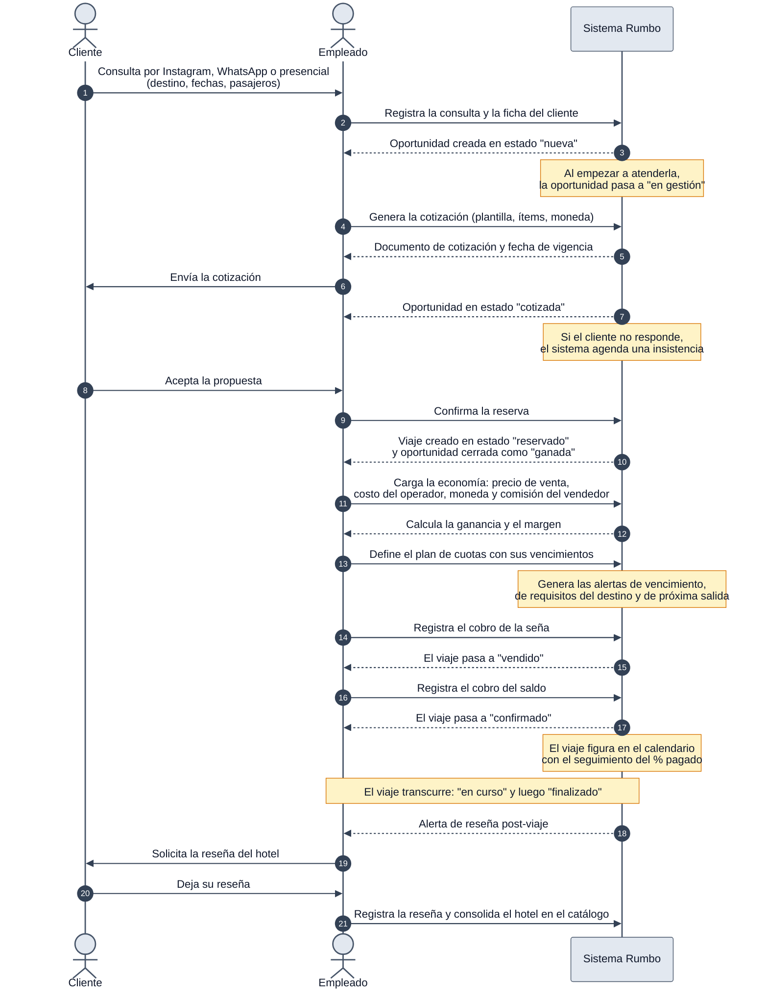

# DGM-SEC — De la consulta a la venta

tags:: #tipo/diagrama #estado/formalizado #pc/pc1

## Qué representa
El flujo **end-to-end** del negocio en el tiempo: desde que llega la consulta hasta que el viaje queda cobrado y el hotel sumado al catálogo, mostrando quién hace cada cosa y qué resuelve el sistema por su cuenta. Es la vista de secuencia de [[CU-01 De la consulta a la venta]], y entra en el entregable de relevamiento.

Notas de origen: [[CU-01 De la consulta a la venta]] · [[Actores]] · [[CU-04 Registrar consulta]] · [[CU-06 Emitir cotización]] · [[CU-07 Confirmar reserva]] · [[CU-10 Registrar economía del viaje]] · [[CU-11 Definir plan de cuotas]] · [[CU-12 Registrar cobro de un pago]] · [[CU-17 Registrar reseña de hotel]] · [[RN-01 Comisión automática]]

## Diagrama

## Convenciones del diagrama
- **Actores y roles vigentes:** el usuario operativo es el **empleado** ([[Actores]]); el **Cliente** es actor externo y no opera el sistema. Los roles `admin`, `dueño` y `freelance` no participan de este flujo.
- **Modelo económico vigente:** el empleado carga precio de venta, costo del operador, moneda y **comisión del vendedor**; el sistema calcula **ganancia y margen** ([[RN-01 Comisión automática]]). No aparece el concepto de "comisión automática sobre la venta" del modelo anterior.
- **Estados explícitos:** las respuestas del sistema nombran el estado resultante de [[Oportunidad]] y [[Viaje]], para poder cruzar el diagrama con [[EST-Oportunidad]] y [[EST-Viaje]].
- **Notas ámbar = acciones automáticas** del sistema, sin intervención de una persona.
- **Numeración automática** (`autonumber`) para poder referenciar un paso puntual en la discusión.
- Motor de layout propio de `sequenceDiagram`: **ELK no aplica** a este tipo de diagrama, a diferencia de [[DGM — Diagrama de clases]], [[DGM-ER]] y los `EST-*`.

## Cómo mantenerlo
- **Source → output:** la verdad vive en [[CU-01 De la consulta a la venta]] y en los CU atómicos que compone. Si cambia un flujo, se actualiza el CU y después este diagrama.
- **Un solo editor a la vez** (el bloque Mermaid es indivisible). Ver [[Guía del Vault#3 · Workflow colaborativo]].
- Al entregar, se renderiza a PNG con `mermaid-cli` y se incrusta en el entregable de relevamiento; ver [[Entregables — índice]].
