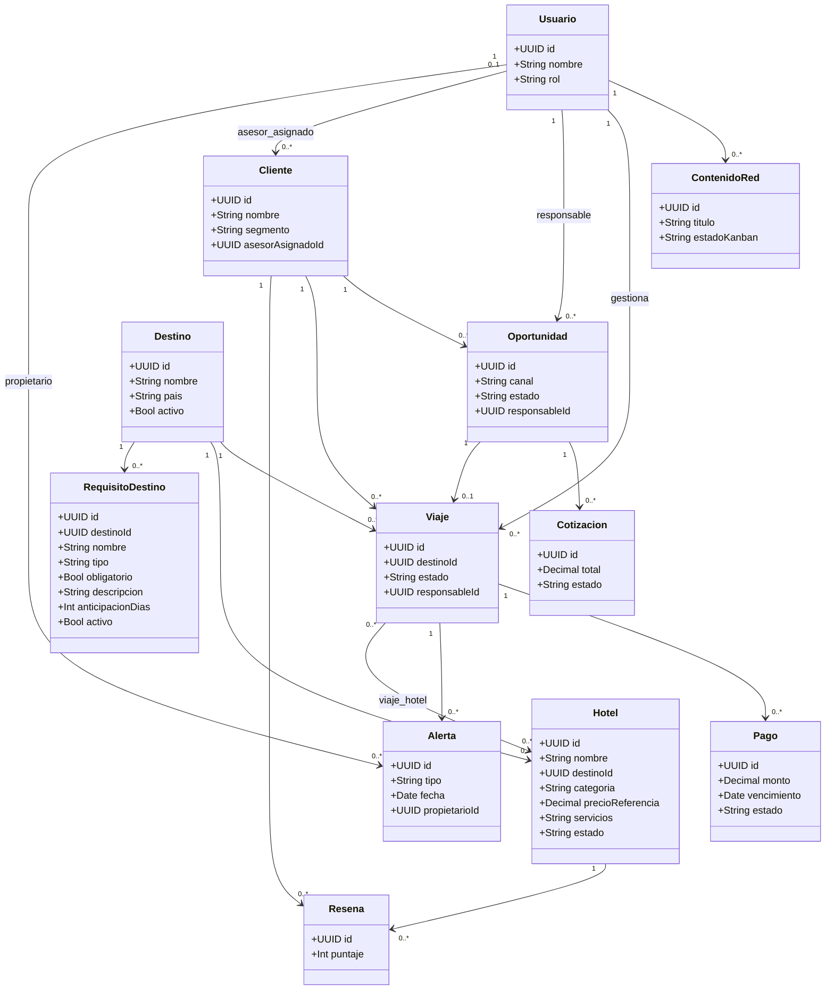

# MOC — Modelo de dominio

tags:: #tipo/diagrama #tipo/modulo #estado/en-revision #pc/pc1

> Mapa de las **12 entidades** y su diagrama de clases. Es la *salida*; la verdad de cada entidad vive en su nota (source). Al cambiar una entidad, actualizar este bloque. Un solo editor por vez (ver [[Guía del Vault#3 · Workflow colaborativo]]).

## Entidades
[[Usuario]] · [[Cliente]] · [[Oportunidad]] · [[Viaje]] · [[Pago]] · [[Hotel]] · [[Reseña]] · [[Alerta]] · [[Cotización]] · [[ContenidoRed]] · [[Destino]] · [[RequisitoDestino]] ⚠️(nueva, ratificar)

## Diagrama de clases (borrador)

> Relación Viaje–Hotel (N:M) y objeto de la Reseña resueltos en [[DEC-0003 Relación Viaje–Hotel y Reseña]].
> `destino` de [[Viaje]] y [[Hotel]] pasó de `String` a FK hacia [[Destino]] (catálogo) — ver [[DEC-0006 Destino como entidad de catálogo]].

## Diagrama ER
- Ver [[DGM-ER]] (modelo relacional para PostgreSQL).

## Pendientes de este diagrama
- Cardinalidad Viaje–Hotel (N:M) y objeto de la `Reseña` (Hotel) → decidido en [[DEC-0003 Relación Viaje–Hotel y Reseña]] (`en-revision`, ratificar en sync).
