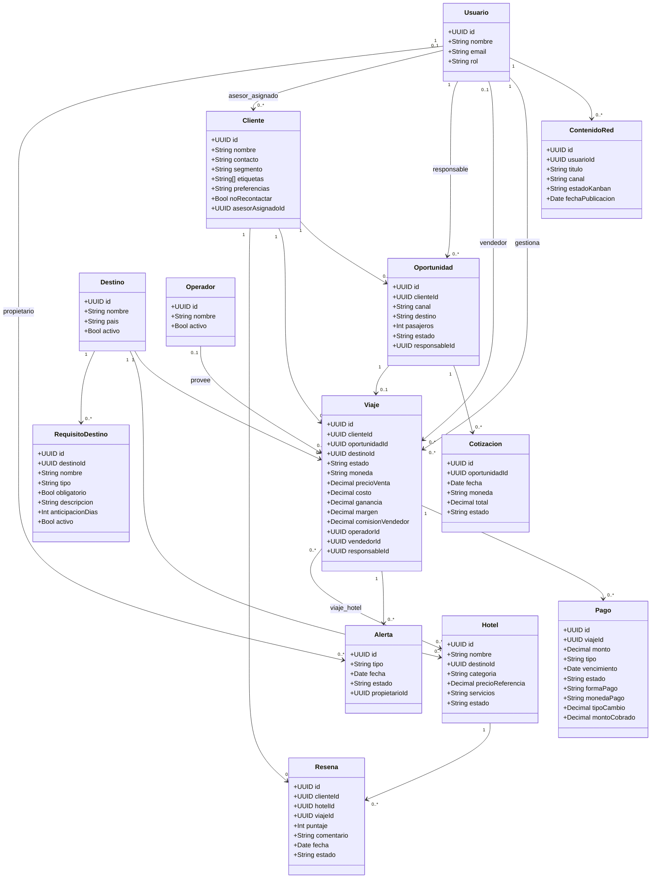

# MOC — Modelo de dominio

tags:: #tipo/diagrama #tipo/modulo #estado/en-revision #pc/pc1

> Mapa de las **13 entidades** y su diagrama de clases. Es la *salida*; la verdad de cada entidad vive en su nota (source). Al cambiar una entidad, actualizar este bloque. Un solo editor por vez (ver [[Guía del Vault#3 · Workflow colaborativo]]).

## Entidades
[[Usuario]] · [[Cliente]] · [[Oportunidad]] · [[Viaje]] · [[Pago]] · [[Hotel]] · [[Reseña]] · [[Alerta]] · [[Cotización]] · [[ContenidoRed]] · [[Destino]] · [[RequisitoDestino]] · [[Operador]] ⚠️(nueva 17/09, [[DEC-0009 Operador-Proveedor como entidad de catálogo]])

## Diagrama de clases (borrador)

> Relación Viaje–Hotel (N:M) y objeto de la Reseña resueltos en [[DEC-0003 Relación Viaje–Hotel y Reseña]].
> `destino` de [[Viaje]] y [[Hotel]] pasó de `String` a FK hacia [[Destino]] (catálogo) — ver [[DEC-0006 Destino como entidad de catálogo]].
> [[Viaje]] gana el bloque económico (`moneda`, `costo`, `ganancia`, `margen`, `vendedor`, `comision_vendedor`) y FK `operador` — ver [[DEC-0007 Modelo económico — ganancia, margen y comisión de vendedor]] y [[DEC-0009 Operador-Proveedor como entidad de catálogo]] (sync 17/09).
> **18/09 (entrevista grill):** se completaron los atributos del diagrama de clases para que quede coherente con las notas fuente ([[Pago]] con `forma_pago`/`moneda_pago`/`tipo_cambio`/`monto_cobrado`/estado `anulado`; [[Cliente]] con `contacto`/`preferencias`/`no_recontactar`; [[Reseña]], [[Cotización]], [[Alerta]] con sus atributos y FKs). `canal` de [[Oportunidad]] suma `presencial` y `segmento` de [[Cliente]] suma `pareja`.

## Diagrama ER
- Ver [[DGM-ER]] (modelo relacional para PostgreSQL).

## Pendientes de este diagrama
- Cardinalidad Viaje–Hotel (N:M) y objeto de la `Reseña` (Hotel) → decidido en [[DEC-0003 Relación Viaje–Hotel y Reseña]] (`en-revision`, ratificar en sync).
