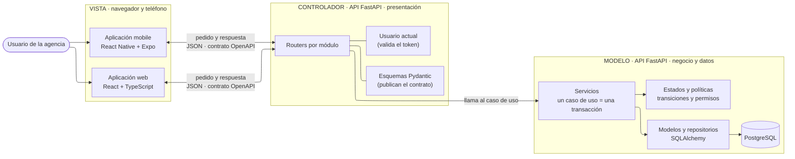
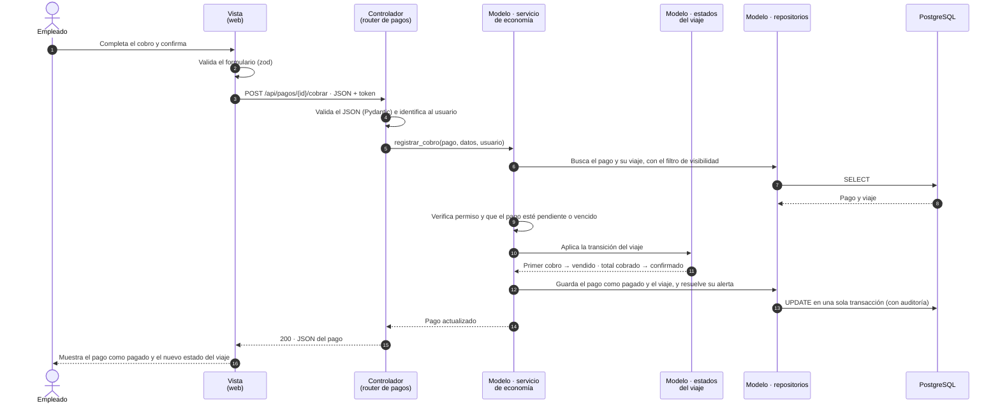
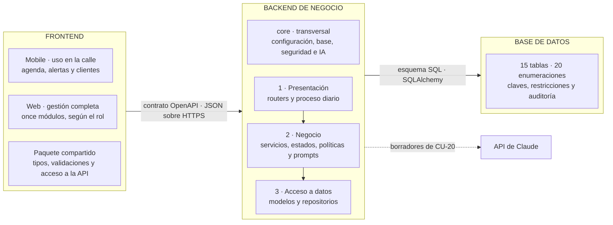

# ARQ — MVC y modelo conceptual por capa

tags:: #tipo/analisis #estado/en-revision #pc/pc1

> Pasos **G2** (sección MVC) y **G3** (modelo conceptual por capa) del plan a 3 días. Responde a las láminas del PC1 «Documento con el MVC» y «Modelo conceptual: Frontend, Backend, Base de datos». Complementa a [[ARQ — Vista general]], que sigue siendo la fuente de las vistas y del C4; esta nota no las repite. Supuesto del plan (H0): «MVC» es **Modelo-Vista-Controlador**. Armada por Francisco el 30/09; la revisa Nahuel antes del cierre del día 2.

## MVC en Rumbo
Rumbo aplica el patrón **Modelo-Vista-Controlador** a escala de todo el sistema: la **Vista** son las aplicaciones que usa la agencia, el **Controlador** es la puerta de entrada de la API y el **Modelo** es el dominio con sus reglas y sus datos. Vista y Controlador corren en equipos distintos y se comunican solo por un **contrato OpenAPI en JSON**.



| Parte | En Rumbo | Tecnología | Capa de [[ARQ — Vista general]] | Responsabilidad | Qué no hace |
|---|---|---|---|---|---|
| **Vista** | Aplicación web y aplicación mobile | React + TypeScript + Vite; React Native + Expo | Clientes (fuera de la API) | Muestra la información y captura lo que carga el usuario; valida el formato de los formularios antes de enviarlos | No guarda datos del negocio ni decide reglas: todo pasa por la API |
| **Controlador** | Routers, esquemas y usuario actual de la API | FastAPI + Pydantic | Presentación | Recibe el pedido HTTP, valida el JSON contra el contrato, identifica al usuario por su token, llama al servicio del caso de uso y devuelve la respuesta en JSON con su código | No tiene reglas de negocio ni consultas a la base |
| **Modelo** | Servicios, estados, políticas, modelos, repositorios y la base | Python + SQLAlchemy + PostgreSQL | Lógica de negocio y acceso a datos | Ejecuta cada caso de uso en una transacción, aplica las transiciones de estado, la visibilidad y los permisos, y guarda y lee los datos | No conoce HTTP ni cómo se muestra la información |

**Por qué los servicios son parte del Modelo y no del Controlador.** En MVC el controlador es delgado: traduce la entrada y delega. Las reglas del negocio (por ejemplo, que el primer cobro pase el viaje a `vendido`, o qué puede ver un vendedor freelance) pertenecen al modelo del dominio. Por eso en Rumbo el Controlador es solo la capa de presentación, y la lógica de negocio y los datos forman el Modelo. El proceso automático diario entra por otro punto de la presentación (`jobs/diario.py`) y usa los mismos servicios, así que aplica las mismas reglas que una persona.

## Comunicación entre Vista y Controlador: OpenAPI en JSON
La Vista y el Controlador no comparten código: se comunican **solo** por el contrato publicado en [[Contrato de la API (OpenAPI)]] (OpenAPI 3.1, 96 operaciones en los 11 módulos).

- **Transporte:** HTTPS, a través de Cloudflare Tunnel y `nginx`, con todas las rutas bajo `/api`.
- **Formato:** JSON en los dos sentidos. Fechas en ISO 8601 (la Vista las muestra como `dd/mm/aa`) e importes como texto decimal, para no perder precisión.
- **Autenticación:** después del inicio de sesión, cada pedido lleva un token en el encabezado `Authorization: Bearer`.
- **Operaciones:** los datos se leen y se editan como recursos (`GET /viajes`, `PATCH /clientes/{id}`) y cada cambio de estado de un caso de uso es una acción propia (`POST /pagos/{id}/cobrar`, `POST /viajes/{id}/cancelar`).
- **Errores:** siempre con el mismo formato (`application/problem+json`): `401` sin sesión válida, `403` sin permiso, `404` inexistente o no visible para ese usuario, `409` si choca con el estado actual y `422` si los datos no son válidos.
- **Tipos compartidos:** la Vista genera sus tipos TypeScript a partir del contrato (`openapi-typescript`) y valida los formularios con `zod`. Si el contrato cambia, la Vista deja de compilar en lugar de fallar en uso.

### Ejemplo: registrar el cobro de un pago (CU-12)
El empleado registra el cobro de una cuota desde la ficha del viaje. La Vista envía:

```http
POST /api/pagos/{pago_id}/cobrar
Authorization: Bearer <token>
Content-Type: application/json
```

```json
{
  "fecha_cobro": "2026-10-02",
  "forma_pago": "transferencia",
  "moneda_pago": "ARS",
  "tipo_cambio": null
}
```

El cuerpo cumple este esquema del contrato (extracto de `openapi.json`):

```json
"CobroRegistrar": {
  "type": "object",
  "description": "El servidor calcula monto_cobrado y actualiza el estado del viaje (CU-12 A0 y A2).",
  "properties": {
    "fecha_cobro": { "type": "string", "format": "date" },
    "forma_pago": { "$ref": "#/components/schemas/FormaPago" },
    "moneda_pago": { "$ref": "#/components/schemas/Moneda" },
    "tipo_cambio": {
      "type": ["string", "null"],
      "format": "decimal",
      "description": "Obligatorio si moneda_pago difiere de la moneda del viaje."
    }
  },
  "required": ["fecha_cobro", "forma_pago", "moneda_pago"]
}
```

Así se reparte el trabajo entre las tres partes:



Si algo falla, el Controlador responde con el error del contrato y la Vista lo muestra: `409` si el pago ya estaba `pagado` o `anulado`, `422` si falta el tipo de cambio en un cobro en otra moneda, y `404` si un freelance intenta cobrar un pago que no es suyo. El detalle del caso de uso, con sus flujos alternativos, está en [[CU-12 Registrar cobro de un pago]] y en su diagrama de secuencia de análisis ([[DGM-SEC — Registrar cobro de un pago]]).

## Modelo conceptual por capa
Rumbo se organiza en tres capas conceptuales: el **frontend**, que usan las personas; el **backend**, que tiene las reglas del negocio; y la **base de datos**, que guarda la información. Cada una se puede cambiar sin tocar las otras mientras se respete el contrato entre ellas: el contrato OpenAPI entre frontend y backend, y el esquema SQL entre backend y base de datos.



### Frontend
- **Responsabilidades:** mostrar la información de cada módulo según el rol del usuario, capturar los datos de los formularios, validarlos antes de enviarlos, llamar a la API y mostrar sus respuestas y errores. Las fechas se muestran como `dd/mm/aa` y los importes en ARS o USD, según la operación.
- **Tecnologías:** React + TypeScript + Vite (web), React Native + Expo (mobile, distribuida de forma interna con EAS Build) y un paquete compartido con TanStack Query, Axios, `zod` y los tipos generados del contrato.
- **Qué atiende:**
  - **Web:** los once módulos (clientes, oportunidades y cotizaciones, viajes, economía y pagos, alertas, configuración, hoteles, redes, dashboard, calendario y usuarios), mostrando a cada rol solo lo que le corresponde: el `freelance`, por ejemplo, no ve el módulo de redes ni puede cargar hoteles.
  - **Mobile:** la agenda y las alertas del día y la consulta de clientes, para el uso fuera de la oficina.
- **Qué no hace:** no decide reglas del negocio ni permisos (el backend los vuelve a verificar siempre) y no guarda datos del negocio en el equipo.

### Backend de negocio
- **Responsabilidades:** ser la **única puerta al dominio**. Autentica a cada usuario y aplica la visibilidad y los permisos de su rol; ejecuta cada caso de uso completo en una transacción; aplica las transiciones de estado de las entidades y rechaza las inválidas; calcula lo que el cliente no debe calcular (ganancia, margen, saldo, porcentaje pagado); registra quién hizo cada cambio; y corre todos los días a las 00:00 el proceso automático que vence pagos y cotizaciones y genera las alertas.
- **Tecnologías:** Python + FastAPI, Pydantic, SQLAlchemy 2.0 async, Alembic para las migraciones y LangChain para la llamada a Claude Sonnet 5.5.
- **Qué atiende:** los once módulos, cada uno con su router, su servicio y su repositorio:

| Módulo | Casos de uso |
|---|---|
| Clientes | CU-02 y CU-03 |
| Oportunidades (incluye cotizaciones y recontacto) | CU-04, CU-05, CU-06 y CU-30 |
| Viajes | CU-07, CU-08, CU-09 y CU-27 |
| Economía y pagos | CU-10, CU-11 y CU-12 |
| Alertas | CU-14 y CU-28 |
| Configuración y catálogos | CU-13, CU-15, CU-26 y CU-31 |
| Hoteles | CU-16, CU-17, CU-18 y CU-29 |
| Redes | CU-19 y CU-20 |
| Dashboard (solo lectura) | CU-21 y CU-22 |
| Calendario (solo lectura) | CU-23 |
| Seguridad | CU-24 y CU-25 |

- **Qué no hace:** no muestra pantallas ni conoce cómo se presenta la información, y no publica en redes ni cobra pagos online (fuera del alcance).

### Base de datos
- **Responsabilidades:** guardar la información de forma persistente y proteger su integridad aunque falle otra capa: claves primarias y foráneas, valores válidos para cada estado y cada tipo, y restricciones que impiden datos incoherentes (por ejemplo, un viaje cancelado sin motivo, una reseña con puntaje fuera de 1 a 5 o una alerta con dos orígenes).
- **Tecnologías:** PostgreSQL, con el esquema escrito en [[Modelo de datos SQL]] a partir del [[DGM-ER]]. En el PC2, la primera migración de Alembic lo reproduce.
- **Qué atiende:** 15 tablas, agrupadas por módulo:

| Módulo | Tablas |
|---|---|
| Clientes | `cliente` |
| Oportunidades | `oportunidad` y `cotizacion` |
| Viajes | `viaje` y `viaje_hotel` (los tramos del itinerario) |
| Economía y pagos | `pago` |
| Alertas | `alerta` |
| Configuración y catálogos | `configuracion`, `destino`, `requisito_destino` y `operador` |
| Hoteles | `hotel` y `resena` |
| Redes | `contenido_red` |
| Seguridad | `usuario` |

- **Criterios transversales:** toda tabla de entidad registra quién la creó y la modificó y cuándo; nada se borra en cascada, porque en Rumbo las bajas son lógicas; y las reglas que dependen de varias filas (por ejemplo, que todo viaje tenga al menos un pago) las garantiza el backend.
- **Qué no hace:** no contiene lógica de negocio en procedimientos almacenados: las reglas viven en el backend, y la base solo asegura la integridad.

## 🔎 Revisión
> [!question] Francisco (30/09) — para Nahuel: (1) ¿estás de acuerdo con ubicar los **servicios** de negocio en el **Modelo** y no en el Controlador? El plan original decía «routers y servicios de FastAPI» para el Controlador; se eligió la lectura clásica de MVC (controlador delgado) porque en Rumbo las reglas viven en los servicios. (2) Revisar que la tabla de módulos y la de tablas por módulo coincidan con ARQ y el ER (`operador` y `destino` quedaron en configuración y catálogos). (3) Revisar el diagrama de secuencia de CU-12 contra la vista lógica.
