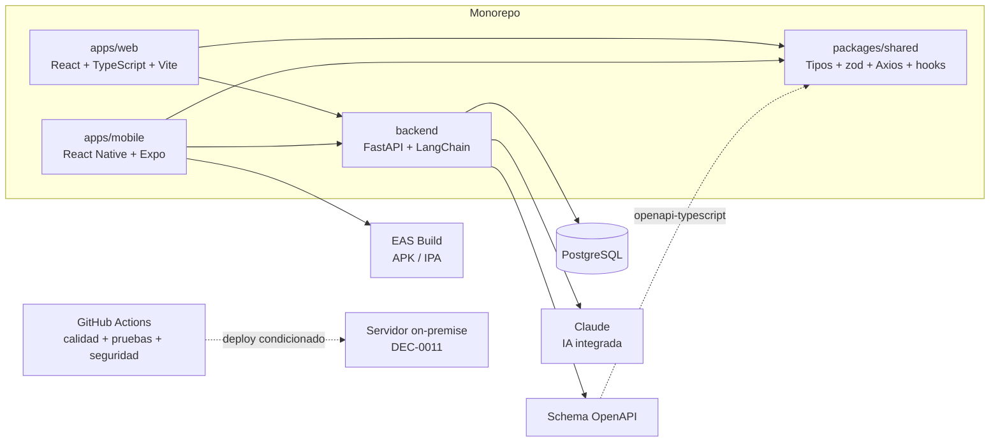
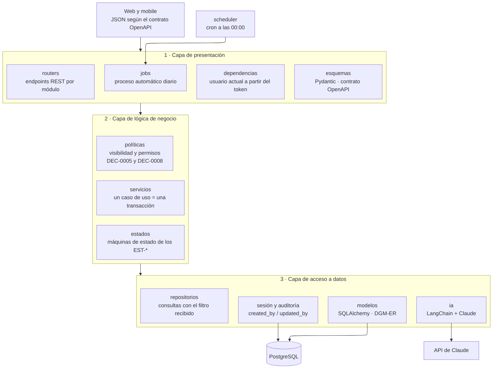

# ARQ — Vista general

tags:: #tipo/analisis #estado/en-revision #pc/pc1

> Arquitectura de software de Rumbo. Basada en [[DEC-0001 Stack tecnológico]].

## Vista de despliegue
Dónde corre cada pieza en producción, según [[DEC-0011 Infraestructura de despliegue on-premise]]. Todo el backend vive en un servidor dentro de la agencia; desde afuera se entra solo por Cloudflare Tunnel, que abre la conexión desde el servidor hacia la nube, así que el router no expone ningún puerto. La caja punteada es lo que se difiere a PC2.

```mermaid
%%{init: {"flowchart": {"defaultRenderer": "elk"}} }%%
flowchart LR
    subgraph Usuarios["Usuarios"]
      Nav["Navegador<br/>admin · dueño · empleado · freelance"]
      Tel["Teléfono<br/>app mobile Android / iOS"]
    end

    subgraph Entrada["Entrada desde internet"]
      CF["Cloudflare Tunnel<br/>TLS y acceso desde fuera de la agencia"]
    end

    subgraph Agencia["Servidor on-premise en la agencia · Ubuntu Server LTS + UPS · DEC-0011"]
      subgraph Compose["Docker Compose"]
        Nginx["nginx<br/>web compilada + proxy de /api"]
        API["api<br/>FastAPI + LangChain"]
        DB[("postgres<br/>volumen persistente")]
        Sched["scheduler<br/>cron 00:00 hora argentina<br/>proceso automático diario"]
      end
      Runner["Runner self-hosted<br/>GitHub Actions · solo main"]
      Backup["Respaldo diario + copia externa<br/>RNF-08 · se implementa en PC2"]
    end

    subgraph Nube["Servicios en la nube"]
      Claude["API de Claude<br/>Sonnet 5.5 · DEC-0012"]
      GH["GitHub<br/>repositorio privado + Actions"]
    end

    Nav -->|"desde afuera"| CF
    Tel --> CF
    Nav -. "red local" .-> Nginx
    CF -->|"túnel saliente,<br/>sin puertos abiertos"| Nginx
    Nginx -->|"/api"| API
    API --> DB
    Sched -->|"vence pagos y cotizaciones,<br/>genera alertas"| DB
    Backup -.-> DB
    API -->|"CU-20"| Claude
    Runner -->|"toma los jobs de main"| GH
    Runner -->|"docker compose up"| Compose

    classDef pendiente stroke-dasharray: 5 5,color:#777
    class Backup pendiente
```



- **nginx** sirve la web de React ya compilada y deriva `/api` al backend. Es el único punto de entrada, tanto desde la red local como desde el túnel.
- **scheduler** ejecuta a las 00:00 el mismo código del backend como comando (por ejemplo `python -m rumbo.jobs.diario`): vence pagos y cotizaciones y genera las alertas `viaje` y `recontacto` ([[DGM-ACT — Proceso automático diario]]). Es idempotente, así que correrlo dos veces no duplica nada.
- **Runner self-hosted:** cuando el pipeline de calidad pasa en `main`, reconstruye y levanta los contenedores. Solo toma jobs de `main` del repositorio privado.
- **App mobile:** EAS Build genera los binarios y se distribuyen de forma interna, sin tiendas; la app habla con la misma API por el túnel.
- **Riesgos aceptados:** un corte de luz más largo que la autonomía de la UPS, o de internet en el local, deja el sistema inaccesible desde afuera (RNF-13).

## Vista de componentes del monorepo
Cómo se organiza el código y qué genera cada parte, según [[DEC-0001 Stack tecnológico]].



## Vista lógica del backend
La API de FastAPI sigue el **modelo de tres capas**: **presentación**, **lógica de negocio** y **acceso a datos**. Cada capa solo usa a la de abajo: presentación → negocio → datos, **nunca hacia arriba y sin saltear capas** (un router nunca llama a un repositorio). Dentro de cada capa hay una subcarpeta por **módulo funcional** del [[MOC — Casos de uso]].

### Capas


| Capa | Carpeta | Qué hace | Qué **no** hace |
|---|---|---|---|
| **1 · Presentación** | `presentacion/` | Recibe el pedido HTTP, valida el JSON con los esquemas Pydantic (que publican el contrato OpenAPI), identifica al usuario por su token ([[DEC-0008 Autenticación propia y rol de vendedor freelance\|DEC-0008]]) y llama a un servicio. `jobs/diario.py` es el otro punto de entrada: lo ejecuta el scheduler a las 00:00. | No tiene reglas de negocio ni consultas. |
| **2 · Lógica de negocio** | `negocio/` | Los **servicios** orquestan un caso de uso completo en **una transacción**: por ejemplo, confirmar la reserva crea el `Viaje`, el plan de cuotas y las alertas, y pasa la `Oportunidad` a `ganada` (CU-07). Los **estados** aplican las transiciones de los `EST-*` y rechazan las inválidas. Las **políticas** deciden qué puede ver y editar cada rol. | No arma SQL ni conoce HTTP. |
| **3 · Acceso a datos** | `datos/` | Los **modelos** mapean las 14 tablas del [[DGM-ER]]. Los **repositorios** buscan y guardan. La **sesión** abre una transacción por pedido y la **auditoría** completa `created_by`, `updated_by`, `created_at` y `updated_at` antes de cada guardado. **`ia`** accede a la API de Claude, igual que los repositorios acceden a la base. | No decide reglas de negocio. |

**Cómo se reparten las reglas transversales entre capas:**
- **Visibilidad por fila.** La capa de negocio decide el filtro: `freelance` solo ve lo propio; las `Alerta` son propias salvo para `admin` y `dueño`; el resto de los roles lee toda la agencia ([[DEC-0005 Autenticación y modelo de roles|DEC-0005]]). El servicio se lo pasa al repositorio como **parámetro obligatorio** de toda consulta de lectura. Así datos no depende de negocio y ningún listado puede olvidar el filtro.
- **Permisos de escritura.** Los valida el servicio antes de modificar: el responsable del registro o `admin`/`dueño`; configuración y moderación, solo `admin`.
- **Auditoría.** Presentación deja el usuario del pedido en el contexto de la sesión, y la capa de datos lo usa para completar las columnas de auditoría en **todas las tablas** sin que cada servicio tenga que acordarse. Lo que hace el proceso automático queda con `created_by`/`updated_by` **vacíos**, que se lee como «lo hizo el sistema».
- **Integración con Claude.** Solo el servicio de `redes` usa `datos/ia` (CU-20), y no le pasa datos de clientes ([[DEC-0012 Modelo de IA del producto|DEC-0012]]). Si la API de Claude falla, CU-20 informa el error y el resto del sistema sigue funcionando.
- **Proceso automático.** `jobs/diario.py` llama a los **mismos servicios** que los routers. Así vencer un pago a medianoche aplica exactamente las mismas reglas que si lo hiciera una persona.

### Módulos (dependencias entre servicios)


- **Once módulos**, con los mismos nombres que el [[MOC — Casos de uso]]. Cada uno tiene su archivo en las tres capas: su router y sus esquemas en presentación, su servicio en negocio y su repositorio en datos.
- **Una flecha es «el servicio de A usa al servicio de B»**, dentro de la capa de negocio. Las dependencias van **en un solo sentido, sin ciclos**. El caso delicado es viajes ↔ economía: confirmar la reserva (viajes) crea el plan de cuotas (economía), y el primer cobro (economía) cambia el estado del viaje. El ciclo se evita porque ese cambio lo aplica `negocio/estados/viaje.py`, que usan los dos servicios, y no el servicio de viajes.
- **`dashboard` y `calendario` solo leen:** hacen consultas agregadas sobre los módulos de operación.
- **`seguridad`** gestiona usuarios y roles (CU-24 y CU-25). Los demás módulos lo usan de forma indirecta, a través del usuario actual que resuelve presentación; por eso no se dibujan esas flechas.

### Estructura de carpetas
```text
backend/rumbo/
├── main.py                     # arma la app FastAPI y registra los routers
├── config.py                   # configuración leída del entorno (.env fuera de Git)
│
├── presentacion/               # CAPA 1 · Presentación
│   ├── dependencias.py         # usuario actual a partir del token (DEC-0008)
│   ├── routers/                # un archivo por módulo: clientes.py, viajes.py, …
│   ├── esquemas/               # Pydantic por módulo; generan el contrato OpenAPI
│   └── jobs/
│       └── diario.py           # punto de entrada del scheduler (00:00)
│
├── negocio/                    # CAPA 2 · Lógica de negocio
│   ├── servicios/              # un archivo por módulo: clientes.py, viajes.py, …
│   ├── estados/                # viaje.py, oportunidad.py, pago.py, cotizacion.py,
│   │                           # alerta.py, contenido_red.py (reglas de los EST-*)
│   └── politicas.py            # visibilidad por fila y permisos (DEC-0005 y DEC-0008)
│
└── datos/                      # CAPA 3 · Acceso a datos
    ├── sesion.py               # sesión async de SQLAlchemy, una transacción por pedido
    ├── auditoria.py            # completa created_by / updated_by antes de guardar
    ├── modelos/                # una clase SQLAlchemy por entidad del DGM-ER
    ├── repositorios/           # un archivo por módulo; reciben el filtro de visibilidad
    └── ia/
        └── claude.py           # cadena LangChain + Claude (DEC-0012)
```

Los once módulos (`clientes`, `oportunidades`, `viajes`, `economia`, `alertas`, `configuracion`, `hoteles`, `redes`, `dashboard`, `calendario` y `seguridad`) aparecen con el mismo nombre de archivo en `routers/`, `esquemas/`, `servicios/` y `repositorios/`. Cotización y recontacto (CU-06 y CU-30) viven dentro de `oportunidades`.

## Componentes
- **Web (React + TypeScript + Vite):** back-office del agente/admin.
- **Mobile (React Native + Expo):** acceso rápido a agenda, alertas y clientes; EAS Build genera los binarios.
- **Paquete compartido:** tipos OpenAPI, validaciones zod, Axios y hooks de TanStack Query para ambas aplicaciones.
- **FastAPI:** única puerta al dominio; sirve JSON a web y mobile e integra Claude mediante LangChain.
- **PostgreSQL:** persistencia relacional de las 13 entidades → [[DGM-ER]].
- **GitHub Actions:** ejecuta lint, type-checking, pruebas y controles de seguridad en cada push.

## Pendiente
- ✅ **Roles y visibilidad** ([[Usuario]]): sellado en [[DEC-0005 Autenticación y modelo de roles]] y ampliado por [[DEC-0008 Autenticación propia y rol de vendedor freelance]] — roles `admin`/`dueño`/`empleado`/`freelance`, con autorización a nivel de fila y catálogo compartido.
- ✅ **Mecanismo de autenticación:** resuelto en [[DEC-0008 Autenticación propia y rol de vendedor freelance]] (usuario/contraseña individual; Google OAuth opcional y futuro).
- ✅ **Infraestructura y despliegue:** decididos en [[DEC-0011 Infraestructura de despliegue on-premise]] (29/09): servidor on-premise con Docker Compose (`nginx`, `api`, `postgres`, `scheduler`), Cloudflare Tunnel y runner self-hosted. Ya está en la *Vista de despliegue* (paso A2, 29/09).
- ✅ **Persistencia y migraciones** (29/09): **SQLAlchemy 2.0 en modo async** para el acceso a PostgreSQL y **Alembic** para las migraciones. El esquema inicial es el del [[DGM-ER]]; en PC2, la primera migración de Alembic reproduce el script SQL del PC1.
- ✅ **Actualización de dependencias** (29/09): **Dependabot**, anotado en [[DEC-0001 Stack tecnológico]].
- ✅ **IA del producto:** Claude Sonnet 5.5 vía LangChain, en [[DEC-0012 Modelo de IA del producto]].
