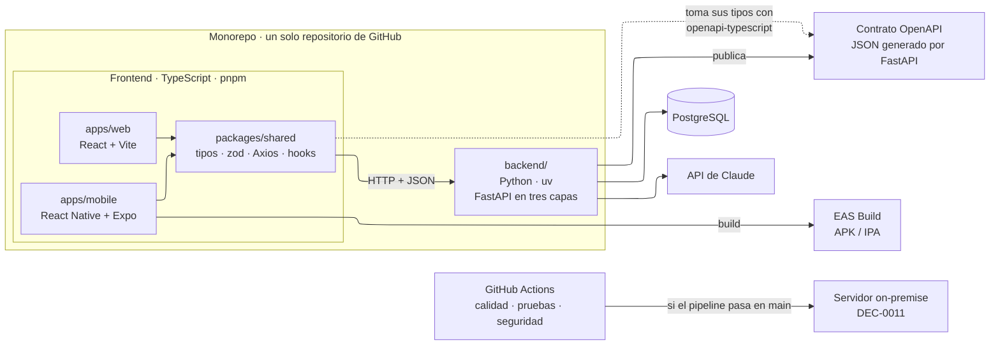
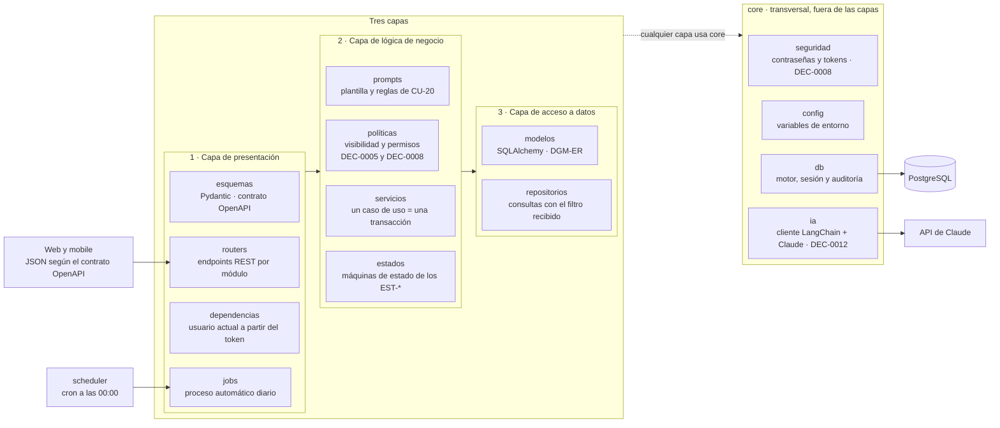
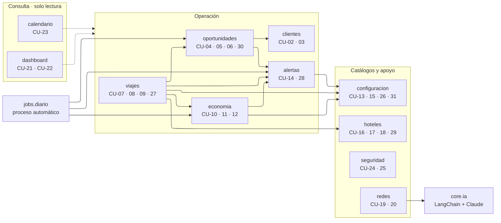
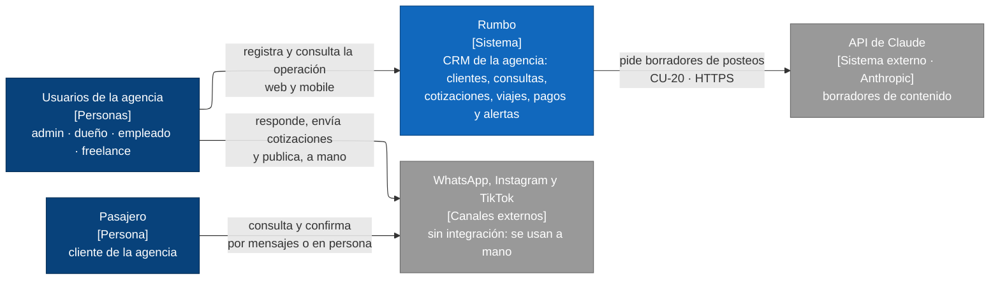
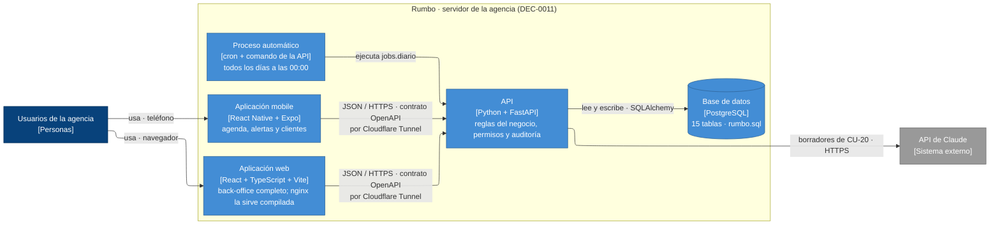

# ARQ — Vista general

tags:: #tipo/analisis #estado/en-revision #pc/pc1

> Arquitectura de software de Rumbo. El stack está en [[DEC-0001 Stack tecnológico]]; la infraestructura, en [[DEC-0011 Infraestructura de despliegue on-premise]].

## Resumen
Rumbo es una aplicación **cliente-servidor**: dos clientes (web y mobile) hablan en JSON con una única API, que es la dueña de todas las reglas del negocio y de la base de datos. Todo el backend corre en un servidor dentro de la agencia.

| Pieza | Tecnología | Rol |
|---|---|---|
| **Web** | React + TypeScript + Vite | Gestión completa: el back-office de la agencia (RNF-14). |
| **Mobile** | React Native + Expo | Acceso rápido a la agenda, las alertas y los clientes; se distribuye de forma interna con EAS Build, sin tiendas. |
| **Paquete compartido** | TypeScript, zod, Axios, TanStack Query | Tipos generados del contrato OpenAPI, validaciones y acceso a la API, reutilizados por web y mobile. |
| **API** | Python + FastAPI, en **tres capas** más un paquete `core` transversal | Única puerta al dominio: presentación, lógica de negocio y acceso a datos; `core` reúne configuración, base, seguridad y el cliente de IA (ver *Vista lógica del backend*). |
| **Base de datos** | PostgreSQL, con SQLAlchemy 2.0 async y Alembic | Persistencia de las 13 entidades del [[DGM-ER]]. |
| **Proceso automático** | Contenedor con cron | Todos los días a las 00:00 vence pagos y cotizaciones y genera alertas, usando los mismos servicios que la API. |
| **IA del producto** | LangChain + Claude Sonnet 5.5 | Solo para los borradores de contenido de CU-20 ([[DEC-0012 Modelo de IA del producto]]). |
| **Servidor** | Ubuntu Server LTS + Docker Compose + UPS | Aloja la API, la base, el proceso automático, nginx y el conector `cloudflared`; todos los usuarios entran por Cloudflare Tunnel. |
| **Calidad y despliegue** | GitHub Actions + runner self-hosted + Dependabot | Lint, tipos, pruebas y seguridad en cada push; despliega solo si el pipeline pasa en `main`. |

La arquitectura se describe en tres vistas: **despliegue** (dónde corre cada pieza), **componentes del monorepo** (cómo se organiza el código) y **vista lógica del backend** (las tres capas de la API y sus módulos). Al final, el **modelo C4** resume todo en tres niveles: contexto, contenedores y componentes.

## Vista de despliegue
Dónde corre cada pieza en producción, según [[DEC-0011 Infraestructura de despliegue on-premise]]. Todo el backend vive en un servidor dentro de la agencia. **Todos los usuarios**, también los de la red local, entran por la URL de Cloudflare Tunnel: el contenedor `cloudflared` abre la conexión desde el servidor hacia la nube, así que el router no expone ningún puerto. La flecha punteada desde el navegador es la entrada local directa, que queda solo como respaldo si se corta internet; la caja punteada es lo que se difiere a PC2.

```mermaid
%%{init: {"flowchart": {"defaultRenderer": "elk"}} }%%
flowchart LR
    subgraph Usuarios["Usuarios"]
      Nav["Navegador<br/>admin · dueño · empleado · freelance"]
      Tel["Teléfono<br/>app mobile Android / iOS"]
    end

    subgraph Entrada["Entrada de todos los usuarios"]
      CF["Cloudflare Tunnel<br/>URL pública con TLS<br/>Cloudflare ve el tráfico descifrado"]
    end

    subgraph Agencia["Servidor on-premise en la agencia · Ubuntu Server LTS + UPS · DEC-0011"]
      subgraph Compose["Docker Compose · cinco contenedores"]
        Cfd["cloudflared<br/>conector del túnel<br/>token en el .env, fuera de Git"]
        Nginx["nginx<br/>web compilada + proxy de /api"]
        API["api<br/>FastAPI + LangChain"]
        DB[("postgres<br/>volumen persistente")]
        Sched["scheduler<br/>cron 00:00 hora argentina<br/>proceso automático diario"]
      end
      Runner["Runner self-hosted<br/>GitHub Actions · solo main"]
      Backup["Respaldo diario + copia externa<br/>RNF-08 · se implementa en PC2"]
    end

    subgraph Nube["Servicios en la nube"]
      Claude["API de Claude<br/>Sonnet 5.5 · DEC-0012"]
      GH["GitHub<br/>repositorio privado + Actions"]
    end

    Nav --> CF
    Tel --> CF
    Nav -. "respaldo local<br/>si se corta internet" .-> Nginx
    CF -->|"túnel abierto desde el servidor,<br/>sin puertos en el router"| Cfd
    Cfd --> Nginx
    Nginx -->|"/api"| API
    API --> DB
    Sched -->|"vence pagos y cotizaciones,<br/>genera alertas"| DB
    Backup -.-> DB
    API -->|"CU-20"| Claude
    Runner -->|"toma los jobs de main"| GH
    Runner -->|"docker compose up"| Compose

    classDef pendiente stroke-dasharray: 5 5,color:#777
    class Backup pendiente
```



- **cloudflared** es el conector de Cloudflare Tunnel: abre la conexión saliente hacia Cloudflare y le entrega el tráfico a `nginx`. Su token vive en el `.env` del servidor y nunca se guarda en Git.
- **nginx** sirve la web de React ya compilada y deriva `/api` al backend. Recibe el tráfico del túnel, que es la entrada normal de **todos** los usuarios; la entrada directa desde la red local queda solo como respaldo si se corta internet.
- **scheduler** ejecuta a las 00:00 el mismo código del backend como comando (`python -m rumbo.presentacion.jobs.diario`): vence pagos y cotizaciones y genera las alertas `viaje` y `recontacto` ([[DGM-ACT — Proceso automático diario]]). Es idempotente, así que correrlo dos veces no duplica nada.
- **Runner self-hosted:** cuando el pipeline de calidad pasa en `main`, reconstruye y levanta los contenedores. Solo toma jobs de `main` del repositorio privado.
- **App mobile:** EAS Build genera los binarios y se distribuyen de forma interna, sin tiendas; la app habla con la misma API por el túnel.
- **Riesgos aceptados:** un corte de luz más largo que la autonomía de la UPS, o de internet en el local, deja el sistema inaccesible desde afuera (RNF-13). Además, Cloudflare termina el TLS, así que ve el tráfico descifrado que pasa por el túnel.

## Vista de componentes del monorepo
Cómo se organiza el código y qué genera cada parte, según [[DEC-0001 Stack tecnológico]].



## Vista lógica del backend
La API de FastAPI sigue el **modelo de tres capas** (**presentación**, **lógica de negocio** y **acceso a datos**) más un paquete **`core`** transversal, fuera de las capas.
- **Entre capas:** cada capa solo usa a la de abajo: presentación → negocio → datos, **nunca hacia arriba y sin saltear capas**. Por ejemplo, un router nunca llama a un repositorio.
- **`core`:** reúne lo **técnico y transversal que no es negocio**: configuración, conexión a la base, seguridad y el cliente de IA. **`core` no usa ninguna capa, y cualquier capa puede usar `core`.** El criterio para que algo entre ahí es que sea técnico, transversal y sin reglas del negocio; así no se convierte en un cajón de sastre.
- **Módulos:** dentro de cada capa hay un archivo por **módulo funcional** del [[MOC — Casos de uso]].

### Capas


| Paquete | Carpeta | Qué hace | Qué **no** hace |
|---|---|---|---|
| **1 · Presentación** | `presentacion/` | Recibe el pedido HTTP, valida el JSON con los esquemas Pydantic (que publican el contrato OpenAPI), identifica al usuario validando su token con `core.seguridad` y llama a un servicio. `jobs/diario.py` es el otro punto de entrada: lo ejecuta el scheduler a las 00:00. | No tiene reglas de negocio ni consultas. |
| **2 · Lógica de negocio** | `negocio/` | Los **servicios** orquestan un caso de uso completo en **una transacción**: por ejemplo, confirmar la reserva crea el `Viaje`, el plan de cuotas y las alertas, y pasa la `Oportunidad` a `ganada` (CU-07). Los **estados** aplican las transiciones de los `EST-*` y rechazan las inválidas. Las **políticas** deciden qué puede ver y editar cada rol. Los **prompts** definen qué se le pide a la IA y con qué límites. | No arma SQL ni conoce HTTP. |
| **3 · Acceso a datos** | `datos/` | Los **modelos** mapean las 15 tablas del [[DGM-ER]] y los **repositorios** buscan y guardan, usando la sesión de `core.db`. | No decide reglas de negocio. |
| **core** | `core/` | **`config`** lee la configuración del entorno. **`db`** crea el motor y la sesión de SQLAlchemy (una transacción por pedido) y completa la auditoría antes de cada guardado. **`seguridad`** hashea contraseñas y emite y valida tokens. **`ia`** habla con la API de Claude por LangChain. | No conoce ninguna capa ni tiene reglas del negocio. |

**Cómo se reparten las reglas transversales:**
- **Visibilidad por fila.** La capa de negocio decide el filtro: `freelance` solo ve lo propio; las `Alerta` son propias salvo para `admin` y `dueño`; el resto de los roles lee toda la agencia ([[DEC-0005 Autenticación y modelo de roles|DEC-0005]]). El servicio se lo pasa al repositorio como **parámetro obligatorio** de toda consulta de lectura. Así datos no depende de negocio y ningún listado puede olvidar el filtro.
- **Permisos de escritura.** Los valida el servicio antes de modificar: el responsable del registro o `admin`/`dueño`; configuración y moderación, solo `admin`.
- **Autenticación.** El login de CU-24 es un servicio de negocio (`seguridad`) que verifica la contraseña con `core.seguridad` y devuelve un token. En cada pedido, presentación valida el token con `core.seguridad` y obtiene el usuario actual ([[DEC-0008 Autenticación propia y rol de vendedor freelance|DEC-0008]]).
- **Auditoría.** Presentación deja el usuario del pedido en el contexto de la sesión, y `core.db` lo usa para completar `created_by`, `updated_by`, `created_at` y `updated_at` en **todas las tablas**, sin que cada servicio tenga que acordarse. Lo que hace el proceso automático queda con `created_by`/`updated_by` **vacíos**, que se lee como «lo hizo el sistema».
- **IA (CU-20), partida en dos.** La **regla de negocio** vive en `negocio/prompts/`: la plantilla con tema, canal y tono, y los límites (no usa datos de clientes, no publica). El **cable técnico** vive en `core/ia.py`: el modelo `claude-sonnet-5-5`, la clave de API, los tiempos de espera y el manejo de errores ([[DEC-0012 Modelo de IA del producto|DEC-0012]]). El servicio de `redes` arma el prompt y se lo pasa a `core.ia`. Si la API de Claude falla, CU-20 informa el error y el resto del sistema sigue funcionando. Es **una sola llamada** (entra un prompt, sale un borrador), no un agente.
- **Proceso automático.** `jobs/diario.py` llama a los **mismos servicios** que los routers. Así vencer un pago a medianoche aplica exactamente las mismas reglas que si lo hiciera una persona.

### Módulos (dependencias entre servicios)


- **Once módulos**, con los mismos nombres que el [[MOC — Casos de uso]]. Cada uno tiene su archivo en las tres capas: su router y sus esquemas en presentación, su servicio en negocio y su repositorio en datos. `redes` es el único que usa `core.ia`.
- **Una flecha es «el servicio de A usa al servicio de B»**, dentro de la capa de negocio. Las dependencias van **en un solo sentido, sin ciclos**. El caso delicado es viajes ↔ economía: confirmar la reserva (viajes) crea el plan de cuotas (economía), y el primer cobro (economía) cambia el estado del viaje. El ciclo se evita porque ese cambio lo aplica `negocio/estados/viaje.py`, que usan los dos servicios, y no el servicio de viajes.
- **`dashboard` y `calendario` solo leen:** hacen consultas agregadas sobre los módulos de operación.
- **`seguridad`** gestiona usuarios y roles (CU-24 y CU-25). Los demás módulos lo usan de forma indirecta, a través del usuario actual que resuelve presentación; por eso no se dibujan esas flechas.

### Estructura de carpetas
```text
backend/rumbo/
├── main.py                     # arma la app FastAPI y registra los routers
│
├── core/                       # TRANSVERSAL · no usa ninguna capa; todas pueden usarlo
│   ├── config.py               # configuración leída del entorno (.env fuera de Git)
│   ├── db.py                   # motor y sesión async de SQLAlchemy + auditoría automática
│   ├── seguridad.py            # hash de contraseñas, emisión y validación de tokens (DEC-0008)
│   └── ia.py                   # cliente LangChain + Claude Sonnet 5.5 (DEC-0012)
│
├── presentacion/               # CAPA 1 · Presentación
│   ├── dependencias.py         # usuario actual a partir del token
│   ├── routers/                # un archivo por módulo: clientes.py, viajes.py, …
│   ├── esquemas/               # Pydantic por módulo; generan el contrato OpenAPI
│   └── jobs/
│       └── diario.py           # punto de entrada del scheduler (00:00)
│
├── negocio/                    # CAPA 2 · Lógica de negocio
│   ├── servicios/              # un archivo por módulo: clientes.py, viajes.py, …
│   ├── estados/                # viaje.py, oportunidad.py, pago.py, cotizacion.py,
│   │                           # alerta.py, contenido_red.py (reglas de los EST-*)
│   ├── politicas.py            # visibilidad por fila y permisos (DEC-0005 y DEC-0008)
│   └── prompts/
│       └── contenido_red.py    # plantilla y límites de CU-20, versionados en el repo
│
└── datos/                      # CAPA 3 · Acceso a datos
    ├── modelos/                # una clase SQLAlchemy por entidad del DGM-ER
    └── repositorios/           # un archivo por módulo; reciben el filtro de visibilidad
```

Los once módulos (`clientes`, `oportunidades`, `viajes`, `economia`, `alertas`, `configuracion`, `hoteles`, `redes`, `dashboard`, `calendario` y `seguridad`) aparecen con el mismo nombre de archivo en `routers/`, `esquemas/`, `servicios/` y `repositorios/`. Cotización y recontacto (CU-06 y CU-30) viven dentro de `oportunidades`.

## Modelo C4
El [modelo C4](https://c4model.com) describe el sistema en niveles de zoom: **contexto** (Rumbo y con quién se relaciona), **contenedores** (las piezas que se ejecutan por separado) y **componentes** (cómo está hecha por dentro la API). Resume en ese formato lo que las vistas de arriba muestran en detalle. Mermaid tiene un tipo de diagrama C4 propio, pero todavía es experimental y se lee mal impreso, así que se dibuja con diagramas de flujo y los colores habituales de C4: personas en azul oscuro, lo que se construye en azules y los sistemas externos en gris.

### Nivel 1 · Contexto


- El **pasajero no usa Rumbo**: habla con la agencia por WhatsApp, Instagram o en persona, y lo que la agencia registra de esa conversación es lo que entra al sistema.
- **WhatsApp, Instagram y TikTok no están integrados** (publicar y enviar mensajes automáticamente está fuera de alcance): Rumbo genera alertas y borradores, y una persona los usa en cada canal.
- La única integración con un sistema externo en tiempo de uso es la **API de Claude**, solo para CU-20 ([[DEC-0012 Modelo de IA del producto|DEC-0012]]).

### Nivel 2 · Contenedores


- **Web y mobile** no guardan datos del negocio ni tienen reglas propias: todo pasa por la API según el [[Contrato de la API (OpenAPI)]].
- El **proceso automático** no es otro programa: es el mismo código de la API ejecutado como comando (`python -m rumbo.presentacion.jobs.diario`), por eso usa las mismas reglas.
- Cómo se despliegan estos contenedores (Docker Compose, `nginx`, `cloudflared`) está en la *Vista de despliegue*; aquí `nginx` y el túnel quedan como parte del camino entre los clientes y la API.

### Nivel 3 · Componentes de la API
Reúne la *Vista lógica del backend* en formato C4: cada caja es un componente de una capa, y las flechas son las llamadas de un caso de uso típico.

```mermaid
%%{init: {"flowchart": {"defaultRenderer": "elk"}} }%%
flowchart LR
    Clientes["Web y mobile<br/>[Contenedores]"]
    Sched["Proceso automático<br/>[Contenedor]"]

    subgraph API["API · FastAPI"]
      subgraph Pres["Presentación"]
        Routers["Routers y esquemas<br/>[FastAPI + Pydantic]<br/>un router por módulo"]
        Deps["Dependencias<br/>[FastAPI]<br/>usuario actual"]
        Jobs["jobs.diario<br/>[comando]"]
      end
      subgraph Neg["Lógica de negocio"]
        Serv["Servicios<br/>[Python]<br/>un caso de uso, una transacción"]
        Est["Estados<br/>[Python]<br/>transiciones de los EST-*"]
        Pol["Políticas<br/>[Python]<br/>visibilidad y permisos"]
        Prompts["Prompts<br/>[Python]<br/>plantilla y límites de CU-20"]
      end
      subgraph Dat["Acceso a datos"]
        Repos["Repositorios<br/>[SQLAlchemy]<br/>consultas con el filtro recibido"]
        Modelos["Modelos<br/>[SQLAlchemy]<br/>tablas del DGM-ER"]
      end
      subgraph Core["core · transversal"]
        Seg["seguridad<br/>[Python]<br/>contraseñas y tokens"]
        Db["db<br/>[SQLAlchemy async]<br/>sesión y auditoría"]
        IA["ia<br/>[LangChain]<br/>cliente de Claude"]
      end
    end

    DB[("PostgreSQL<br/>[Contenedor]")]
    Claude["API de Claude<br/>[Sistema externo]"]

    Clientes -->|"JSON / HTTPS"| Routers
    Routers --> Deps
    Deps -->|"valida el token"| Seg
    Routers -->|"llama al caso de uso"| Serv
    Sched --> Jobs
    Jobs -->|"mismos servicios"| Serv
    Serv --> Pol
    Serv --> Est
    Serv -->|"filtro de visibilidad"| Repos
    Serv --> Prompts
    Serv -->|"prompt armado"| IA
    Repos --> Modelos
    Repos --> Db
    Db -->|"SQL"| DB
    IA -->|"HTTPS"| Claude

    classDef contenedor fill:#438dd5,stroke:#2e6295,color:#ffffff
    classDef componente fill:#85bbf0,stroke:#5d82a8,color:#000000
    classDef externo fill:#999999,stroke:#6b6b6b,color:#ffffff
    class Clientes,Sched,DB contenedor
    class Routers,Deps,Jobs,Serv,Est,Pol,Prompts,Repos,Modelos,Seg,Db,IA componente
    class Claude externo
```



- Las flechas respetan la regla de las capas: presentación llama a negocio y negocio a datos, sin saltear capas; `core` lo puede usar cualquiera y no usa ninguna capa.
- La tabla de paquetes, las reglas transversales y los once módulos están en la *Vista lógica del backend*; este nivel no los repite.

## Decisiones que sostienen esta arquitectura
- **Stack:** [[DEC-0001 Stack tecnológico]], con **Dependabot** para actualizar dependencias (29/09).
- **Roles y visibilidad:** [[DEC-0005 Autenticación y modelo de roles]], ampliada por [[DEC-0008 Autenticación propia y rol de vendedor freelance]]: roles `admin`, `dueño`, `empleado` y `freelance`, con visibilidad por fila y catálogo compartido.
- **Autenticación:** usuario y contraseña individual, con auditoría de autor en cada registro (DEC-0008). Google OAuth queda como opción futura.
- **Infraestructura y despliegue:** [[DEC-0011 Infraestructura de despliegue on-premise]].
- **Persistencia y migraciones** (29/09): SQLAlchemy 2.0 async y Alembic. El esquema inicial es el del [[DGM-ER]], escrito como script en [[Modelo de datos SQL]]; en PC2, la primera migración de Alembic lo reproduce.
- **IA del producto:** [[DEC-0012 Modelo de IA del producto]].
- **Contrato entre vista y controlador:** [[Contrato de la API (OpenAPI)]], preliminar para el PC1; en PC2 lo genera FastAPI.

## Pendiente
- **A6 · Ratificar esta nota** en el cierre del día 2 y pasarla a `formalizado`.
