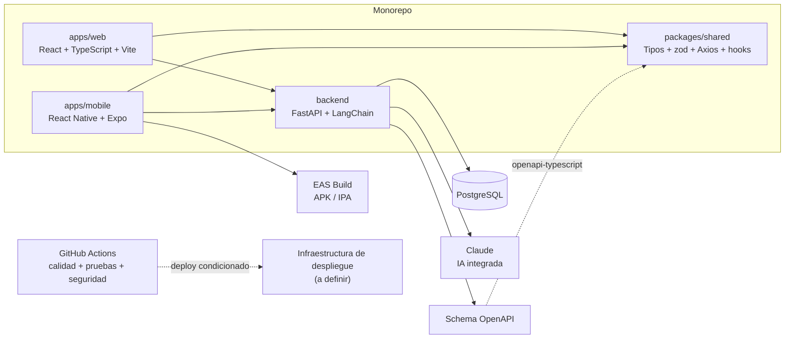

# ARQ — Vista general

tags:: #tipo/analisis #estado/en-revision #pc/pc1

> Arquitectura de software de Rumbo. Basada en [[DEC-0001 Stack tecnológico]].

## Vista de despliegue

## Componentes
- **Web (React + TypeScript + Vite):** back-office del agente/admin.
- **Mobile (React Native + Expo):** acceso rápido a agenda, alertas y clientes; EAS Build genera los binarios.
- **Paquete compartido:** tipos OpenAPI, validaciones zod, Axios y hooks de TanStack Query para ambas aplicaciones.
- **FastAPI:** única puerta al dominio; sirve JSON a web y mobile e integra Claude mediante LangChain.
- **PostgreSQL:** persistencia relacional de las 13 entidades → [[DGM-ER]].
- **GitHub Actions:** ejecuta lint, type-checking, pruebas y controles de seguridad en cada push.

## Pendiente
- ✅ **Roles y visibilidad** ([[Usuario]]): sellado en [[DEC-0005 Autenticación y modelo de roles]] y ampliado por [[DEC-0008 Autenticación propia y rol de vendedor freelance]] — roles `admin`/`dueño`/`empleado`/`freelance`, con autorización a nivel de fila y catálogo compartido.
- ✅ **Mecanismo de autenticación:** resuelto en [[DEC-0008 Autenticación propia y rol de vendedor freelance]] (usuario/contraseña individual; Google OAuth opcional y futuro).
- ✅ **Infraestructura y despliegue:** decididos en [[DEC-0011 Infraestructura de despliegue on-premise]] (29/09): servidor on-premise con Docker Compose (`nginx`, `api`, `postgres`, `scheduler`), Cloudflare Tunnel y runner self-hosted. ⏳ Falta llevarlo al diagrama de la vista de despliegue (paso A2).
- ✅ **Persistencia y migraciones** (29/09): **SQLAlchemy 2.0 en modo async** para el acceso a PostgreSQL y **Alembic** para las migraciones. El esquema inicial es el del [[DGM-ER]]; en PC2, la primera migración de Alembic reproduce el script SQL del PC1.
- ✅ **Actualización de dependencias** (29/09): **Dependabot**, anotado en [[DEC-0001 Stack tecnológico]].
- ✅ **IA del producto:** Claude Sonnet 5.5 vía LangChain, en [[DEC-0012 Modelo de IA del producto]].
