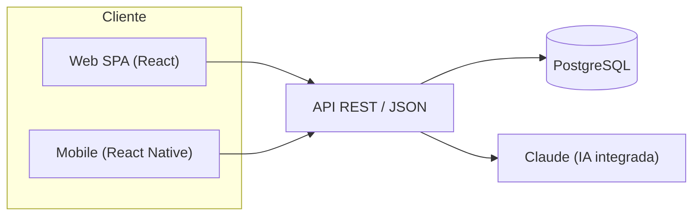

# ARQ — Vista general

tags:: #tipo/analisis #estado/en-revision #pc/pc1

> Arquitectura de software de Rumbo. Basada en [[DEC-0001 Stack tecnológico]].

## Vista de despliegue

## Componentes
- **Web SPA (React):** back-office del agente/admin.
- **Mobile (React Native):** acceso rápido a agenda, alertas y clientes.
- **API REST (JSON):** única puerta al dominio; sirve a web y mobile.
- **PostgreSQL:** persistencia relacional de las 10 entidades → [[DGM-ER]].
- **Claude:** IA integrada (cotizador asistido, propuestas de contenido). No decide por el agente ([[Alcance y fuera de alcance]]).

## Pendiente
- Autenticación y roles ([[Usuario]]). `#accion/decidir`
- Definir hosting y estructura de repos.
