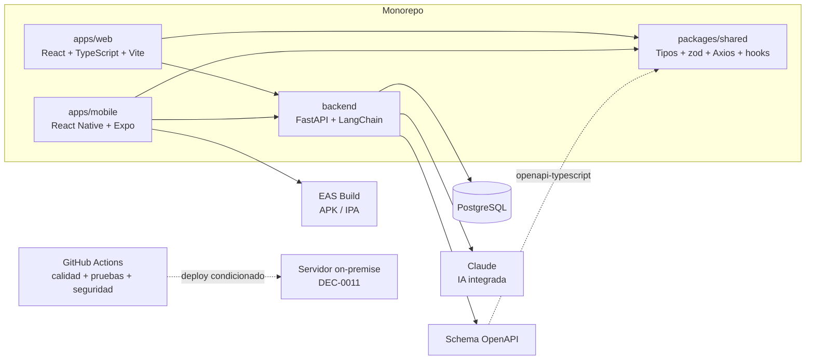
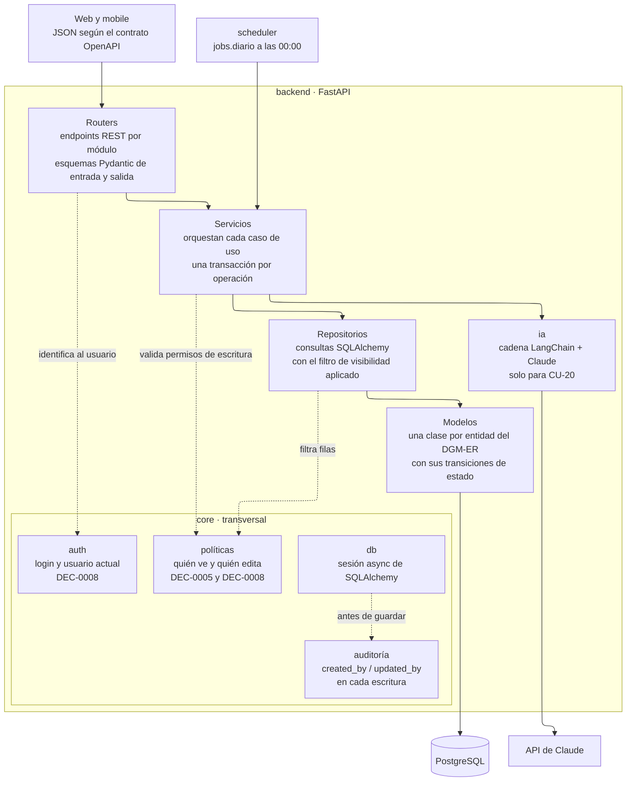

# ARQ — Vista general

tags:: #tipo/analisis #estado/en-revision #pc/pc1

> Arquitectura de software de Rumbo. Basada en [[DEC-0001 Stack tecnológico]].

## Vista de despliegue
Dónde corre cada pieza en producción, según [[DEC-0011 Infraestructura de despliegue on-premise]]. Todo el backend vive en un servidor dentro de la agencia; desde afuera se entra solo por Cloudflare Tunnel, que abre la conexión desde el servidor hacia la nube, así que el router no expone ningún puerto. La caja punteada es lo que se difiere a PC2.

```mermaid
%%{init: {"flowchart": {"defaultRenderer": "elk"}} }%%
flowchart LR
    subgraph Usuarios["Usuarios"]
      Nav["Navegador<br/>admin · dueño · empleado · freelance"]
      Tel["Teléfono<br/>app mobile Android / iOS"]
    end

    subgraph Entrada["Entrada desde internet"]
      CF["Cloudflare Tunnel<br/>TLS y acceso desde fuera de la agencia"]
    end

    subgraph Agencia["Servidor on-premise en la agencia · Ubuntu Server LTS + UPS · DEC-0011"]
      subgraph Compose["Docker Compose"]
        Nginx["nginx<br/>web compilada + proxy de /api"]
        API["api<br/>FastAPI + LangChain"]
        DB[("postgres<br/>volumen persistente")]
        Sched["scheduler<br/>cron 00:00 hora argentina<br/>proceso automático diario"]
      end
      Runner["Runner self-hosted<br/>GitHub Actions · solo main"]
      Backup["Respaldo diario + copia externa<br/>RNF-08 · se implementa en PC2"]
    end

    subgraph Nube["Servicios en la nube"]
      Claude["API de Claude<br/>Sonnet 5.5 · DEC-0012"]
      GH["GitHub<br/>repositorio privado + Actions"]
    end

    Nav -->|"desde afuera"| CF
    Tel --> CF
    Nav -. "red local" .-> Nginx
    CF -->|"túnel saliente,<br/>sin puertos abiertos"| Nginx
    Nginx -->|"/api"| API
    API --> DB
    Sched -->|"vence pagos y cotizaciones,<br/>genera alertas"| DB
    Backup -.-> DB
    API -->|"CU-20"| Claude
    Runner -->|"toma los jobs de main"| GH
    Runner -->|"docker compose up"| Compose

    classDef pendiente stroke-dasharray: 5 5,color:#777
    class Backup pendiente
```



- **nginx** sirve la web de React ya compilada y deriva `/api` al backend. Es el único punto de entrada, tanto desde la red local como desde el túnel.
- **scheduler** ejecuta a las 00:00 el mismo código del backend como comando (por ejemplo `python -m rumbo.jobs.diario`): vence pagos y cotizaciones y genera las alertas `viaje` y `recontacto` ([[DGM-ACT — Proceso automático diario]]). Es idempotente, así que correrlo dos veces no duplica nada.
- **Runner self-hosted:** cuando el pipeline de calidad pasa en `main`, reconstruye y levanta los contenedores. Solo toma jobs de `main` del repositorio privado.
- **App mobile:** EAS Build genera los binarios y se distribuyen de forma interna, sin tiendas; la app habla con la misma API por el túnel.
- **Riesgos aceptados:** un corte de luz más largo que la autonomía de la UPS, o de internet en el local, deja el sistema inaccesible desde afuera (RNF-13).

## Vista de componentes del monorepo
Cómo se organiza el código y qué genera cada parte, según [[DEC-0001 Stack tecnológico]].



## Vista lógica del backend
Cómo se organiza por dentro la API de FastAPI. Hay dos cortes: **por capas**, que dice qué responsabilidad tiene cada pieza, y **por módulos**, con un paquete por cada módulo funcional del [[MOC — Casos de uso]].

### Capas


| Capa | Qué hace | Qué **no** hace |
|---|---|---|
| **Routers** | Reciben el pedido HTTP, validan el JSON con esquemas Pydantic, obtienen el usuario actual y llaman a un servicio. Los esquemas publican el contrato OpenAPI. | No tienen reglas de negocio ni consultas. |
| **Servicios** | Orquestan un caso de uso completo en **una transacción**: por ejemplo, confirmar la reserva crea el `Viaje`, el plan de cuotas, las alertas y pasa la `Oportunidad` a `ganada` (CU-07). Validan los permisos de escritura. | No arman SQL ni conocen HTTP. |
| **Repositorios** | Buscan y guardan entidades con SQLAlchemy. **Toda consulta de lectura aplica el filtro de visibilidad** del usuario, así ningún endpoint puede olvidarlo. | No deciden reglas de negocio. |
| **Modelos** | Una clase por entidad del [[DGM-ER]]. Cada clase con máquina de estados tiene sus **transiciones como métodos** (`Viaje.registrar_cobro()`, `Pago.anular()`…), que aplican las reglas de los `EST-*` y rechazan las transiciones inválidas. | No acceden a la base ni a otros servicios. |

**Transversales (`core`):**
- **`auth`:** login con usuario y contraseña ([[DEC-0008 Autenticación propia y rol de vendedor freelance|DEC-0008]]); cada pedido llega con un token y la dependencia de FastAPI devuelve el `Usuario` actual con su rol.
- **`políticas`:** un único lugar que traduce la matriz de visibilidad de [[DEC-0005 Autenticación y modelo de roles|DEC-0005]] y DEC-0008 a filtros y permisos. En **lectura**: `freelance` solo ve lo propio; las `Alerta` son propias salvo para `admin` y `dueño`; el resto de los roles lee toda la agencia. En **escritura**: el responsable del registro o `admin`/`dueño`; configuración y moderación, solo `admin`.
- **`auditoría`:** un evento de la sesión de SQLAlchemy completa `created_by`, `updated_by`, `created_at` y `updated_at` **antes de cada guardado**, con el usuario del pedido. Así la auditoría de todas las tablas no depende de que cada servicio se acuerde. Lo que hace el proceso automático queda con `created_by`/`updated_by` **vacíos**, que se lee como «lo hizo el sistema».
- **`db`:** abre una sesión async por pedido, que es la transacción del servicio.

**Integración con Claude:** el paquete `ia` encapsula la cadena de LangChain de [[DEC-0012 Modelo de IA del producto|DEC-0012]]. Solo lo usa el servicio de `redes` (CU-20) y no recibe datos de clientes. Si la API de Claude falla, CU-20 informa el error y el resto del sistema sigue funcionando.

**Proceso automático:** `jobs.diario` no es una capa aparte: es un punto de entrada más, como los routers, que llama a los **mismos servicios**. Así vencer un pago a medianoche aplica exactamente las mismas reglas que si lo hiciera una persona.

### Módulos


- **Un paquete por módulo funcional**, con los mismos nombres que el [[MOC — Casos de uso]]. Cada paquete tiene su `router`, sus `esquemas`, su `servicio` y su `repositorio`. Los **modelos son compartidos** (`rumbo/modelos/`), porque las entidades se relacionan entre módulos por clave foránea.
- **Una flecha es «el servicio de A usa al servicio de B».** Las dependencias van **en un solo sentido, sin ciclos**. El caso delicado es viajes ↔ economía: confirmar la reserva (viajes) crea el plan de cuotas (economía), y el primer cobro (economía) cambia el estado del viaje. El ciclo se evita porque el cambio de estado lo aplica el **modelo** (`Viaje.registrar_cobro()`), no el servicio de viajes.
- **`dashboard` y `calendario` solo leen:** hacen consultas agregadas sobre los módulos de operación y no escriben nada.
- **`seguridad`** gestiona usuarios y roles (CU-24 y CU-25). Todos los módulos lo usan de forma indirecta a través de `core.auth`, por eso no se dibujan esas flechas.

Estructura de carpetas del backend:
```text
backend/rumbo/
├── main.py                 # arma la app FastAPI y registra los routers
├── core/                   # auth, politicas, auditoria, db, config
├── modelos/                # una clase SQLAlchemy por entidad, con sus transiciones
├── modulos/
│   ├── clientes/           # router.py · esquemas.py · servicio.py · repositorio.py
│   ├── oportunidades/      # incluye Cotización y el recontacto (CU-30)
│   ├── viajes/
│   ├── economia/
│   ├── alertas/
│   ├── configuracion/
│   ├── hoteles/
│   ├── redes/
│   ├── dashboard/
│   ├── calendario/
│   └── seguridad/
├── ia/                     # cadena LangChain + Claude (DEC-0012)
└── jobs/diario.py          # proceso automático de las 00:00
```

## Componentes
- **Web (React + TypeScript + Vite):** back-office del agente/admin.
- **Mobile (React Native + Expo):** acceso rápido a agenda, alertas y clientes; EAS Build genera los binarios.
- **Paquete compartido:** tipos OpenAPI, validaciones zod, Axios y hooks de TanStack Query para ambas aplicaciones.
- **FastAPI:** única puerta al dominio; sirve JSON a web y mobile e integra Claude mediante LangChain.
- **PostgreSQL:** persistencia relacional de las 13 entidades → [[DGM-ER]].
- **GitHub Actions:** ejecuta lint, type-checking, pruebas y controles de seguridad en cada push.

## Pendiente
- ✅ **Roles y visibilidad** ([[Usuario]]): sellado en [[DEC-0005 Autenticación y modelo de roles]] y ampliado por [[DEC-0008 Autenticación propia y rol de vendedor freelance]] — roles `admin`/`dueño`/`empleado`/`freelance`, con autorización a nivel de fila y catálogo compartido.
- ✅ **Mecanismo de autenticación:** resuelto en [[DEC-0008 Autenticación propia y rol de vendedor freelance]] (usuario/contraseña individual; Google OAuth opcional y futuro).
- ✅ **Infraestructura y despliegue:** decididos en [[DEC-0011 Infraestructura de despliegue on-premise]] (29/09): servidor on-premise con Docker Compose (`nginx`, `api`, `postgres`, `scheduler`), Cloudflare Tunnel y runner self-hosted. Ya está en la *Vista de despliegue* (paso A2, 29/09).
- ✅ **Persistencia y migraciones** (29/09): **SQLAlchemy 2.0 en modo async** para el acceso a PostgreSQL y **Alembic** para las migraciones. El esquema inicial es el del [[DGM-ER]]; en PC2, la primera migración de Alembic reproduce el script SQL del PC1.
- ✅ **Actualización de dependencias** (29/09): **Dependabot**, anotado en [[DEC-0001 Stack tecnológico]].
- ✅ **IA del producto:** Claude Sonnet 5.5 vía LangChain, en [[DEC-0012 Modelo de IA del producto]].
