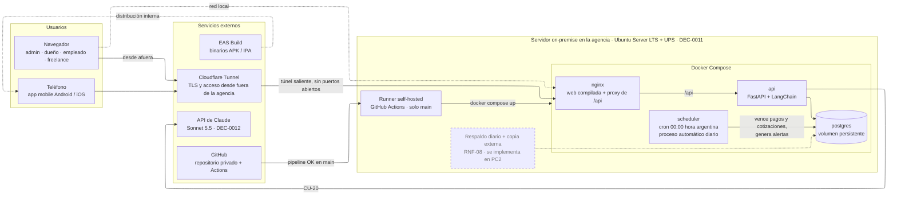
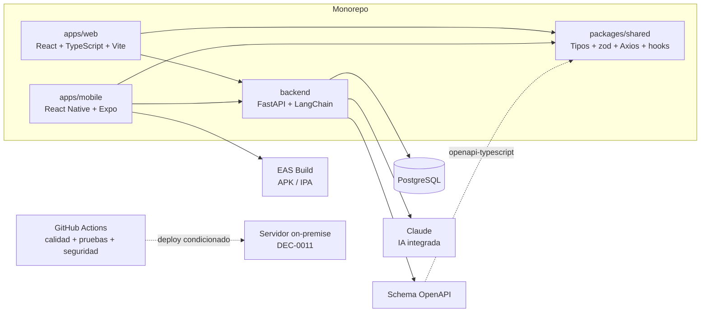

# ARQ — Vista general

tags:: #tipo/analisis #estado/en-revision #pc/pc1

> Arquitectura de software de Rumbo. Basada en [[DEC-0001 Stack tecnológico]].

## Vista de despliegue
Dónde corre cada pieza en producción, según [[DEC-0011 Infraestructura de despliegue on-premise]]. Todo el backend vive en un servidor dentro de la agencia; desde afuera se entra solo por Cloudflare Tunnel, que abre la conexión desde el servidor hacia la nube, así que el router no expone ningún puerto. La caja punteada es lo que se difiere a PC2.

- **nginx** sirve la web de React ya compilada y deriva `/api` al backend. Es el único punto de entrada, tanto desde la red local como desde el túnel.
- **scheduler** ejecuta a las 00:00 el mismo código del backend como comando (por ejemplo `python -m rumbo.jobs.diario`): vence pagos y cotizaciones y genera las alertas `viaje` y `recontacto` ([[DGM-ACT — Proceso automático diario]]). Es idempotente, así que correrlo dos veces no duplica nada.
- **Runner self-hosted:** cuando el pipeline de calidad pasa en `main`, reconstruye y levanta los contenedores. Solo toma jobs de `main` del repositorio privado.
- **App mobile:** EAS Build genera los binarios y se distribuyen de forma interna, sin tiendas; la app habla con la misma API por el túnel.
- **Riesgos aceptados:** un corte de luz más largo que la autonomía de la UPS, o de internet en el local, deja el sistema inaccesible desde afuera (RNF-13).

## Vista de componentes del monorepo
Cómo se organiza el código y qué genera cada parte, según [[DEC-0001 Stack tecnológico]].

## Componentes
- **Web (React + TypeScript + Vite):** back-office del agente/admin.
- **Mobile (React Native + Expo):** acceso rápido a agenda, alertas y clientes; EAS Build genera los binarios.
- **Paquete compartido:** tipos OpenAPI, validaciones zod, Axios y hooks de TanStack Query para ambas aplicaciones.
- **FastAPI:** única puerta al dominio; sirve JSON a web y mobile e integra Claude mediante LangChain.
- **PostgreSQL:** persistencia relacional de las 13 entidades → [[DGM-ER]].
- **GitHub Actions:** ejecuta lint, type-checking, pruebas y controles de seguridad en cada push.

## Pendiente
- ✅ **Roles y visibilidad** ([[Usuario]]): sellado en [[DEC-0005 Autenticación y modelo de roles]] y ampliado por [[DEC-0008 Autenticación propia y rol de vendedor freelance]] — roles `admin`/`dueño`/`empleado`/`freelance`, con autorización a nivel de fila y catálogo compartido.
- ✅ **Mecanismo de autenticación:** resuelto en [[DEC-0008 Autenticación propia y rol de vendedor freelance]] (usuario/contraseña individual; Google OAuth opcional y futuro).
- ✅ **Infraestructura y despliegue:** decididos en [[DEC-0011 Infraestructura de despliegue on-premise]] (29/09): servidor on-premise con Docker Compose (`nginx`, `api`, `postgres`, `scheduler`), Cloudflare Tunnel y runner self-hosted. Ya está en la *Vista de despliegue* (paso A2, 29/09).
- ✅ **Persistencia y migraciones** (29/09): **SQLAlchemy 2.0 en modo async** para el acceso a PostgreSQL y **Alembic** para las migraciones. El esquema inicial es el del [[DGM-ER]]; en PC2, la primera migración de Alembic reproduce el script SQL del PC1.
- ✅ **Actualización de dependencias** (29/09): **Dependabot**, anotado en [[DEC-0001 Stack tecnológico]].
- ✅ **IA del producto:** Claude Sonnet 5.5 vía LangChain, en [[DEC-0012 Modelo de IA del producto]].
