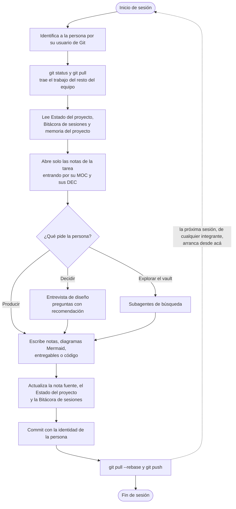

# IA — Agentes del proyecto

tags:: #tipo/analisis #estado/en-revision #pc/pc1

> Responde a la lámina del PC1 «Agentes IA implementados». El foco son los **agentes que el equipo usa para planificar y desarrollar** Rumbo. La IA **dentro del producto** se documenta en lo mínimo indispensable en [[DEC-0012 Modelo de IA del producto]].
>
> Paso **E3** del plan a 3 días (frente de Francisco). Fichas completadas el 30/09; a ratificar en A6.

## Ciclo de trabajo con el agente
Cada sesión de trabajo con Claude Code sigue el mismo ciclo, definido en [[CLAUDE|CLAUDE.md]]. El vault versionado con Git funciona como **memoria compartida**: lo que no queda escrito en el vault no sobrevive al chat, y cada integrante retoma desde lo que dejó el otro.

## Agentes
El equipo trabaja con **un agente principal**, Claude Code, que según la tarea delega en **subagentes** o se conecta con herramientas externas mediante **servidores MCP** (*Model Context Protocol*). La elección de Claude como agente de trabajo está justificada en [[Herramientas del proyecto]].

| Agente | Rol | Modelo | Contexto | Resultado |
|---|---|---|---|---|
| Claude Code | Agente principal de cada sesión | Claude Opus o Sonnet, según la tarea | `CLAUDE.md` y el vault | Notas, diagramas, entregables y código, con commit |
| Subagentes | Búsqueda y exploración en paralelo | El del agente principal o uno más liviano | El que les pasa el agente principal | Un resumen para el agente principal |
| MCP de Figma | Conecta a Claude Code con Figma | — (es una herramienta, no un modelo) | El archivo de Figma del prototipo | Pantallas, componentes, interacciones y PNG |

### Claude Code — agente principal
- **Qué hace:** es el agente con el que cada integrante trabaja en su sesión. Lee y edita los archivos del vault, ejecuta comandos, genera los entregables y registra lo hecho. Lo usaron los tres integrantes para el relevamiento, los casos de uso, el modelo de dominio, los diagramas UML, la arquitectura, el contrato de la API y el script SQL.
- **Modelos:** Claude Opus para el análisis y las decisiones de diseño, y Claude Sonnet para tareas más acotadas. Según la [[Bitácora de sesiones]]: Claude Opus 4.8 del 09/09 al 18/09, Claude Sonnet 5 del 18/09 al 25/09 (diagramas de estado, clases y secuencia) y Claude Opus 5.5 desde el 29/09.
- **Herramientas:** lectura, búsqueda y edición de archivos del repositorio; la línea de comandos, con Git, `pandoc` (entregables `.docx`), `mermaid-cli` (PNG de los diagramas), Node.js (generador del contrato OpenAPI), Redocly (validación del contrato) y PostgreSQL (validación del script SQL); las **skills** del proyecto en `.claude/skills/`, compartidas por Git ([[Skills compartidas]]); y los servidores MCP de Figma, para el prototipo, y de Mermaid Chart, para validar diagramas.
- **Entrevista de diseño:** para decidir, Claude pregunta de a una cuestión, con su recomendación, y la persona decide. Así se hicieron la entrevista de consistencia del 18/09 y la de diseño del 29/09.
- **De dónde toma el contexto:** no recuerda las sesiones anteriores. Cada sesión arranca leyendo [[CLAUDE|CLAUDE.md]], [[Estado del proyecto]], la [[Bitácora de sesiones]] y [[Claude Code — memoria del proyecto]], y después abre solo las notas de la tarea, entrando por su MOC (ver [[Contexto eficiente con Claude (ahorro de tokens)]]). Reconoce a la persona por su usuario de Git y hace cada commit con la identidad de esa persona.
- **Límites:** no aprueba decisiones ni da por cerrado un documento: eso lo hace el equipo, y cada decisión queda registrada con su justificación. No inventa datos del negocio: si falta información, avanza con una propuesta marcada como borrador. Cuando dos documentos se contradicen, manda el relevamiento, después las decisiones aprobadas y después el resto. No guarda credenciales en Git ni cambia la identidad de Git de nadie. Respeta el alcance: no propone pagos online, publicación automática en redes ni integración con mayoristas. Y cada acción sobre archivos y comandos queda sujeta a los permisos que la persona le da en la sesión.
- **Ejemplo real:** el 29/09, al escribir el script SQL, Claude Code detectó once datos que los casos de uso pedían y el ER no guardaba. Los propuso, Nahuel los aprobó, quedaron registrados como decisión del equipo ([[DEC-0013 Datos que faltaban en el ER]]) y se propagaron al ER, al diagrama de clases, a las entidades y al script. Después validó el script contra un PostgreSQL local.

### Subagentes — exploración en paralelo
- **Qué hacen:** son instancias de Claude que el agente principal lanza para una tarea acotada, sobre todo **búsquedas amplias en el vault** (por ejemplo, cruzar los 31 CU con las 13 entidades para encontrar incoherencias). Cada subagente trabaja con su propio contexto y le devuelve al agente principal solo la conclusión, no los archivos que leyó.
- **Modelo:** el del agente principal, o uno más liviano cuando la tarea es solo buscar.
- **Herramientas:** las de lectura y búsqueda. Los subagentes de exploración no editan archivos.
- **Por qué se usan:** permiten revisar muchas notas sin llenar el contexto de la sesión principal, que sigue concentrada en la tarea.
- **Límites:** no ven la conversación de la sesión, solo el pedido que les arma el agente principal. Tampoco hacen commits ni toman decisiones: lo que encuentran lo revisa el agente principal con la persona.

### MCP de Figma — prototipo de interfaces
- **Qué hace:** conecta a Claude Code con Figma para que pueda leer y escribir en un archivo de diseño. Con él se construyó el [[Prototipo UI]] ([Rumbo — Prototipo PC1](https://www.figma.com/design/5rq8HOlZQ3uu4IUpBuhuZp)).
- **Herramientas que expone:** crear y editar nodos, componentes, estilos y variables, agregar interacciones de prototipo y exportar capturas de cada pantalla.
- **Contexto:** los casos de uso, las entidades y los estados del vault. Las pantallas usan el lenguaje ubicuo y los estados reales del modelo.
- **Límites:** trabaja con la cuenta de Figma de quien lo usa (la de estudiante de Paloma) y solo sobre los archivos a los que esa cuenta tiene acceso. El resultado lo revisa una persona antes de darlo por bueno.
- **Ejemplo real:** el 29/09, Paloma armó con Claude Code y el MCP de Figma un sistema de diseño propio (tokens, estilos de texto, 28 íconos y componentes) y, con él, 31 pantallas navegables, con 435 interacciones y 5 puntos de inicio, uno por rol. Las 36 capturas de `07-Entregables/Prototipo/img/` también se exportaron con el MCP.

## Y la IA dentro del producto
Es otra cosa. Rumbo usa IA en una sola función: [[CU-20 Generar propuesta de contenido con IA|CU-20]] genera un borrador de posteo con **Claude Sonnet 5.5**, llamado desde el backend con LangChain, sin datos de clientes y sin publicar nada. Está decidido en [[DEC-0012 Modelo de IA del producto]] y la diferencia entre las dos IA se explica en [[Herramientas del proyecto]].
