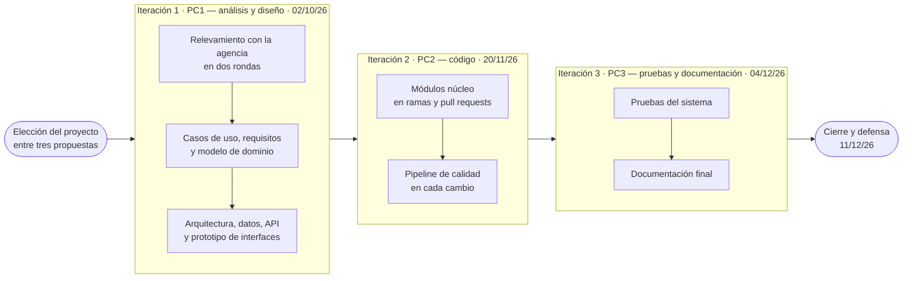
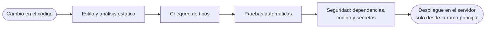

# Modelo de desarrollo

tags:: #tipo/analisis #estado/formalizado #pc/pc1

> Paso **H2** del plan a 3 días. Responde a la lámina del PC1 «Modelo de desarrollo utilizado con interfaces gráficas». Supuesto del plan (H0): «modelo de desarrollo» se lee como la **metodología de trabajo** del equipo. Borrador armado por Francisco el 30/09, por acuerdo de la sync, para que Paloma se concentre en B5; lo revisa Paloma.

Este apartado describe cómo trabaja el equipo para construir Rumbo: el ciclo de vida, las prácticas que sostienen el trabajo entre tres personas, cómo se controla la calidad y cómo se diseñaron las interfaces gráficas.

## Ciclo de vida: iterativo e incremental por punto de control
El proyecto avanza en **iteraciones**, una por cada punto de control de la cátedra. Cada iteración parte de lo que dejó la anterior, agrega un incremento completo y verificable, y cierra con una entrega. Se eligió este modelo porque las fechas de entrega son fijas, el equipo es chico y el relevamiento se completó en dos rondas con la agencia: un modelo en cascada no hubiera dejado incorporar la segunda ronda sin rehacer el análisis.

- **Iteración 1 (PC1):** relevamiento, análisis y diseño. Termina con el modelo UML completo, la arquitectura, el modelo de datos, el contrato de la API y el prototipo de interfaces.
- **Iteración 2 (PC2):** código funcional de los módulos núcleo, sobre el diseño aprobado.
- **Iteración 3 (PC3):** pruebas y documentación. El diseño queda congelado, salvo que una decisión nueva lo reemplace de forma explícita.
- Al cerrar cada punto de control se deja una **versión etiquetada** del repositorio (`pc1`, `pc2`, `pc3`), para poder volver exactamente a lo entregado.

## Prácticas de trabajo del equipo

### Una sola fuente de verdad, versionada
Todo el proyecto vive en un **repositorio Git privado**, escrito en Markdown: relevamiento, casos de uso, entidades, decisiones, diagramas y entregables. Cada contenido tiene **una sola nota de origen**, y el resto lo referencia. Los diagramas se escriben como texto en Mermaid y se exportan a imagen. Así los tres documentos del análisis no se contradicen, y cualquier cambio queda registrado con su autor y su fecha.

### Madurez de cada documento
Cada nota indica en qué estado está:

| Estado | Qué significa |
|---|---|
| Borrador | La está escribiendo su responsable. |
| En revisión | Está completa y espera la revisión del equipo. |
| Formalizado | El equipo la aprobó de forma explícita, con fecha. |

Nada pasa a formalizado sin la aprobación de los tres. Antes de cada entrega se verifica que no quede ningún documento obligatorio en borrador.

### Decisiones registradas
Cada decisión que no es obvia se registra en un **documento de decisión** con su contexto, las alternativas que se consideraron, la justificación y quiénes la aprobaron. Cuando dos documentos se contradicen, manda el relevamiento, después las decisiones aprobadas y después el resto; la contradicción se resuelve con una decisión, no eligiendo una versión en silencio. A la fecha del PC1 hay trece decisiones registradas, entre ellas el stack tecnológico, el modelo económico, los roles y la infraestructura.

### Reuniones de sincronización
El equipo se reúne en una **sync semanal** para revisar el avance, resolver las decisiones abiertas y aprobar documentos. Para decisiones grandes se usa una **entrevista de diseño**: se recorren las preguntas abiertas de a una, cada una con una recomendación, y el equipo decide. Para el cierre del PC1 el ritmo pasó a ser diario.

### Roles y reparto del trabajo
Los tres integrantes comparten los roles de coordinación del repositorio, cuidado del modelo de dominio y registro de decisiones. El trabajo se reparte por **frentes**: cada persona es responsable de una parte y la presenta, y el resto la revisa.

### Git y trazabilidad
- **Documentación (PC1):** commits pequeños y descriptivos sobre la rama principal, uno por tarea.
- **Código (desde PC2):** una rama por funcionalidad y un **pull request** revisado antes de integrar. Cada commit cita la regla o la decisión que implementa.
- Cada integrante trabaja con **su propia identidad de Git**, así queda claro quién hizo cada cambio.
- Al empezar, cada sesión trae el trabajo del resto del equipo; al terminar, deja registrado qué hizo, qué verificó y qué quedó pendiente, y sube sus cambios.

### Asistencia de IA
El equipo trabaja con un agente de IA que lee el repositorio al empezar cada sesión y deja por escrito lo que hace. El repositorio funciona como memoria compartida: lo que no queda escrito ahí no pasa de una sesión a otra. El detalle de cada agente, con sus herramientas y límites, está en el documento de inteligencia artificial.

## Control de calidad (a partir del PC2)
Cada cambio en el código pasa por un **pipeline automático** antes de integrarse:

| Parte | Estilo y tipos | Pruebas |
|---|---|---|
| Backend (Python) | ruff y mypy | pytest, con cobertura |
| Web (React) | ESLint, Prettier y TypeScript | Vitest, React Testing Library y Playwright |
| Mobile (React Native) | ESLint, Prettier y TypeScript | Jest, React Native Testing Library y Maestro |

La seguridad se revisa con pip-audit, pnpm audit, bandit, Semgrep (reglas OWASP) y gitleaks, y Dependabot propone las actualizaciones de dependencias. Estas herramientas forman parte del stack tecnológico elegido para el proyecto ([[DEC-0001 Stack tecnológico]]).

## Interfaces gráficas
Las interfaces se diseñaron en un **prototipo navegable en Figma**, construido sobre el modelo ya aprobado: usan el lenguaje del negocio (cliente, oportunidad, cotización, viaje, pago, alerta), los estados reales de cada entidad y datos de ejemplo ficticios pero coherentes entre pantallas ([[Prototipo UI]]).

### Cómo se diseñó
1. **Validar el estilo con una sola pantalla.** Se empezó por la agenda de alertas del día, que es la pantalla de inicio del empleado, y se ajustó hasta que el equipo estuvo de acuerdo con el estilo, antes de hacer el resto.
2. **Armar un sistema de diseño liviano.** Con ese estilo se definieron los elementos que se repiten en todas las pantallas, para que el prototipo sea coherente y cada pantalla nueva salga rápido.
3. **Diseñar las pantallas clave** siguiendo el circuito de la consulta a la venta y después **el resto de los casos de uso**, agrupados por módulo.
4. **Completar las vistas por perfil y el mobile**, a pedido del equipo al aprobar el prototipo.
5. **Hacerlo navegable** y revisar que cada pantalla se alcance desde algún punto de inicio.

### Sistema de diseño
- **Colores:** la paleta de azules y grises que eligió el equipo, cargada como variables. Además hay colores de estado: rojo para lo atrasado, verde para lo resuelto y ámbar para los avisos.
- **Tipografía:** Plus Jakarta Sans, con ocho estilos de texto (de títulos a etiquetas).
- **Componentes reutilizables:** botón, etiqueta de estado, ítem de menú, fila de alerta, campo, chip y barra lateral, además de 28 íconos. Todas las pantallas se arman con estos componentes.
- **Accesibilidad:** el contraste del texto cumple el nivel AA de WCAG y el color nunca es la única señal: cada estado lleva también un texto o un ícono.

### Criterios de usabilidad
- **La acción principal a la vista:** cada alerta ofrece el botón que corresponde a su tipo (registrar un cobro, revisar la documentación, contactar al cliente).
- **Menos filtros, más claros:** la agenda se filtra con un control de cuatro opciones (todas, atrasadas, hoy y próximas) en lugar de muchos filtros sueltos.
- **Deshacer en lugar de confirmar:** al resolver una alerta aparece un aviso con «Deshacer», así el trabajo diario no se frena con confirmaciones.
- **Estados vacíos y errores dibujados:** la agenda sin pendientes, la búsqueda sin resultados, el posible cliente duplicado y el inicio de sesión con credenciales inválidas.
- **Formularios sobre la pantalla de origen:** las altas y las confirmaciones se abren como panel o diálogo, sin perder de vista la pantalla desde la que se abrieron.

### Una vista por perfil
El sistema no se ve igual para todos. El prototipo muestra lo que ve y lo que puede hacer cada perfil:

| Perfil | Qué cambia |
|---|---|
| Empleado | Opera todo el circuito y ve la información de toda la agencia, con un filtro para lo suyo. Su agenda y su dashboard muestran solo lo suyo. No ve reportes ni configuración. |
| Administrador | Además, ve las alertas de toda la agencia, modera las reseñas, ve reportes y configura el sistema completo. |
| Dueña | Tiene todo lo del administrador (configuración completa, usuarios, comisiones y moderación de reseñas) y, además, el dashboard y los reportes de toda la empresa. |
| Vendedor freelance | Ve y opera solo sus clientes, oportunidades y viajes. Consulta los hoteles sin modificarlos, no usa redes y ve su comisión, no la rentabilidad de la agencia. |

### Web y mobile
La **web** cubre la gestión completa. La **app mobile** cubre lo que se usa fuera del escritorio: la agenda y las alertas (verlas, resolverlas, posponerlas y crear recordatorios) y los clientes (buscarlos, ver su ficha y dar de alta uno nuevo). Lo demás, como cotizar, gestionar viajes o registrar cobros, se hace desde la web.

### Prototipo navegable
Tiene un punto de inicio por perfil (empleado en escritorio, mobile, dueña, administrador y vendedor freelance) y se recorre como si fuera el sistema. Las pantallas se muestran a continuación, cada una con el caso de uso que realiza.

## 🔎 Revisión
> [!success] Sync 30/09/26 (Francisco, Nahuel y Paloma) — **aprobada y formalizada**. Antes de formalizar se corrigió la fila de la dueña en *Una vista por perfil*: tiene todo lo del administrador (decisión del mismo día sobre CU-13, CU-25 y CU-29). Si al revisar el documento hace falta un ajuste, se hace sobre esta nota.

> [!note] Francisco (30/09) — borrador armado en la sync del 30/09 para liberar a Paloma, que tiene B5. Los cambios de Francisco sobre el `.docx` (30/09) ya están pasados a esta nota. Detalle de los agentes en [[IA — Agentes del proyecto]]. Sale de [[Trabajo en equipo — Git y memoria]], [[DEC-0001 Stack tecnológico]], [[Cronograma y PC]], [[Estado del proyecto]] y la [[Bitácora de sesiones]]. La galería de pantallas del entregable se genera sola desde la tabla de [[Prototipo UI]]: cuando B5 sume pantallas, alcanza con volver a correr `build-desarrollo.sh`. **Paloma:** revisar sobre todo *Interfaces gráficas* y sumar lo que haga falta del sistema de diseño.

> [!success] Paloma (30/09) — revisado. El resto de la nota está bien. En *Interfaces gráficas* se sumaron cómo se diseñó, el sistema de diseño, los criterios de usabilidad, la vista por perfil y el alcance web/mobile, todo tomado de [[Prototipo UI]] (B5 cerrado, 59 pantallas). La fila de la dueña sigue la decisión abierta sobre su configuración (solo destinos y operadores). Queda para aprobar en la sync; después hay que regenerar el `.docx` con `build-desarrollo.sh`.
