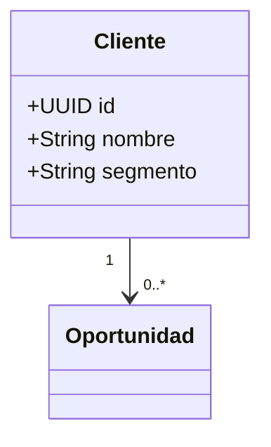

# DGM-<TIPO>-<Nombre>

<!-- TIPO: (nada)=clases/ER · SEC=secuencia · ACT=actividad · CU=casos de uso -->
tags:: #tipo/diagrama #estado/borrador

## Qué representa
<1-2 líneas. Enlazar a las notas de origen para que la gráfica apunte al source.>
Notas de origen: [[Cliente]] · [[Viaje]] · [[CU-01 De la consulta a la venta]]

## Diagrama

## Cómo mantenerlo
- **Source → output:** este diagrama es la *salida*; la verdad vive en las notas de entidad/CU. Al cambiar una entidad, actualizar acá.
- **Un solo editor a la vez** (el bloque Mermaid es indivisible): avisar en el canal, editar, commit + push, liberar. Ver [[Guía del Vault#3 · Workflow colaborativo]].
- **Conflicto de merge:** se resuelve como código (diff por línea) y se re-valida el render.
- Claude Code puede **regenerar** este bloque a partir de las notas de entidad; el humano valida y formaliza.
